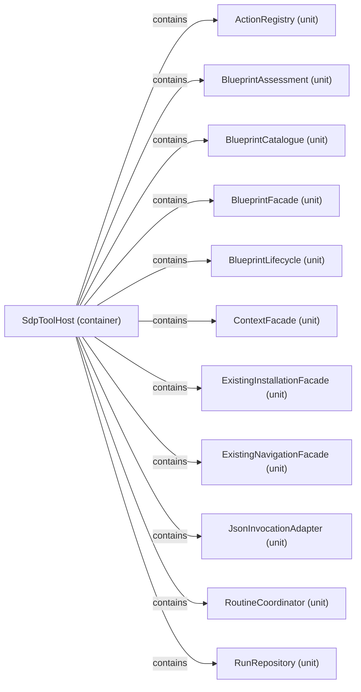

# Logical decomposition: SdpToolHost

[Viewpoint](index.md) · [Navigator](../../navigator.md)

Revision: `02ca3d1cf871998399f43803bbf47f6fa73321b38ce22301b196973963cd3480`.

## Logical decomposition: SdpToolHost

Source facts: f0169, f0170, f0171, f0172, f0173, f0174, f0175, f0176, f0177, f0178, f0179.

