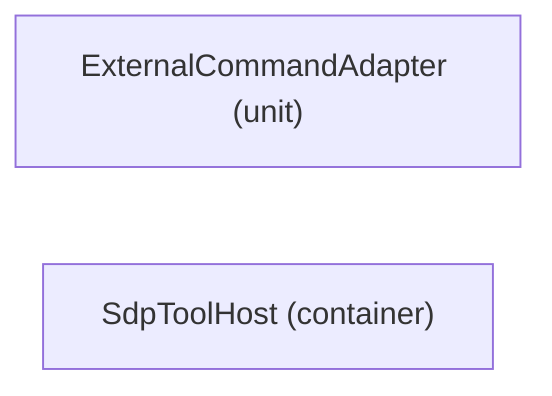

# Architecture roots — no connection/allocation is inferred

[Viewpoint](index.md) · [Navigator](../../navigator.md)

Revision: `02ca3d1cf871998399f43803bbf47f6fa73321b38ce22301b196973963cd3480`.

## Architecture roots — no connection/allocation is inferred

Source facts: .

Declarations only.

