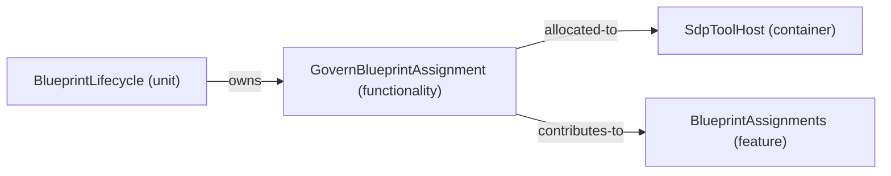

# Feature: BlueprintAssignments — mode RoutineHandling

[Viewpoint](index.md) · [Navigator](../../navigator.md)

Revision: `02ca3d1cf871998399f43803bbf47f6fa73321b38ce22301b196973963cd3480`.

## Feature: BlueprintAssignments — mode RoutineHandling

Source facts: f0026, f0067, f0068.

