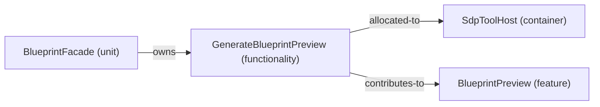

# Feature: BlueprintPreview — mode ProjectReading

[Viewpoint](index.md) · [Navigator](../../navigator.md)

Revision: `02ca3d1cf871998399f43803bbf47f6fa73321b38ce22301b196973963cd3480`.

## Feature: BlueprintPreview — mode ProjectReading

Source facts: f0023, f0064, f0065.

