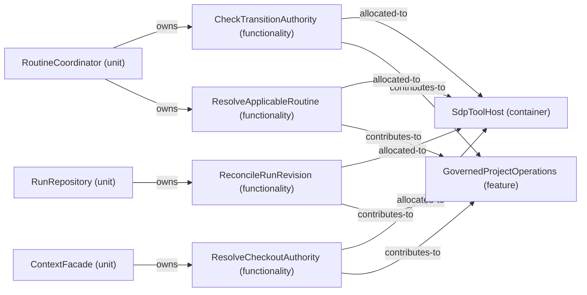

# Feature: GovernedProjectOperations — mode RoutineHandling

[Viewpoint](index.md) · [Navigator](../../navigator.md)

Revision: `02ca3d1cf871998399f43803bbf47f6fa73321b38ce22301b196973963cd3480`.

## Feature: GovernedProjectOperations — mode RoutineHandling

Source facts: f0037, f0038, f0041, f0086, f0087, f0091, f0092, f0094, f0095, f0113, f0114, f0166.

