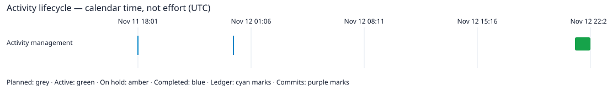

# Activity management

Markers: [all](activity-view://sdp/activity/ACTIVITY-SDP-0002?markers=all) [ledger](activity-view://sdp/activity/ACTIVITY-SDP-0002?markers=ledger) [commits](activity-view://sdp/activity/ACTIVITY-SDP-0002?markers=commits) [none](activity-view://sdp/activity/ACTIVITY-SDP-0002?markers=none) 

Zoom: [day](activity-view://sdp/activity/ACTIVITY-SDP-0002?zoom=day) [week](activity-view://sdp/activity/ACTIVITY-SDP-0002?zoom=week) [month](activity-view://sdp/activity/ACTIVITY-SDP-0002?zoom=month) 

State: **Active**. Owner: project-owner.

[Need and desired outcome](file:///home/warloc/git/SDP/SDP/Activities/Activity-0002--Activity-Management/01-Mandate/Mandate.md)

Phase readiness is not assessed; existing documents are evidence of sources, not acceptance.

## Mandate

- [Activity management mandate](file:///home/warloc/git/SDP/SDP/Activities/Activity-0002--Activity-Management/01-Mandate/Mandate.md)

## Study

- [Existing study and implementation findings](file:///home/warloc/git/SDP/SDP/Activities/Activity-0002--Activity-Management/02-Study/Study.md)

## Requirements

- [Activity delivery requirements](file:///home/warloc/git/SDP/SDP/Activities/Activity-0002--Activity-Management/03-Requirements/Requirements.md)

## Design

- [Pinned Activity implementation handoff](file:///home/warloc/git/SDP/SDP/Activities/Activity-0002--Activity-Management/04-Design/Blueprints.md)
- [Activity model to implementation mapping](file:///home/warloc/git/SDP/SDP/Activities/Activity-0002--Activity-Management/04-Design/CodeMapping.md)
- [Selected design and implementation handoff](file:///home/warloc/git/SDP/SDP/Activities/Activity-0002--Activity-Management/04-Design/Design.md)
- [A0 executable architecture contract](file:///home/warloc/git/SDP/SDP/Activities/Activity-0002--Activity-Management/04-Design/ImplementationContract.md)
- [task](file:///home/warloc/git/SDP/SDP/Activities/Activity-0002--Activity-Management/04-Design/task.json)
- [Session 0016 — Activity system design](file:///home/warloc/git/SDP/SDP/Sessions/session-%230016--Activity_design.md)

## Implementation

- [PLAN-SDP-0027 — Activity management](file:///home/warloc/git/SDP/SDP/Activities/Activity-0002--Activity-Management/05-Implementation/Plan.md)

## Verification

- [Activity0002 verification](file:///home/warloc/git/SDP/SDP/Activities/Activity-0002--Activity-Management/06-Verification/Verification.md)

## Sessions

- [Session 0018 — Activity management](file:///home/warloc/git/SDP/SDP/Activities/Activity-0002--Activity-Management/Sessions/session-%230018--Activity_management.md)

## Lifecycle timeline

Calendar time is not effort or productive hours. Events follow causal ledger order; timestamps never reorder history. Scope starts at recorded Activity adoption.

### Activity management

- Planned: 2026-11-12T21:23:19.540801Z (UTC) → 2026-11-12T21:23:19.541043Z (UTC); calendar duration 242µs.
- Active: 2026-11-12T21:23:19.541043Z (UTC) → ongoing as of 2026-11-12T22:21:20.055473097Z (UTC); calendar duration 58m0.514430097s.

Marker legend: ◆ lifecycle transition; ◇ ledger event; │ explicitly associated commit. Commit time is unavailable unless supplied by a checked repository association; no unrelated Git traffic is inferred.

- ◇ 2026-11-12T21:23:19.540801Z (UTC) — Owner selects Activity support after accepted restructuring; manually register and activate Activity0002 with real timestamps.. Recorded: 2026-11-12T21:23:19.540627Z (UTC). [Ledger source](file:///home/warloc/git/SDP/SDP/ProjectManagement/Ledger.ndjson)
  - [Need-driven Activities across successive Sessions](file:///home/warloc/git/SDP/SDP/KanBan/active/%23061--Proposal--Need-driven-activities.md)
  - [PLAN-SDP-0027 — Activity management](file:///home/warloc/git/SDP/SDP/Activities/Activity-0002--Activity-Management/05-Implementation/Plan.md)
  - [Session 0018 — Activity management](file:///home/warloc/git/SDP/SDP/Activities/Activity-0002--Activity-Management/Sessions/session-%230018--Activity_management.md)
- ◇ 2026-11-12T21:23:19.541043Z (UTC) — Owner selects Activity support after accepted restructuring; manually register and activate Activity0002 with real timestamps.. Recorded: 2026-11-12T21:23:19.540901Z (UTC). [Ledger source](file:///home/warloc/git/SDP/SDP/ProjectManagement/Ledger.ndjson)
  - [Need-driven Activities across successive Sessions](file:///home/warloc/git/SDP/SDP/KanBan/active/%23061--Proposal--Need-driven-activities.md)
  - [PLAN-SDP-0027 — Activity management](file:///home/warloc/git/SDP/SDP/Activities/Activity-0002--Activity-Management/05-Implementation/Plan.md)
  - [Session 0018 — Activity management](file:///home/warloc/git/SDP/SDP/Activities/Activity-0002--Activity-Management/Sessions/session-%230018--Activity_management.md)
- ◇ 2026-11-11T18:01:15.416238Z (UTC) — Capture owner Activity proposal linking customer needs and successive Sessions; no schema adoption or execution.. Recorded: Unknown effective time. [Ledger source](file:///home/warloc/git/SDP/SDP/ProjectManagement/Ledger.ndjson)
  - Attributed source (source unavailable)
- ◇ 2026-11-11T22:45:35.782381Z (UTC) — Owner selects Activity integration first and authorizes complete design; CardState in-progress. Candidate design and Session0016 delivered; runtime not implemented.. Recorded: Unknown effective time. [Ledger source](file:///home/warloc/git/SDP/SDP/ProjectManagement/Ledger.ndjson)
  - [Session 0016 — Activity system design](file:///home/warloc/git/SDP/SDP/Sessions/session-%230016--Activity_design.md)
  - [Need-driven Activities across successive Sessions](file:///home/warloc/git/SDP/SDP/KanBan/active/%23061--Proposal--Need-driven-activities.md)
- ◇ 2026-11-11T22:45:35.782381Z (UTC) — Owner places browsing behind qualified Activity integration. CardState queued; predecessor KB061; no browsing execution.. Recorded: Unknown effective time. [Ledger source](file:///home/warloc/git/SDP/SDP/ProjectManagement/Ledger.ndjson)
  - [Session 0016 — Activity system design](file:///home/warloc/git/SDP/SDP/Sessions/session-%230016--Activity_design.md)
  - [Need-driven Activities across successive Sessions](file:///home/warloc/git/SDP/SDP/KanBan/active/%23061--Proposal--Need-driven-activities.md)
- ◇ 2026-11-11T22:45:35.782381Z (UTC) — Owner priority change: qualify Activity integration before browsing design execution. Plan remains planned, with KB060 queued behind KB061.. Recorded: Unknown effective time. [Ledger source](file:///home/warloc/git/SDP/SDP/ProjectManagement/Ledger.ndjson)
  - [Session 0016 — Activity system design](file:///home/warloc/git/SDP/SDP/Sessions/session-%230016--Activity_design.md)
  - [Need-driven Activities across successive Sessions](file:///home/warloc/git/SDP/SDP/KanBan/active/%23061--Proposal--Need-driven-activities.md)
- ◇ 2026-11-12T10:21:39.009288Z (UTC) — Owner refines Activity design: generic README, Mandate-owned need/outcome, root Sessions, unrelated discussion allowed but implementation scoped to active Activity, and attributed commit/ledger timeline markers. Card remains in-progress; runtime not implemented.. Recorded: Unknown effective time. [Ledger source](file:///home/warloc/git/SDP/SDP/ProjectManagement/Ledger.ndjson)
  - [Session 0016 — Activity system design](file:///home/warloc/git/SDP/SDP/Sessions/session-%230016--Activity_design.md)
- ◇ 2026-11-12T13:54:51.470256Z (UTC) — Owner selects Activity and Session creation through SDPTool. Initial ActivityCommands SDL WORK and command/source ownership design recorded; source validation passes. Card remains in-progress; runtime implementation and review remain pending.. Recorded: Unknown effective time. [Ledger source](file:///home/warloc/git/SDP/SDP/ProjectManagement/Ledger.ndjson)
  - [Session 0016 — Activity system design](file:///home/warloc/git/SDP/SDP/Sessions/session-%230016--Activity_design.md)
  - Attributed source (source unavailable)
- ◇ 2026-11-12T15:01:54.586815Z (UTC) — Owner requests a complete architecture migration proposal with mandatory removal and durable analysis-to-implementation handoff. Proposal registered; execution unselected.. Recorded: Unknown effective time. [Ledger source](file:///home/warloc/git/SDP/SDP/ProjectManagement/Ledger.ndjson)
  - [PLAN-SDP-0026 — Complete SDPTool architecture migration](file:///home/warloc/git/SDP/SDP/05--Implementation/SDPTool/ArchitectureMigration/Plan.md)
  - [Session 0016 — Activity system design](file:///home/warloc/git/SDP/SDP/Sessions/session-%230016--Activity_design.md)
  - [Need-driven Activities across successive Sessions](file:///home/warloc/git/SDP/SDP/KanBan/active/%23061--Proposal--Need-driven-activities.md)
- ◇ 2026-11-12T15:01:54.586815Z (UTC) — Prepare whole-system migration route with mandatory inventory/design phases, Blueprint trial, complete workflow migration and final zero-leftover acceptance. Detailed target and execution remain unselected.. Recorded: Unknown effective time. [Ledger source](file:///home/warloc/git/SDP/SDP/ProjectManagement/Ledger.ndjson)
  - [Complete SDPTool architecture migration](file:///home/warloc/git/SDP/SDP/KanBan/completed/%23062--Proposal--Complete-SDPTool-architecture-migration.md)
  - [Need-driven Activities across successive Sessions](file:///home/warloc/git/SDP/SDP/KanBan/active/%23061--Proposal--Need-driven-activities.md)
  - [Session 0016 — Activity system design](file:///home/warloc/git/SDP/SDP/Sessions/session-%230016--Activity_design.md)
- ◇ 2026-11-12T18:18:37.307066Z (UTC) — Owner defers Activity feature implementation until restructuring completes; next Activity will be created manually. Preserve current design and resume after PLAN0026 acceptance or explicit owner reprioritization.. Recorded: Unknown effective time. [Ledger source](file:///home/warloc/git/SDP/SDP/ProjectManagement/Ledger.ndjson)
  - [PLAN-SDP-0026 — Complete SDPTool architecture migration](file:///home/warloc/git/SDP/SDP/05--Implementation/SDPTool/ArchitectureMigration/Plan.md)
  - [SDPTool restructuring mandate](file:///home/warloc/git/SDP/SDP/Activities/Activity-0001--SDPTool-Restructuring/01-Mandate/Mandate.md)
  - [Session 0017 — SDPTool restructuring coordination](file:///home/warloc/git/SDP/SDP/Activities/Activity-0001--SDPTool-Restructuring/Sessions/session-%230017--SDPTool_restructuring.md)
- ◇ 2026-11-12T18:18:37.307533Z (UTC) — Owner selects restructuring-only scope for manually created Activity0001. M4 Activity functionality transferred to the future second Activity. No new public actions or Blueprint features. Plan remains planned; current Session reference lives in the document, not management links.. Recorded: Unknown effective time. [Ledger source](file:///home/warloc/git/SDP/SDP/ProjectManagement/Ledger.ndjson)
  - [Complete SDPTool architecture migration](file:///home/warloc/git/SDP/SDP/KanBan/completed/%23062--Proposal--Complete-SDPTool-architecture-migration.md)
  - [Need-driven Activities across successive Sessions](file:///home/warloc/git/SDP/SDP/KanBan/active/%23061--Proposal--Need-driven-activities.md)
- ◇ 2026-11-12T18:18:37.307776Z (UTC) — Owner confirms browsing after restructuring then Activity support, as the first tool-created Activity. Plan remains planned. Correct current management links to registered cards; historical bytes and document Session references preserved.. Recorded: Unknown effective time. [Ledger source](file:///home/warloc/git/SDP/SDP/ProjectManagement/Ledger.ndjson)
  - Attributed source (source unavailable)
  - [Need-driven Activities across successive Sessions](file:///home/warloc/git/SDP/SDP/KanBan/active/%23061--Proposal--Need-driven-activities.md)
  - [Complete SDPTool architecture migration](file:///home/warloc/git/SDP/SDP/KanBan/completed/%23062--Proposal--Complete-SDPTool-architecture-migration.md)
- ◇ 2026-11-12T21:23:19.540174Z (UTC) — Owner selects Activity0002 after restructuring acceptance; create complete implementation plan.. Recorded: Unknown effective time. [Ledger source](file:///home/warloc/git/SDP/SDP/ProjectManagement/Ledger.ndjson)
  - [Need-driven Activities across successive Sessions](file:///home/warloc/git/SDP/SDP/KanBan/active/%23061--Proposal--Need-driven-activities.md)
- ◇ 2026-11-12T21:23:19.540317Z (UTC) — Owner authorizes execution through Activity0002; start A0 contract reconciliation.. Recorded: Unknown effective time. [Ledger source](file:///home/warloc/git/SDP/SDP/ProjectManagement/Ledger.ndjson)
  - [Need-driven Activities across successive Sessions](file:///home/warloc/git/SDP/SDP/KanBan/active/%23061--Proposal--Need-driven-activities.md)
- ◇ 2026-11-12T21:23:19.540452Z (UTC) — Predecessor accepted; owner authorizes Activity0002. CardState in-progress under PLAN0027.. Recorded: Unknown effective time. [Ledger source](file:///home/warloc/git/SDP/SDP/ProjectManagement/Ledger.ndjson)
  - [PLAN-SDP-0027 — Activity management](file:///home/warloc/git/SDP/SDP/Activities/Activity-0002--Activity-Management/05-Implementation/Plan.md)
  - [Activity management mandate](file:///home/warloc/git/SDP/SDP/Activities/Activity-0002--Activity-Management/01-Mandate/Mandate.md)
  - [Session 0018 — Activity management](file:///home/warloc/git/SDP/SDP/Activities/Activity-0002--Activity-Management/Sessions/session-%230018--Activity_management.md)

