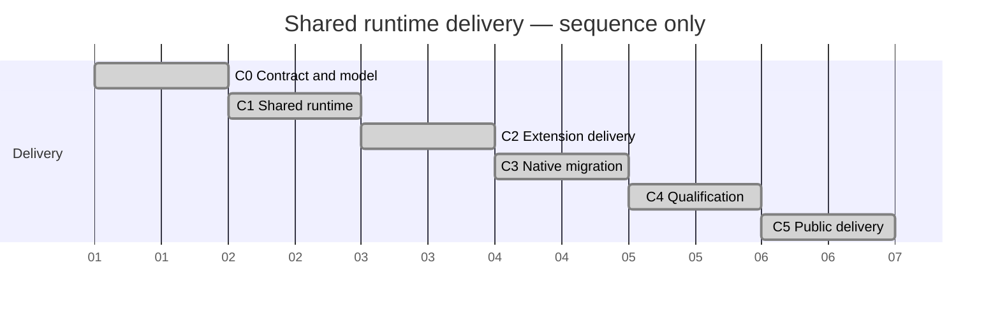

# Shared runtime implementation and delivery

## Roadmap

**Completed. Sequence only** — synthetic equal slots show dependency order,
not dates or effort. This closeout projection is retrospective; earlier roadmaps
were prose-only. Detailed milestones remain authoritative in PLAN-SDP-0029.

| State | Step | Dependency / outcome evidence |
| --- | --- | --- |
| completed | C0 Contract/model | Selected contract; final model validation/checkpoint00002 |
| completed | C1 Runtime | C0; exact engine identity, setup and typed shared SDUI |
| completed | C2 Extension | C1; identical public engine, actual upgrade/fresh install |
| completed | C3 Native | C1; no private helpers, offline registered engine |
| completed | C4 Qualification | C2/C3; exact CI,95 CTests and independent review |
| completed | C5 Delivery | C4; signed public artifacts and consumer workflows |

Current step: none. Goal delivered; all selected contributions complete.

| Field | Value |
| --- | --- |
| Session reference | SESSION-SDP-0021 |
| Status | completed |
| Activity | ACTIVITY-SDP-0004 |
| Phase | 05-Implementation |
| Phase contributions | 03-Requirements, 04-Design, 05-Implementation, 06-Verification |
| Plan | PLAN-SDP-0029 |

## Goal and authority

Owner: execute Activity4. Deliver one shared SDPTool engine through gh extension
and offline XFMD consumption. Plan and mandate select full qualified delivery,
without main merges or unrelated project upgrades.

## Concurrent-work preflight

SDP432c292 on sdp/shared-tool-installation contains the planned Activity4 study;
only the persistent project-history lock is unrelated untracked state. gh-sdp
b177e14 is clean. Isolated XFMD140be2b has no tracked modifications; its .deps
link is preserved. Primary XFMD main has unrelated dirty work and is excluded.
Activity1/2/3 are complete; actual service transitions select Activity4 and create
this Session. KB063 is the only card selected by this plan. No identity collision
or observed overlapping work affects the three bounded source areas. Green for
this scope; unknown remote work is not asserted absent.

## Work journal — 2026-11-13

Loaded SDP entry, master, change-analysis, architect, planning, versioning and
release routines. The implementation contract selects exact canonical-engine
republishing, explicit setup, direct native lookup and no runtime bootstrap.
Bounded delegated workers own gh-sdp and the isolated XFMD checkout; main owns
canonical engine/model, integration and release coordination. Fresh independent
review remains required. SDUI preview/check move into a shared library; the native
prototype helper is embedded in the same release executable and materialized
locally by content hash, with no download/update route of its own.

Actual Activity update/session-create/activate receipts are retained by the service
in ../.operations and management history. This journal is a manual work summary.

## Linked records

- [Implementation plan](../05-Implementation/Plan.md)
- [Runtime contract](../04-Design/ImplementationContract.md)
- [KB063](../../../KanBan/completed/%23063--Change--Single-SDPTool-installation.md)

## C1 implementation and candidate

Canonical source63b7f8303f3688d135272913bb437895f11080f2 is committed and pushed.
The production-signed2.3.0 engine SHA256 is
8c7c21fc616b57a4dc4b20eba0fa9cd03418ca31335a00b5d4da02f6d88d3c82.
The clean release worktree and package receipts are retained; no embedded Go VCS
stamp is claimed. Explicit BuildRevision and the signed descriptor bind the source.

Fresh review found transient setup, missing native capability preflight and public
contract documentation gaps. These were corrected, then focused source review
passed. Root package tests, focused race, SDUI preview checks, bootstrap race,
Toolkit90 tests and validation pass. The first broad Go run used the insufficient
10-minute default and also captured an early unsupported-boolean schema defect;
that defect is fixed and targeted tests pass. The broad final run uses the project's
30-minute timeout. CI, signed predecessor matrix, actual extension update and exact
native RPM/SDUI qualification remain pending. Publication has not occurred.

The actual gh2.97 download test exposed accepted truncatedHTTP200 bytes and a
force flag that does not refetch the recorded version. The selected recovery is
remove/reinstall using a fresh gh HTTP cache, verified against the same registered
path. No fallback engine is added. XFMD also retains GUI OS library dependencies
needed by the relocated embedded native prototype.

## Final candidate refinement

The63b7 and dab8 local packages are preserved as superseded candidates. Native
integration exposed the global-output parser's assumption that every `preview`
token is the old FILE command; the new SDUI subcommand now accepts global JSON
selection correctly while preserving literal option values. SDUI source calls
were then completed as a typed shared service, removing the argv/JSON bridge.
The final source is774e150774d184d0604ae78f274586eeb2bad495; engine SHA256
2cfcf12f8bfb0d6fa8d11391db874f68d9bc9210c85974ff3cecee50f915ced6.
Focused source review approves the delta. Full final local/CI checks and final
consumer packages remain pending; superseded CI runs were explicitly canceled.

The broad Go suite's only remaining failure was a predecessor test still expecting
six releases; the actual signed7-predecessor matrix already passed. The expectation
now includes original2.2.1. Governance completed551 seconds successfully. Native
tests newly enabled against the real engine exposed five old URI/eager-tree
assumptions; they are being corrected to the Activity3 advertised-target contract
with navigation/source/stale/Back/cancellation obligations preserved, not disabled.

## Final public delivery and interrupted-turn recovery

Actual canonical SDP2.3.0 and gh-sdp2.3.0 publication, download/signature/identity,
normal public extension upgrade and fresh installation, public-default signed
Framework preview/apply and repeat no-op all pass. XFMD0.11.0-81 is signed and
published. Actual public DNF upgrade from0.10.0-76 and fresh install each pass the
three offline Reading/Activity/SDUI native probes; all95 CTests pass. Combined
independent technical delivery is approved, without personal owner review.

An agent daemon restart interrupted the reporting turn while the existing RPM
publisher continued. Recovery checked branch/process/artifact/review state before
resuming; no completed publication was repeated. Consumer closeout commits are
gh-sdp bb88389 and XFMD645d5ac, separate from qualified release sources1753a11 and
16e57a3. Root source remains774e150 for the published engine. The post-release
model correction only reorders/formats the original declaration/statement inventory;
sourcegraph validation and tool checkpoint00002 are retained. Prior pending and
candidate statements above are chronological checkpoints, superseded here.

Loaded SDP entry, Master, Change Analysis, Architect, Planning, Worker, Versioning,
Release, Traceability and verification/reviewer references as relevant. Delegated
independent Reviewer supplied its own report. This is manual agent-reported work
history, not automatic capture. Final evidence: ../06-Verification/Verification.md,
ReleaseChecklist.md and IndependentReview.md. PLAN0029 and KB063 complete on that
evidence. Reconcile actual descriptor references using guarded hold/update/resume,
then complete Activity4 with explicit whole-scope contribution dispositions.
The observed execution store is quiescent; this does not claim control of arbitrary
remote work. No further step is selected; no main merge or live upgrade performed.

## Actual lifecycle closeout

The canonical2.3.0 service completed guarded hold, descriptor update, resume and
complete operations. Whole-scope PLAN0029 and SESSION0021 dispositions are completed;
verification is linked with its canonical identity. One update attempt correctly
refused a verification document lacking its identity metadata; that metadata was
added and a fresh request succeeded. No failed request is presented as success.
Activity4 now replays as completed and no Activity is active. Receipts are retained
in ../06-Verification/Lifecycle; prior descriptor snapshots and ledger bytes remain.
Final validation and documentation commit/push conclude this reporting step.

## Owner-authorized main integration — 2026-11-14

Owner input: merge all SDP work into main. This is a subsequent explicit
integration authorization; earlier no-merge statements describe their checkpoints.
Recovered the completed Activity1–4 records and this Session; no new implementation
or Activity activation is needed. Loaded canonical SDP entry and Traceability
skills with the document workflow. Preflight found only the preserved untracked
management lock, no tracked edits or overlapping product work. After origin fetch,
main bfe3b40 had no divergent commits and the selected66e09a2 head contained all
local/fetched remote branch tips. Local main was fast-forwarded successfully to
that exact head, preserving all82 commits and the reviewed tree without conflicts.

The working-branch follow-up updates the stale project overview and integration
history. Run Toolkit/management validation, fast-forward main to include this
administrative record, then push the branch and main under the owner's authority.
Existing source/public qualification remains applicable; no source changed, no
broad tests were repeated, and no consumer repository merge or new release is
included. The Activity and C0–C5 remain completed. Final remote verification is the
remaining administrative step; this journal does not pre-claim push success.
