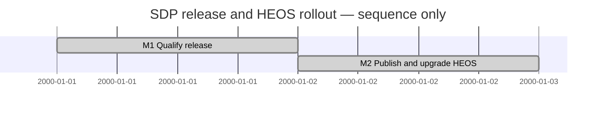

# Release and HEOS rollout

## Roadmap — sequence only

| State | Step | Outcome / dependency |
| --- | --- | --- |
| completed | M1 Qualification | Exact package, signed predecessor matrix and independent review and final CI passed |
| completed | M2 Public rollout | M1; public release and actual HEOS upgrade after approved history correction |

| Field | Value |
| --- | --- |
| Session reference | SESSION-SDP-0022 |
| Status | completed |
| Activity | ACTIVITY-SDP-0005 |
| Phase | 05-Implementation |
| Phase contributions | 05-Implementation, 06-Verification |
| Plan | MAINT-SDP-0020 |

## Goal

Qualify and publish SDP2.3.1 and upgrade HEOS through the signed installer

## Linked records

- plan: [MAINT-SDP-0020](../../../Maintenance/R231/Plan.md)

## Release preflight and route

Owner selects a new installable release and HEOS first. Main cef86e4 contains
completed Activity1–4. New Activity5 owns this bounded rollout. Loaded SDP,
Release, Versioning, Verifier, Planning and Traceability routines. Existing HEOS
dirty browsing documents/history are preserved; all rehearsal uses a copied tree.
MAINT-SDP-0020 owns the milestones. M1 qualification is current; M2 public delivery
and live HEOS verification follow. No other project or XFMD package is selected.
Version2.3.1 is an additive predecessor-support/documentation patch with unchanged
runtime semantics; no language/wire version bump. See Maintenance/R231/Plan.md.

## Candidate and consumer findings

The first clean candidate failed CI because the immutable Session creation snapshot
was unstaged.84d5e46 includes the snapshot; signing and all8 predecessor rehearsals
pass. Native helper bytes match the prior qualified release. New CI's checkout has
the identical source tree; broad job remains pending. gh-sdp packagingae7aa21
retains exact engine bytes. Verification in Maintenance/R231 is authoritative.

HEOS rehearsal found five pre-existing invalid history fields. A copied-tree
correction and14-action upgrade preserve owner files and repeat without changes.
The owner was asked explicitly for the required historical-byte exception after
preparing the exact patch. Live HEOS remains untouched pending that answer;
release preparation continues independently. No validator was weakened.

## Owner-approved historical correction

Owner explicitly approved archiving the HEOS original ledger byte-for-byte,
applying exactly the five reviewed field corrections and then upgrading HEOS.
Before mutation the live tree matched its saved owner-file hashes. The original
ledger hash6d58c2c67b9b03e9945bfb3420b3b434fdc9a8a25079a9a8b32aaeef96eb29cb is
retained in HEOS Maintenance/SDP-Upgrade-20261114/evidence with the patch and
Correction.json. Only approved fields changed. HEOS now uses local maintenance
branch heos/sdp-upgrade-2.3.1 with all prior uncommitted work retained. Session0013
records rollout under its installed manual convention. Actual Framework remains
signed2.2.0 until public release gates pass and the installer applies2.3.1.

## Final outcome

M1/M2 complete: signed public SDP/gh-sdp2.3.1, exact download/trust/consumer checks,
source-equivalent CI and independent final review pass. Actual local gh extension
upgrade/setup and HEOS2.2.0-to2.3.1 public-default upgrade preserve owner files and
corrected ledger prefix; repeat is a no-op. The owner's exact five-field exception
is applied with the original retained. HEOS stays on its local maintenance branch
with prior dirty work preserved; no consumer commit/push is implied. No next step
is selected. Complete Activity5 through the canonical service with whole-scope
Maintenance/Session dispositions, validate final records and push release branches.
This is a manual work summary, distinct from personal owner review or main merge.

## Actual lifecycle closure

Released shared engine2.3.1 performed guarded hold/update/resume/complete and now
replays Activity5 as completed. The descriptor reconciliation records versioned
examples already required by the authorized release metadata consistency gate and
links final verification; no new implementation was selected. All whole-scope
contributions are completed. Original descriptor/session snapshots and all prior
producer ledger bytes remain intact. Final validation and branch pushes finish
administrative reporting; the published engine stays exact84d5e46.
