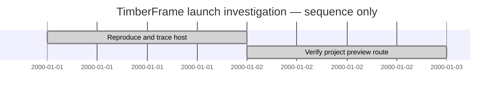

# Reproduce TimberFrame native launch failure

## Roadmap — sequence only

| State | Step | Outcome |
| --- | --- | --- |
| completed | S1 | Exact published failure and static preview reproduced; host boundary identified |
| completed | S2 | Existing Analysis host opens; six pane and three split checks pass |

| Field | Value |
| --- | --- |
| Session reference | SESSION-SDP-0025 |
| Status | completed |
| Activity | ACTIVITY-SDP-0007 |
| Phase | 02-Study |
| Phase contributions | 02-Study |

## Goal

Reproduce reported failure and identify the correct preview host without changing product code

## T001 — Owner request and investigation

Owner authorizes clone and reproduction of the unsupported-pane error. The fresh
consumer main is 9b7af853; installed SDPTool is 2.3.2. Both check and run reproduce
the exact error at CaseParameters/settings 164:2, while static preview succeeds.
The standalone host intentionally lacks pane adapters; the consumer's existing
review host uses DocumentHost and explicit fixtures. No model or product changes
are selected. Primary card KB-SDUI-007 remains linked here because Activity API
sourceCards accepts only the SDP project namespace.

Loaded SDP/Change Analysis/document workflow and the consumer's SDP entrypoint and
project instructions. Scoped concurrency/preflight and exact evidence are in
[Study](../02-Study/Launch-readiness.md). No agents were delegated. This Session was
registered after initial reproduction; the entry is a reconstructed work summary,
not a transcript or a claim of captured host identity. Next: finish the bounded
native smoke, record its outcome and close the reproduction study.

## T002 — Work outcome

The existing project launcher passes its Analysis smoke in isolated Xvfb: native
window ready, six tab activations, three split resize/restore checks, exit 0.
No product or model edits were needed. Both study steps are complete; the owner
can use tools/preview_gui.sh while deciding whether the shared launcher should
adopt DocumentHost/provider inputs. That implementation remains unselected.
Evidence is in the Study; close the study card and Activity through canonical
history and retain this branch's concise documentation delivery. No release,
merge, remote consumer publication or broad regression run is selected.

Closeout recorded: Activity0007 and KB-SDUI-007 are completed; management and
Toolkit validators pass. The consumer working tree remains clean. No selected
implementation step remains after this reproduction study.
