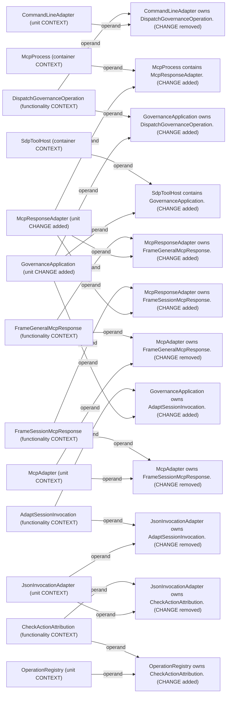

# Semantic changes

[Overview](index.md)

- added SDPTool/unit/GovernanceApplication
- added SDPTool/unit/McpResponseAdapter
- added McpResponseAdapter owns FrameSessionMcpResponse. [TARGET Responsibilities.design line 69](sources/TARGET/Responsibilities.design)
- removed JsonInvocationAdapter owns AdaptSessionInvocation. [NOW Responsibilities.design line 61](sources/NOW/Responsibilities.design)
- added OperationRegistry owns CheckActionAttribution. [TARGET Responsibilities.design line 71](sources/TARGET/Responsibilities.design)
- added SdpToolHost contains GovernanceApplication. [TARGET Responsibilities.design line 81](sources/TARGET/Responsibilities.design)
- added GovernanceApplication owns DispatchGovernanceOperation. [TARGET Responsibilities.design line 56](sources/TARGET/Responsibilities.design)
- added McpResponseAdapter owns FrameGeneralMcpResponse. [TARGET Responsibilities.design line 68](sources/TARGET/Responsibilities.design)
- removed CommandLineAdapter owns DispatchGovernanceOperation. [NOW Responsibilities.design line 50](sources/NOW/Responsibilities.design)
- removed JsonInvocationAdapter owns CheckActionAttribution. [NOW Responsibilities.design line 62](sources/NOW/Responsibilities.design)
- added GovernanceApplication owns AdaptSessionInvocation. [TARGET Responsibilities.design line 55](sources/TARGET/Responsibilities.design)
- added McpProcess contains McpResponseAdapter. [TARGET Responsibilities.design line 67](sources/TARGET/Responsibilities.design)
- removed McpAdapter owns FrameGeneralMcpResponse. [NOW Responsibilities.design line 65](sources/NOW/Responsibilities.design)
- removed McpAdapter owns FrameSessionMcpResponse. [NOW Responsibilities.design line 66](sources/NOW/Responsibilities.design)

