# Modeled context

[Overview](index.md)

CHANGE is added/removed; unchanged nodes are CONTEXT, not permission to edit.
PRESERVE obligations are listed separately. Runtime and code coverage remain UNKNOWN.

- unchanged SdpToolHost contains ModelGovernance. [NOW Responsibilities.design line 81](sources/NOW/Responsibilities.design) [TARGET Responsibilities.design line 85](sources/TARGET/Responsibilities.design)
- unchanged GovernanceService owns ManageSessionExecution. [NOW Responsibilities.design line 55](sources/NOW/Responsibilities.design) [TARGET Responsibilities.design line 58](sources/TARGET/Responsibilities.design)
- unchanged SdpToolHost contains ProjectHistory. [NOW Responsibilities.design line 85](sources/NOW/Responsibilities.design) [TARGET Responsibilities.design line 89](sources/TARGET/Responsibilities.design)
- added McpResponseAdapter owns FrameSessionMcpResponse. [TARGET Responsibilities.design line 69](sources/TARGET/Responsibilities.design)
- removed JsonInvocationAdapter owns AdaptSessionInvocation. [NOW Responsibilities.design line 61](sources/NOW/Responsibilities.design)
- added OperationRegistry owns CheckActionAttribution. [TARGET Responsibilities.design line 71](sources/TARGET/Responsibilities.design)
- unchanged GovernanceService owns ManageGovernedWork. [NOW Responsibilities.design line 54](sources/NOW/Responsibilities.design) [TARGET Responsibilities.design line 57](sources/TARGET/Responsibilities.design)
- unchanged SDPTool contains McpProcess. [NOW System.design line 6](sources/NOW/System.design) [TARGET System.design line 6](sources/TARGET/System.design)
- added SdpToolHost contains GovernanceApplication. [TARGET Responsibilities.design line 81](sources/TARGET/Responsibilities.design)
- unchanged ProjectHistory owns PersistCanonicalHistory. [NOW Responsibilities.design line 74](sources/NOW/Responsibilities.design) [TARGET Responsibilities.design line 77](sources/TARGET/Responsibilities.design)
- unchanged BlueprintService owns ManageBlueprintAssignments. [NOW Responsibilities.design line 48](sources/NOW/Responsibilities.design) [TARGET Responsibilities.design line 50](sources/TARGET/Responsibilities.design)
- added GovernanceApplication owns DispatchGovernanceOperation. [TARGET Responsibilities.design line 56](sources/TARGET/Responsibilities.design)
- unchanged ProjectFacade owns SelectDocument. [NOW Responsibilities.design line 73](sources/NOW/Responsibilities.design) [TARGET Responsibilities.design line 76](sources/TARGET/Responsibilities.design)
- unchanged OperationRegistry owns DescribePublicActions. [NOW Responsibilities.design line 69](sources/NOW/Responsibilities.design) [TARGET Responsibilities.design line 72](sources/TARGET/Responsibilities.design)
- unchanged SdpToolHost contains JsonInvocationAdapter. [NOW Responsibilities.design line 80](sources/NOW/Responsibilities.design) [TARGET Responsibilities.design line 84](sources/TARGET/Responsibilities.design)
- unchanged CommandLineAdapter owns DecodeCommandArguments. [NOW Responsibilities.design line 49](sources/NOW/Responsibilities.design) [TARGET Responsibilities.design line 51](sources/TARGET/Responsibilities.design)
- unchanged SdpToolHost contains GovernanceService. [NOW Responsibilities.design line 78](sources/NOW/Responsibilities.design) [TARGET Responsibilities.design line 82](sources/TARGET/Responsibilities.design)
- unchanged JsonInvocationAdapter owns DecodeActionRequest. [NOW Responsibilities.design line 63](sources/NOW/Responsibilities.design) [TARGET Responsibilities.design line 64](sources/TARGET/Responsibilities.design)
- unchanged SdpToolHost contains ProgramRunner. [NOW Responsibilities.design line 83](sources/NOW/Responsibilities.design) [TARGET Responsibilities.design line 87](sources/TARGET/Responsibilities.design)
- unchanged SdpToolHost contains OperationRegistry. [NOW Responsibilities.design line 82](sources/NOW/Responsibilities.design) [TARGET Responsibilities.design line 86](sources/TARGET/Responsibilities.design)
- unchanged BlueprintService owns GenerateBlueprint. [NOW Responsibilities.design line 47](sources/NOW/Responsibilities.design) [TARGET Responsibilities.design line 49](sources/TARGET/Responsibilities.design)
- unchanged McpProcess contains McpAdapter. [NOW Responsibilities.design line 67](sources/NOW/Responsibilities.design) [TARGET Responsibilities.design line 66](sources/TARGET/Responsibilities.design)
- unchanged SdpToolHost contains ReleaseLogService. [NOW Responsibilities.design line 86](sources/NOW/Responsibilities.design) [TARGET Responsibilities.design line 90](sources/TARGET/Responsibilities.design)
- unchanged SdpToolHost contains BlueprintService. [NOW Responsibilities.design line 76](sources/NOW/Responsibilities.design) [TARGET Responsibilities.design line 79](sources/TARGET/Responsibilities.design)
- unchanged ProjectFacade owns BuildNavigation. [NOW Responsibilities.design line 71](sources/NOW/Responsibilities.design) [TARGET Responsibilities.design line 74](sources/TARGET/Responsibilities.design)
- unchanged McpAdapter owns ExposeBoundCapabilities. [NOW Responsibilities.design line 64](sources/NOW/Responsibilities.design) [TARGET Responsibilities.design line 65](sources/TARGET/Responsibilities.design)
- added McpResponseAdapter owns FrameGeneralMcpResponse. [TARGET Responsibilities.design line 68](sources/TARGET/Responsibilities.design)
- removed CommandLineAdapter owns DispatchGovernanceOperation. [NOW Responsibilities.design line 50](sources/NOW/Responsibilities.design)
- removed JsonInvocationAdapter owns CheckActionAttribution. [NOW Responsibilities.design line 62](sources/NOW/Responsibilities.design)
- unchanged InstallService owns RecoverInstallation. [NOW Responsibilities.design line 60](sources/NOW/Responsibilities.design) [TARGET Responsibilities.design line 63](sources/TARGET/Responsibilities.design)
- unchanged BlueprintService owns AssessBlueprint. [NOW Responsibilities.design line 46](sources/NOW/Responsibilities.design) [TARGET Responsibilities.design line 48](sources/TARGET/Responsibilities.design)
- unchanged SDPTool contains SdpToolHost. [NOW System.design line 7](sources/NOW/System.design) [TARGET System.design line 7](sources/TARGET/System.design)
- unchanged SdpToolHost contains CommandLineAdapter. [NOW Responsibilities.design line 77](sources/NOW/Responsibilities.design) [TARGET Responsibilities.design line 80](sources/TARGET/Responsibilities.design)
- unchanged SdpToolHost contains InstallService. [NOW Responsibilities.design line 79](sources/NOW/Responsibilities.design) [TARGET Responsibilities.design line 83](sources/TARGET/Responsibilities.design)
- unchanged ReleaseLogService owns ProjectReleaseNotes. [NOW Responsibilities.design line 75](sources/NOW/Responsibilities.design) [TARGET Responsibilities.design line 78](sources/TARGET/Responsibilities.design)
- added GovernanceApplication owns AdaptSessionInvocation. [TARGET Responsibilities.design line 55](sources/TARGET/Responsibilities.design)
- unchanged ProgramRunner owns RunSelectedProgram. [NOW Responsibilities.design line 70](sources/NOW/Responsibilities.design) [TARGET Responsibilities.design line 73](sources/TARGET/Responsibilities.design)
- unchanged ProjectFacade owns DiscoverProject. [NOW Responsibilities.design line 72](sources/NOW/Responsibilities.design) [TARGET Responsibilities.design line 75](sources/TARGET/Responsibilities.design)
- added McpProcess contains McpResponseAdapter. [TARGET Responsibilities.design line 67](sources/TARGET/Responsibilities.design)
- unchanged InstallService owns PreviewInstallation. [NOW Responsibilities.design line 59](sources/NOW/Responsibilities.design) [TARGET Responsibilities.design line 62](sources/TARGET/Responsibilities.design)
- removed McpAdapter owns FrameGeneralMcpResponse. [NOW Responsibilities.design line 65](sources/NOW/Responsibilities.design)
- unchanged InstallService owns ApplyInstallation. [NOW Responsibilities.design line 58](sources/NOW/Responsibilities.design) [TARGET Responsibilities.design line 61](sources/TARGET/Responsibilities.design)
- unchanged ModelGovernance owns ManageModelArtifacts. [NOW Responsibilities.design line 68](sources/NOW/Responsibilities.design) [TARGET Responsibilities.design line 70](sources/TARGET/Responsibilities.design)
- unchanged SdpToolHost contains ProjectFacade. [NOW Responsibilities.design line 84](sources/NOW/Responsibilities.design) [TARGET Responsibilities.design line 88](sources/TARGET/Responsibilities.design)
- removed McpAdapter owns FrameSessionMcpResponse. [NOW Responsibilities.design line 66](sources/NOW/Responsibilities.design)

```mermaid
flowchart LR
    f0["SdpToolHost contains ModelGovernance. (CONTEXT)"]
    f1["GovernanceService owns ManageSessionExecution. (CONTEXT)"]
    f10["BlueprintService owns ManageBlueprintAssignments. (CONTEXT)"]
    f11["GovernanceApplication owns DispatchGovernanceOperation. (CHANGE added)"]
    f12["ProjectFacade owns SelectDocument. (CONTEXT)"]
    f13["OperationRegistry owns DescribePublicActions. (CONTEXT)"]
    f14["SdpToolHost contains JsonInvocationAdapter. (CONTEXT)"]
    f15["CommandLineAdapter owns DecodeCommandArguments. (CONTEXT)"]
    f16["SdpToolHost contains GovernanceService. (CONTEXT)"]
    f17["JsonInvocationAdapter owns DecodeActionRequest. (CONTEXT)"]
    f18["SdpToolHost contains ProgramRunner. (CONTEXT)"]
    f19["SdpToolHost contains OperationRegistry. (CONTEXT)"]
    f2["SdpToolHost contains ProjectHistory. (CONTEXT)"]
    f20["BlueprintService owns GenerateBlueprint. (CONTEXT)"]
    f21["McpProcess contains McpAdapter. (CONTEXT)"]
    f22["SdpToolHost contains ReleaseLogService. (CONTEXT)"]
    f23["SdpToolHost contains BlueprintService. (CONTEXT)"]
    f24["ProjectFacade owns BuildNavigation. (CONTEXT)"]
    f25["McpAdapter owns ExposeBoundCapabilities. (CONTEXT)"]
    f26["McpResponseAdapter owns FrameGeneralMcpResponse. (CHANGE added)"]
    f27["CommandLineAdapter owns DispatchGovernanceOperation. (CHANGE removed)"]
    f28["JsonInvocationAdapter owns CheckActionAttribution. (CHANGE removed)"]
    f29["InstallService owns RecoverInstallation. (CONTEXT)"]
    f3["McpResponseAdapter owns FrameSessionMcpResponse. (CHANGE added)"]
    f30["BlueprintService owns AssessBlueprint. (CONTEXT)"]
    f31["SDPTool contains SdpToolHost. (CONTEXT)"]
    f32["SdpToolHost contains CommandLineAdapter. (CONTEXT)"]
    f33["SdpToolHost contains InstallService. (CONTEXT)"]
    f34["ReleaseLogService owns ProjectReleaseNotes. (CONTEXT)"]
    f35["GovernanceApplication owns AdaptSessionInvocation. (CHANGE added)"]
    f36["ProgramRunner owns RunSelectedProgram. (CONTEXT)"]
    f37["ProjectFacade owns DiscoverProject. (CONTEXT)"]
    f38["McpProcess contains McpResponseAdapter. (CHANGE added)"]
    f39["InstallService owns PreviewInstallation. (CONTEXT)"]
    f4["JsonInvocationAdapter owns AdaptSessionInvocation. (CHANGE removed)"]
    f40["McpAdapter owns FrameGeneralMcpResponse. (CHANGE removed)"]
    f41["InstallService owns ApplyInstallation. (CONTEXT)"]
    f42["ModelGovernance owns ManageModelArtifacts. (PRESERVE unchanged)"]
    f43["SdpToolHost contains ProjectFacade. (CONTEXT)"]
    f44["McpAdapter owns FrameSessionMcpResponse. (CHANGE removed)"]
    f5["OperationRegistry owns CheckActionAttribution. (CHANGE added)"]
    f6["GovernanceService owns ManageGovernedWork. (CONTEXT)"]
    f7["SDPTool contains McpProcess. (CONTEXT)"]
    f8["SdpToolHost contains GovernanceApplication. (CHANGE added)"]
    f9["ProjectHistory owns PersistCanonicalHistory. (CONTEXT)"]
    n0["McpProcess (container CONTEXT)"]
    n1["SdpToolHost (container CONTEXT)"]
    n10["DiscoverProject (functionality CONTEXT)"]
    n11["DispatchGovernanceOperation (functionality CONTEXT)"]
    n12["ExposeBoundCapabilities (functionality CONTEXT)"]
    n13["FrameGeneralMcpResponse (functionality CONTEXT)"]
    n14["FrameSessionMcpResponse (functionality CONTEXT)"]
    n15["GenerateBlueprint (functionality CONTEXT)"]
    n16["ManageBlueprintAssignments (functionality CONTEXT)"]
    n17["ManageGovernedWork (functionality CONTEXT)"]
    n18["ManageModelArtifacts (functionality CONTEXT)"]
    n19["ManageSessionExecution (functionality CONTEXT)"]
    n2["AdaptSessionInvocation (functionality CONTEXT)"]
    n20["PersistCanonicalHistory (functionality CONTEXT)"]
    n21["PreviewInstallation (functionality CONTEXT)"]
    n22["ProjectReleaseNotes (functionality CONTEXT)"]
    n23["RecoverInstallation (functionality CONTEXT)"]
    n24["RunSelectedProgram (functionality CONTEXT)"]
    n25["SelectDocument (functionality CONTEXT)"]
    n26["SDPTool (system CONTEXT)"]
    n27["BlueprintService (unit CONTEXT)"]
    n28["CommandLineAdapter (unit CONTEXT)"]
    n29["GovernanceApplication (unit CHANGE added)"]
    n3["ApplyInstallation (functionality CONTEXT)"]
    n30["GovernanceService (unit CONTEXT)"]
    n31["InstallService (unit CONTEXT)"]
    n32["JsonInvocationAdapter (unit CONTEXT)"]
    n33["McpAdapter (unit CONTEXT)"]
    n34["McpResponseAdapter (unit CHANGE added)"]
    n35["ModelGovernance (unit CONTEXT)"]
    n36["OperationRegistry (unit CONTEXT)"]
    n37["ProgramRunner (unit CONTEXT)"]
    n38["ProjectFacade (unit CONTEXT)"]
    n39["ProjectHistory (unit CONTEXT)"]
    n4["AssessBlueprint (functionality CONTEXT)"]
    n40["ReleaseLogService (unit CONTEXT)"]
    n5["BuildNavigation (functionality CONTEXT)"]
    n6["CheckActionAttribution (functionality CONTEXT)"]
    n7["DecodeActionRequest (functionality CONTEXT)"]
    n8["DecodeCommandArguments (functionality CONTEXT)"]
    n9["DescribePublicActions (functionality CONTEXT)"]
    n1 -->|operand| f0
    n35 -->|operand| f0
    n19 -->|operand| f1
    n30 -->|operand| f1
    n1 -->|operand| f2
    n39 -->|operand| f2
    n14 -->|operand| f3
    n34 -->|operand| f3
    n2 -->|operand| f4
    n32 -->|operand| f4
    n6 -->|operand| f5
    n36 -->|operand| f5
    n17 -->|operand| f6
    n30 -->|operand| f6
    n0 -->|operand| f7
    n26 -->|operand| f7
    n1 -->|operand| f8
    n29 -->|operand| f8
    n20 -->|operand| f9
    n39 -->|operand| f9
    n16 -->|operand| f10
    n27 -->|operand| f10
    n11 -->|operand| f11
    n29 -->|operand| f11
    n25 -->|operand| f12
    n38 -->|operand| f12
    n9 -->|operand| f13
    n36 -->|operand| f13
    n1 -->|operand| f14
    n32 -->|operand| f14
    n8 -->|operand| f15
    n28 -->|operand| f15
    n1 -->|operand| f16
    n30 -->|operand| f16
    n7 -->|operand| f17
    n32 -->|operand| f17
    n1 -->|operand| f18
    n37 -->|operand| f18
    n1 -->|operand| f19
    n36 -->|operand| f19
    n15 -->|operand| f20
    n27 -->|operand| f20
    n0 -->|operand| f21
    n33 -->|operand| f21
    n1 -->|operand| f22
    n40 -->|operand| f22
    n1 -->|operand| f23
    n27 -->|operand| f23
    n5 -->|operand| f24
    n38 -->|operand| f24
    n12 -->|operand| f25
    n33 -->|operand| f25
    n13 -->|operand| f26
    n34 -->|operand| f26
    n11 -->|operand| f27
    n28 -->|operand| f27
    n6 -->|operand| f28
    n32 -->|operand| f28
    n23 -->|operand| f29
    n31 -->|operand| f29
    n4 -->|operand| f30
    n27 -->|operand| f30
    n1 -->|operand| f31
    n26 -->|operand| f31
    n1 -->|operand| f32
    n28 -->|operand| f32
    n1 -->|operand| f33
    n31 -->|operand| f33
    n22 -->|operand| f34
    n40 -->|operand| f34
    n2 -->|operand| f35
    n29 -->|operand| f35
    n24 -->|operand| f36
    n37 -->|operand| f36
    n10 -->|operand| f37
    n38 -->|operand| f37
    n0 -->|operand| f38
    n34 -->|operand| f38
    n21 -->|operand| f39
    n31 -->|operand| f39
    n13 -->|operand| f40
    n33 -->|operand| f40
    n3 -->|operand| f41
    n31 -->|operand| f41
    n18 -->|operand| f42
    n35 -->|operand| f42
    n1 -->|operand| f43
    n38 -->|operand| f43
    n14 -->|operand| f44
    n33 -->|operand| f44
```

## Cuts and exclusions

- 9d9a074a4a81efa2197f59f266ba7c55c862b2f9f934bc901ed5bbb0f710334f: System/mode propagation boundary
- SDPTool/actor/ProjectUser: outside modeled closure
- SDPTool/container/ControllerProcess: outside modeled closure
- SDPTool/feature/GovernedProjectTools: outside modeled closure
- SDPTool/functionality/CoordinateHostWork: outside modeled closure
- SDPTool/functionality/DecodeControllerCommand: outside modeled closure
- SDPTool/functionality/LaunchIsolatedSessionController: outside modeled closure
- SDPTool/unit/ControllerAdapter: outside modeled closure
- SDPTool/unit/HostCoordinator: outside modeled closure
- SDPTool/usecase/CoordinateWork: outside modeled closure
- SDPTool/usecase/InspectProject: outside modeled closure
- SDPTool/usecase/MaintainDesign: outside modeled closure
- SDPTool/usecase/MaintainInstallation: outside modeled closure
