# Modeled context

[Overview](index.md)

CHANGE is added/removed; unchanged nodes are CONTEXT, not permission to edit.
PRESERVE obligations are listed separately. Runtime and code coverage remain UNKNOWN.

- added SdlSemanticLibrary owns ComposeViewpointExplanation. [TARGET System.design line 61](sources/TARGET/System.design)
- added DocumentPublisher owns RejectStaleSelection. [TARGET System.design line 75](sources/TARGET/System.design)
- added NavigationProjection owns ProjectOrderedReadingTree. [TARGET System.design line 51](sources/TARGET/System.design)
- added ComposeObjectDetail contributes-to ReadableSystemDesign. [TARGET System.design line 66](sources/TARGET/System.design)
- added ExternalXfmd owns RenderReturnedDocument. [TARGET System.design line 83](sources/TARGET/System.design)
- added ReadingActionContract permits ReadingBundle. [TARGET System.design line 87](sources/TARGET/System.design)
- added SelectedReadingResource has value-type = text. [TARGET System.design line 106](sources/TARGET/System.design)
- added SelectReadingNode upholds ReadingPayload. [TARGET System.design line 102](sources/TARGET/System.design)
- added ReadingActions upholds ReadingActionContract. [TARGET System.design line 85](sources/TARGET/System.design)
- added ProjectOrderedReadingTree contributes-to ProducerOwnedNavigation. [TARGET System.design line 52](sources/TARGET/System.design)
- removed NavigationProjection owns ProjectDiagramInventory. [NOW System.design line 13](sources/NOW/System.design)
- added DocumentPublisher owns PublishOnDemandBundle. [TARGET System.design line 77](sources/TARGET/System.design)
- added SdlSemanticLibrary owns SeparateCompleteRegisters. [TARGET System.design line 67](sources/TARGET/System.design)
- added ExternalXfmd owns ActivateOpaqueTarget. [TARGET System.design line 81](sources/TARGET/System.design)
- added SdlSemanticLibrary owns ExplainChannelParticipants. [TARGET System.design line 69](sources/TARGET/System.design)
- added ReadingBundle replies-to SelectReadingNode. [TARGET System.design line 90](sources/TARGET/System.design)
- added SdlSemanticLibrary owns ResolveReadableStatements. [TARGET System.design line 71](sources/TARGET/System.design)
- added NavigationProjection owns DiscoverSystemMembership. [TARGET System.design line 49](sources/TARGET/System.design)
- added SdlSemanticLibrary owns SelectSemanticCollections. [TARGET System.design line 59](sources/TARGET/System.design)
- added ComposeCollectionChapters contributes-to ReadableSystemDesign. [TARGET System.design line 64](sources/TARGET/System.design)
- added ResolveReadableStatements contributes-to ReadableSystemDesign. [TARGET System.design line 72](sources/TARGET/System.design)
- added RetainCheckedSources contributes-to ReadableSystemDesign. [TARGET System.design line 74](sources/TARGET/System.design)
- added SdlSemanticLibrary owns ComposeCollectionChapters. [TARGET System.design line 63](sources/TARGET/System.design)
- added ReaderOpensCollection step 2 sends ReadingBundle from DocumentPublisher to ExternalXfmd via ReadingActions reply-to 1. [TARGET System.design line 98](sources/TARGET/System.design)
- added SdlSemanticLibrary consumes CheckedSourceGraph. [TARGET System.design line 47](sources/TARGET/System.design)
- added ConsumeProducerTree contributes-to ProducerOwnedNavigation. [TARGET System.design line 80](sources/TARGET/System.design)
- added KeepExpansionSeparate contributes-to ProducerOwnedNavigation. [TARGET System.design line 56](sources/TARGET/System.design)
- added ReadingBundle upholds ReadingPayload. [TARGET System.design line 103](sources/TARGET/System.design)
- added ProjectUnassignedSource contributes-to ProducerOwnedNavigation. [TARGET System.design line 58](sources/TARGET/System.design)
- added ReadingActionContract permits SelectReadingNode. [TARGET System.design line 86](sources/TARGET/System.design)
- added ExplainChannelParticipants contributes-to ReadableSystemDesign. [TARGET System.design line 70](sources/TARGET/System.design)
- added DesignReader pursues UnderstandSystem. [TARGET System.design line 44](sources/TARGET/System.design)
- added ReadingPayload has-field SelectedReadingResource. [TARGET System.design line 104](sources/TARGET/System.design)
- added ReaderOpensCollection step 1 sends SelectReadingNode from ExternalXfmd to DocumentPublisher via ReadingActions. [TARGET System.design line 97](sources/TARGET/System.design)
- added ExternalXfmd uses ReadingActions as sender of SelectReadingNode in mode DesignBrowsing. [TARGET System.design line 91](sources/TARGET/System.design)
- unchanged SdpToolHost contains SdlSemanticLibrary. [NOW System.design line 10](sources/NOW/System.design) [TARGET System.design line 41](sources/TARGET/System.design)
- added DiscoverSystemMembership contributes-to ProducerOwnedNavigation. [TARGET System.design line 50](sources/TARGET/System.design)
- added PublishOnDemandBundle contributes-to ReadableSystemDesign. [TARGET System.design line 78](sources/TARGET/System.design)
- added ReadingActionContract has completeness = closed. [TARGET System.design line 99](sources/TARGET/System.design)
- added ReaderOpensCollection exercises UnderstandSystem. [TARGET System.design line 95](sources/TARGET/System.design)
- added ActivateOpaqueTarget contributes-to ProducerOwnedNavigation. [TARGET System.design line 82](sources/TARGET/System.design)
- added SeparateCompleteRegisters contributes-to ReadableSystemDesign. [TARGET System.design line 68](sources/TARGET/System.design)
- added SelectSemanticCollections contributes-to ReadableSystemDesign. [TARGET System.design line 60](sources/TARGET/System.design)
- unchanged SdpToolHost contains DocumentPublisher. [NOW System.design line 12](sources/NOW/System.design) [TARGET System.design line 43](sources/TARGET/System.design)
- added ComposeViewpointExplanation contributes-to ReadableSystemDesign. [TARGET System.design line 62](sources/TARGET/System.design)
- added ReadableSystemDesign supports UnderstandSystem. [TARGET System.design line 45](sources/TARGET/System.design)
- added SdlSemanticLibrary owns ComposeObjectDetail. [TARGET System.design line 65](sources/TARGET/System.design)
- added NavigationProjection owns ProjectUnassignedSource. [TARGET System.design line 57](sources/TARGET/System.design)
- added ReadingPayload has completeness = closed. [TARGET System.design line 101](sources/TARGET/System.design)
- added ExternalXfmd owns ConsumeProducerTree. [TARGET System.design line 79](sources/TARGET/System.design)
- added ReaderOpensCollection has completeness = closed. [TARGET System.design line 100](sources/TARGET/System.design)
- added ExternalXfmd consumes NativeDocumentRendering. [TARGET System.design line 48](sources/TARGET/System.design)
- added SelectReadingNode has message-kind = request. [TARGET System.design line 88](sources/TARGET/System.design)
- added ProducerOwnedNavigation supports UnderstandSystem. [TARGET System.design line 46](sources/TARGET/System.design)
- added ReadingBundle has message-kind = result. [TARGET System.design line 89](sources/TARGET/System.design)
- added DocumentPublisher owns RetainCheckedSources. [TARGET System.design line 73](sources/TARGET/System.design)
- unchanged SDPTool contains SdpToolHost. [NOW System.design line 9](sources/NOW/System.design) [TARGET System.design line 40](sources/TARGET/System.design)
- added SelectedReadingResource has presence = required. [TARGET System.design line 105](sources/TARGET/System.design)
- added ExternalXfmd uses ReadingActions as receiver of ReadingBundle in mode DesignBrowsing. [TARGET System.design line 92](sources/TARGET/System.design)
- added RenderReturnedDocument contributes-to ProducerOwnedNavigation. [TARGET System.design line 84](sources/TARGET/System.design)
- added AdvertisePrimaryActivation contributes-to ProducerOwnedNavigation. [TARGET System.design line 54](sources/TARGET/System.design)
- added DocumentPublisher uses ReadingActions as sender of ReadingBundle in mode DesignBrowsing. [TARGET System.design line 94](sources/TARGET/System.design)
- added NavigationProjection owns KeepExpansionSeparate. [TARGET System.design line 55](sources/TARGET/System.design)
- added DocumentPublisher uses ReadingActions as receiver of SelectReadingNode in mode DesignBrowsing. [TARGET System.design line 93](sources/TARGET/System.design)
- unchanged SdpToolHost contains NavigationProjection. [NOW System.design line 11](sources/NOW/System.design) [TARGET System.design line 42](sources/TARGET/System.design)
- added NavigationProjection owns AdvertisePrimaryActivation. [TARGET System.design line 53](sources/TARGET/System.design)
- added RejectStaleSelection contributes-to ReadableSystemDesign. [TARGET System.design line 76](sources/TARGET/System.design)
- added ReaderOpensCollection runs-in DesignBrowsing. [TARGET System.design line 96](sources/TARGET/System.design)

```mermaid
flowchart LR
    f0["SdlSemanticLibrary owns ComposeViewpointExplanation. (CHANGE added)"]
    f1["DocumentPublisher owns RejectStaleSelection. (CHANGE added)"]
    f10["NavigationProjection owns ProjectDiagramInventory. (CHANGE removed)"]
    f11["DocumentPublisher owns PublishOnDemandBundle. (CHANGE added)"]
    f12["SdlSemanticLibrary owns SeparateCompleteRegisters. (CHANGE added)"]
    f13["ExternalXfmd owns ActivateOpaqueTarget. (CHANGE added)"]
    f14["SdlSemanticLibrary owns ExplainChannelParticipants. (CHANGE added)"]
    f15["ReadingBundle replies-to SelectReadingNode. (CHANGE added)"]
    f16["SdlSemanticLibrary owns ResolveReadableStatements. (CHANGE added)"]
    f17["NavigationProjection owns DiscoverSystemMembership. (CHANGE added)"]
    f18["SdlSemanticLibrary owns SelectSemanticCollections. (CHANGE added)"]
    f19["ComposeCollectionChapters contributes-to ReadableSystemDesign. (CHANGE added)"]
    f2["NavigationProjection owns ProjectOrderedReadingTree. (CHANGE added)"]
    f20["ResolveReadableStatements contributes-to ReadableSystemDesign. (CHANGE added)"]
    f21["RetainCheckedSources contributes-to ReadableSystemDesign. (CHANGE added)"]
    f22["SdlSemanticLibrary owns ComposeCollectionChapters. (CHANGE added)"]
    f23["ReaderOpensCollection step 2 sends ReadingBundle from DocumentPublisher to ExternalXfmd via ReadingActions reply-to 1. (CHANGE added)"]
    f24["SdlSemanticLibrary consumes CheckedSourceGraph. (CHANGE added)"]
    f25["ConsumeProducerTree contributes-to ProducerOwnedNavigation. (CHANGE added)"]
    f26["KeepExpansionSeparate contributes-to ProducerOwnedNavigation. (CHANGE added)"]
    f27["ReadingBundle upholds ReadingPayload. (CHANGE added)"]
    f28["ProjectUnassignedSource contributes-to ProducerOwnedNavigation. (CHANGE added)"]
    f29["ReadingActionContract permits SelectReadingNode. (CHANGE added)"]
    f3["ComposeObjectDetail contributes-to ReadableSystemDesign. (CHANGE added)"]
    f30["ExplainChannelParticipants contributes-to ReadableSystemDesign. (CHANGE added)"]
    f31["DesignReader pursues UnderstandSystem. (CHANGE added)"]
    f32["ReadingPayload has-field SelectedReadingResource. (CHANGE added)"]
    f33["ReaderOpensCollection step 1 sends SelectReadingNode from ExternalXfmd to DocumentPublisher via ReadingActions. (CHANGE added)"]
    f34["ExternalXfmd uses ReadingActions as sender of SelectReadingNode in mode DesignBrowsing. (CHANGE added)"]
    f35["SdpToolHost contains SdlSemanticLibrary. (CONTEXT)"]
    f36["DiscoverSystemMembership contributes-to ProducerOwnedNavigation. (CHANGE added)"]
    f37["PublishOnDemandBundle contributes-to ReadableSystemDesign. (CHANGE added)"]
    f38["ReadingActionContract has completeness = closed. (CHANGE added)"]
    f39["ReaderOpensCollection exercises UnderstandSystem. (CHANGE added)"]
    f4["ExternalXfmd owns RenderReturnedDocument. (CHANGE added)"]
    f40["ActivateOpaqueTarget contributes-to ProducerOwnedNavigation. (CHANGE added)"]
    f41["SeparateCompleteRegisters contributes-to ReadableSystemDesign. (CHANGE added)"]
    f42["SelectSemanticCollections contributes-to ReadableSystemDesign. (CHANGE added)"]
    f43["SdpToolHost contains DocumentPublisher. (CONTEXT)"]
    f44["ComposeViewpointExplanation contributes-to ReadableSystemDesign. (CHANGE added)"]
    f45["ReadableSystemDesign supports UnderstandSystem. (CHANGE added)"]
    f46["SdlSemanticLibrary owns ComposeObjectDetail. (CHANGE added)"]
    f47["NavigationProjection owns ProjectUnassignedSource. (CHANGE added)"]
    f48["ReadingPayload has completeness = closed. (CHANGE added)"]
    f49["ExternalXfmd owns ConsumeProducerTree. (CHANGE added)"]
    f5["ReadingActionContract permits ReadingBundle. (CHANGE added)"]
    f50["ReaderOpensCollection has completeness = closed. (CHANGE added)"]
    f51["ExternalXfmd consumes NativeDocumentRendering. (CHANGE added)"]
    f52["SelectReadingNode has message-kind = request. (CHANGE added)"]
    f53["ProducerOwnedNavigation supports UnderstandSystem. (CHANGE added)"]
    f54["ReadingBundle has message-kind = result. (CHANGE added)"]
    f55["DocumentPublisher owns RetainCheckedSources. (CHANGE added)"]
    f56["SDPTool contains SdpToolHost. (PRESERVE unchanged)"]
    f57["SelectedReadingResource has presence = required. (CHANGE added)"]
    f58["ExternalXfmd uses ReadingActions as receiver of ReadingBundle in mode DesignBrowsing. (CHANGE added)"]
    f59["RenderReturnedDocument contributes-to ProducerOwnedNavigation. (CHANGE added)"]
    f6["SelectedReadingResource has value-type = text. (CHANGE added)"]
    f60["AdvertisePrimaryActivation contributes-to ProducerOwnedNavigation. (CHANGE added)"]
    f61["DocumentPublisher uses ReadingActions as sender of ReadingBundle in mode DesignBrowsing. (CHANGE added)"]
    f62["NavigationProjection owns KeepExpansionSeparate. (CHANGE added)"]
    f63["DocumentPublisher uses ReadingActions as receiver of SelectReadingNode in mode DesignBrowsing. (CHANGE added)"]
    f64["SdpToolHost contains NavigationProjection. (CONTEXT)"]
    f65["NavigationProjection owns AdvertisePrimaryActivation. (CHANGE added)"]
    f66["RejectStaleSelection contributes-to ReadableSystemDesign. (CHANGE added)"]
    f67["ReaderOpensCollection runs-in DesignBrowsing. (CHANGE added)"]
    f7["SelectReadingNode upholds ReadingPayload. (CHANGE added)"]
    f8["ReadingActions upholds ReadingActionContract. (CHANGE added)"]
    f9["ProjectOrderedReadingTree contributes-to ProducerOwnedNavigation. (CHANGE added)"]
    n0["DesignReader (actor CHANGE added)"]
    n1["ReadingActions (channel CHANGE added)"]
    n10["ComposeCollectionChapters (functionality CHANGE added)"]
    n11["ComposeObjectDetail (functionality CHANGE added)"]
    n12["ComposeViewpointExplanation (functionality CHANGE added)"]
    n13["ConsumeProducerTree (functionality CHANGE added)"]
    n14["DiscoverSystemMembership (functionality CHANGE added)"]
    n15["ExplainChannelParticipants (functionality CHANGE added)"]
    n16["KeepExpansionSeparate (functionality CHANGE added)"]
    n17["ProjectDiagramInventory (functionality CHANGE removed)"]
    n18["ProjectOrderedReadingTree (functionality CHANGE added)"]
    n19["ProjectUnassignedSource (functionality CHANGE added)"]
    n2["SdpToolHost (container CONTEXT)"]
    n20["PublishOnDemandBundle (functionality CHANGE added)"]
    n21["RejectStaleSelection (functionality CHANGE added)"]
    n22["RenderReturnedDocument (functionality CHANGE added)"]
    n23["ResolveReadableStatements (functionality CHANGE added)"]
    n24["RetainCheckedSources (functionality CHANGE added)"]
    n25["SelectSemanticCollections (functionality CHANGE added)"]
    n26["SeparateCompleteRegisters (functionality CHANGE added)"]
    n27["CheckedSourceGraph (interface CHANGE added)"]
    n28["NativeDocumentRendering (interface CHANGE added)"]
    n29["ReadingBundle (message CHANGE added)"]
    n3["ReadingActionContract (contract CHANGE added)"]
    n30["SelectReadingNode (message CHANGE added)"]
    n31["DesignBrowsing (mode CHANGE added)"]
    n32["ReaderOpensCollection (scenario CHANGE added)"]
    n33["SDPTool (system CONTEXT)"]
    n34["DocumentPublisher (unit CONTEXT)"]
    n35["ExternalXfmd (unit CONTEXT)"]
    n36["NavigationProjection (unit CONTEXT)"]
    n37["SdlSemanticLibrary (unit CONTEXT)"]
    n38["UnderstandSystem (usecase CHANGE added)"]
    n4["ReadingPayload (contract CHANGE added)"]
    n5["ProducerOwnedNavigation (feature CHANGE added)"]
    n6["ReadableSystemDesign (feature CHANGE added)"]
    n7["SelectedReadingResource (field CHANGE added)"]
    n8["ActivateOpaqueTarget (functionality CHANGE added)"]
    n9["AdvertisePrimaryActivation (functionality CHANGE added)"]
    n12 -->|operand| f0
    n37 -->|operand| f0
    n21 -->|operand| f1
    n34 -->|operand| f1
    n18 -->|operand| f2
    n36 -->|operand| f2
    n6 -->|operand| f3
    n11 -->|operand| f3
    n22 -->|operand| f4
    n35 -->|operand| f4
    n3 -->|operand| f5
    n29 -->|operand| f5
    n7 -->|operand| f6
    n4 -->|operand| f7
    n30 -->|operand| f7
    n1 -->|operand| f8
    n3 -->|operand| f8
    n5 -->|operand| f9
    n18 -->|operand| f9
    n17 -->|operand| f10
    n36 -->|operand| f10
    n20 -->|operand| f11
    n34 -->|operand| f11
    n26 -->|operand| f12
    n37 -->|operand| f12
    n8 -->|operand| f13
    n35 -->|operand| f13
    n15 -->|operand| f14
    n37 -->|operand| f14
    n29 -->|operand| f15
    n30 -->|operand| f15
    n23 -->|operand| f16
    n37 -->|operand| f16
    n14 -->|operand| f17
    n36 -->|operand| f17
    n25 -->|operand| f18
    n37 -->|operand| f18
    n6 -->|operand| f19
    n10 -->|operand| f19
    n6 -->|operand| f20
    n23 -->|operand| f20
    n6 -->|operand| f21
    n24 -->|operand| f21
    n10 -->|operand| f22
    n37 -->|operand| f22
    n1 -->|operand| f23
    n29 -->|operand| f23
    n32 -->|operand| f23
    n34 -->|operand| f23
    n35 -->|operand| f23
    n27 -->|operand| f24
    n37 -->|operand| f24
    n5 -->|operand| f25
    n13 -->|operand| f25
    n5 -->|operand| f26
    n16 -->|operand| f26
    n4 -->|operand| f27
    n29 -->|operand| f27
    n5 -->|operand| f28
    n19 -->|operand| f28
    n3 -->|operand| f29
    n30 -->|operand| f29
    n6 -->|operand| f30
    n15 -->|operand| f30
    n0 -->|operand| f31
    n38 -->|operand| f31
    n4 -->|operand| f32
    n7 -->|operand| f32
    n1 -->|operand| f33
    n30 -->|operand| f33
    n32 -->|operand| f33
    n34 -->|operand| f33
    n35 -->|operand| f33
    n1 -->|operand| f34
    n30 -->|operand| f34
    n31 -->|operand| f34
    n35 -->|operand| f34
    n2 -->|operand| f35
    n37 -->|operand| f35
    n5 -->|operand| f36
    n14 -->|operand| f36
    n6 -->|operand| f37
    n20 -->|operand| f37
    n3 -->|operand| f38
    n32 -->|operand| f39
    n38 -->|operand| f39
    n5 -->|operand| f40
    n8 -->|operand| f40
    n6 -->|operand| f41
    n26 -->|operand| f41
    n6 -->|operand| f42
    n25 -->|operand| f42
    n2 -->|operand| f43
    n34 -->|operand| f43
    n6 -->|operand| f44
    n12 -->|operand| f44
    n6 -->|operand| f45
    n38 -->|operand| f45
    n11 -->|operand| f46
    n37 -->|operand| f46
    n19 -->|operand| f47
    n36 -->|operand| f47
    n4 -->|operand| f48
    n13 -->|operand| f49
    n35 -->|operand| f49
    n32 -->|operand| f50
    n28 -->|operand| f51
    n35 -->|operand| f51
    n30 -->|operand| f52
    n5 -->|operand| f53
    n38 -->|operand| f53
    n29 -->|operand| f54
    n24 -->|operand| f55
    n34 -->|operand| f55
    n2 -->|operand| f56
    n33 -->|operand| f56
    n7 -->|operand| f57
    n1 -->|operand| f58
    n29 -->|operand| f58
    n31 -->|operand| f58
    n35 -->|operand| f58
    n5 -->|operand| f59
    n22 -->|operand| f59
    n5 -->|operand| f60
    n9 -->|operand| f60
    n1 -->|operand| f61
    n29 -->|operand| f61
    n31 -->|operand| f61
    n34 -->|operand| f61
    n16 -->|operand| f62
    n36 -->|operand| f62
    n1 -->|operand| f63
    n30 -->|operand| f63
    n31 -->|operand| f63
    n34 -->|operand| f63
    n2 -->|operand| f64
    n36 -->|operand| f64
    n9 -->|operand| f65
    n36 -->|operand| f65
    n6 -->|operand| f66
    n21 -->|operand| f66
    n31 -->|operand| f67
    n32 -->|operand| f67
```

## Cuts and exclusions

