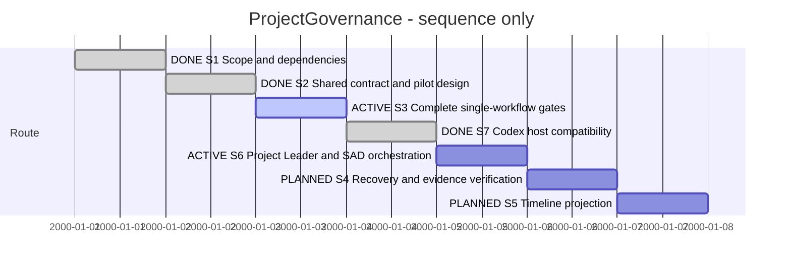

# Session 0007 — ProjectGovernance

## Session roadmap

Latest recorded turn: T035 — PGI4-C1 candidate evidence and guarded rework verified in the core, compiled CLI and pg_lab.
The native trial asks, receives a delayed fixture reply, starts one fresh attempt
and implements/reports the selected behavior. Local acknowledgement, coordination and
serialized leader delivery are implemented. C8 native single-worker/leader and completed
history recovery pass. Parallel evidence, sustained-hour capacity, active-host recovery,
independent review and canonical publication remain. PGI4-C1 now captures candidate-bound
external evidence and supports guarded rework, preserving historical results.
Sequence only; synthetic dates represent order, not estimates or elapsed time.



| State | Step | Work | Prerequisite / authority | Outcome / evidence |
| --- | --- | --- | --- | --- |
| completed | S1 | Recover skills, studies, card dependencies and ownership | Owner request, 2026-10-03 | Assessment below; RGS2 reused |
| completed | S2 | Design the smallest common routing, run, Session and client contract | Owner continuation, T002 | [PGD1 / PLAN-SDP-0017](../04--Design/SDPTool/ProjectGovernance/Plan.md), contract, acceptance cases and protocol inspection |
| on-going | S3 | Deliver one end-to-end workflow through SDPTool and the Codex client | S2 complete; [PLAN-SDP-0018](../05--Implementation/SDPTool/ProjectGovernance/Plan.md) active | PGI1/PGI2 delivered; PGI3-C6 verified; owner reports PGI3-U1 trial performed; native mapping remains unverified; PGI4-C1 evidence/rework delivered, review/publication remain |
| completed | S7 | Codex 0.164.0 and compatible later hosts / PGC1 | Owner T029; KB057 and existing PLAN-SDP-0018 | 98b449c range/identity/recovery checks, full race/vet, 60 schema cases and real no-model 0.164.0 controller/MCP probe pass; full native/review gates remain |
| on-going | S6 | Project Leader/SAD coordination in bounded increments | Owner T014 selects [KB052](../KanBan/active/%23052--Change--Project-Leader-and-SAD-orchestration.md); same [plan](../05--Implementation/SDPTool/ProjectGovernance/Plan.md) | PGL1 delivered at [inspection level](../05--Implementation/SDPTool/ProjectGovernance/Evidence-PGL1.md); PGL2-C1 preparation, C2a lifecycle, C2b provider checks and C2c decisions and C2d activation/native code trial delivered; PGL3-C2 reports/inbox, C3 attention/replies and C4 guarded continuation delivered; C5 acknowledgement, C6 console/MCP and C7 serialized leader delivery/recovery and C8 native bounded workflow delivered; parallel/capacity/review/publication gates remain |
| planned | S4 | Verify interruption, resume, scope change and evidence disposition | S3 candidate | Evidence required before wider use |
| planned | S5 | Project recorded activity into the KB043 timeline | Reliable S3/S4 capture and selected rendering scope | Full timeline remains deferred |

| Field | Value |
| --- | --- |
| Session reference | SESSION-SDP-0007 |
| Status | active |
| Primary card | [KB-SDP-038](../KanBan/active/%23038--Proposal--Codex-app-server-development-client.md) |
| Snapshot date | 2026-10-24 |
| Current step | S3/S6 active: PGI4-C1 exact candidate evidence and rework delivered after the C8 native trial; review/publication and retained orchestration gates remain |
| Proposed next step | PGI4 review provenance and checked canonical publication; retain two-Master/active-host recovery, SAD/owner interaction, capacity and integrated verification. SDL-only scope; KB059 onHold |
| Execution authority | T003/T004 select and resume PGI1; T006 selects PGI2; T007 selects PGI3; T008 resumes it with restored Git access; T009 selects explicit approval interaction; T010 continues executing-turn reattachment; T011 selects bounded launch provenance; T012 continues explicit skill invocation/correlation; T013 prioritizes owner development trials; T014 selects KB052 after reported trial; T015 continues PGL2 preparation; T018 continues bounded PG-local revision/retirement; T020 continues provider-backed review checks; T022 continues implementation while owner reads the walkthrough; T024 continues the plan toward Session completion; T025 selects automatic reporting and requests a multi-machine attention/control extension; T026 assigns hub/webapp to a separate project and continues local SDP/SDPTool work; T027 continues local attention/replies; T028 continues guarded attention continuation; T029 selects stable Codex >=0.164.0 and compatible later hosts, preserving other scopes |

## Goal and ownership

Owner definition, summarized from the current prompt: ProjectGovernance covers
method, methodology and tools that keep collaboration between the owner and Codex
agents organized. KB036, KB037, KB038, KB042 and KB043 belong to this workstream.
Retain the existing ProjectGovernance ecosystem; its name does not require one
monolithic binary or a second process tree.

The owner reports another agent is handling ModelGovernance. That workstream owns
model artifacts, identities, checkpoints, merge and promotion, as described in its
[current design](../04--Design/SDPTool/ModelGovernance/Design.md) and
[Session 0006](session-%230006--Model_governance.md). ProjectGovernance owns work
selection, collaboration, routine applicability, work progress and disposition.
It references model identities and evidence when relevant; a successful model
operation does not automatically complete an assignment or establish owner approval.
No ModelGovernance files or contracts are changed by this turn.

## Affected cards

Snapshot: 2026-10-10. KB038 and KB052 are active for the selected route; other
capability cards retain their broader backlog scope.
No card is merged, split or closed merely to group this workstream.

| Card | Role | Initial lifecycle / CardState | Planned outcome in this route | Current snapshot | Actual final |
| --- | --- | --- | --- | --- | --- |
| [KB038](../KanBan/active/%23038--Proposal--Codex-app-server-development-client.md) | Primary client and execution integration | backlog / backlog | One usable governed workflow | active / in-progress | PGI1/PGI2 delivered; PGI3 in progress |
| [KB052](../KanBan/active/%23052--Change--Project-Leader-and-SAD-orchestration.md) | Project Leader and SAD runtime | backlog / backlog | Responsive owner coordination with bounded assignments | active / in-progress | PGL1 inspection and PGL2 preparation/lifecycle/provider/decision/activation delivered in bounded increments; full workflow pending |
| [KB036](../KanBan/backlog/%23036--Proposal--Request-routines-and-process-control.md) | Request classification and routine selection | backlog / backlog | Small shared entry contract exercised by pilot | backlog / backlog | Pending; broader coverage retained |
| [KB037](../KanBan/backlog/%23037--Proposal--Observable-routine-state-machine.md) | Durable run state, transitions and observation | backlog / backlog | Minimum run/recovery core | backlog / backlog | Pending; full observer retained |
| [KB042](../KanBan/backlog/%23042--Proposal--Goal-oriented-sessions-and-roadmaps.md) | Session identity, roadmap and turn history | backlog / backlog | Capture/correlation beyond existing manual format | backlog / backlog | Pending |
| [KB043](../KanBan/backlog/%23043--Proposal--Event-derived-session-timelines.md) | Derived timeline | backlog / backlog | Later projection of observed events | backlog / backlog | Pending |

## Plan register

| Ref | Plan / record | Document readiness | Canonical lifecycle | Role |
| --- | --- | --- | --- | --- |
| P0 | [PLAN-SDP-0007](../02--Requirements/RoutineGovernance/StudyPlan.md) | completed | completed | Reused RGS2 study; not reopened |
| P1 | [PLAN-SDP-0017](../04--Design/SDPTool/ProjectGovernance/Plan.md) | completed | completed | S2 contract, inspection and implementation handoff |
| P2 | [PLAN-SDP-0018](../05--Implementation/SDPTool/ProjectGovernance/Plan.md) | in progress | active | PGI1/PGI2 delivered; PGI3 in progress, PGI4/PGI5 planned |

## Dependency assessment and recommended first delivery

T001 assessment retained below. T002 delivers the shared design and handoff linked
in the plan register; remaining runtime acceptance belongs to PGI.

Reuse the completed [RGS2 synthesis](../02--Requirements/RoutineGovernance/Synthesis.md).
KB036 should precede client behavior at the contract level, but finishing all of
KB036 before starting KB038 is unnecessary. Machine-supported routing benefits
from the client-owned submission boundary in KB038; durable transition validation
belongs to KB037's SDPTool core. These responsibilities are complementary.

1. Define a minimum KB036 contract: classify an incoming request, reuse applicable
   work and authorization, select a versioned routine, and expose missing coverage.
   Reassess steering inputs that change scope. A status question should remain easy.
2. Define the KB037/KB042 identities and ownership together: project/checkout,
   Session/step, request, routine version/run, assignment/attempt, candidate and
   evidence, mapped to Codex thread/turn/item IDs. Pin state transitions, revision
   checks, retry handling and interruption/reconciliation. Keep ProjectManagement
   lifecycle and Traceability evidence authoritative; no rival history store.
3. Exercise that contract through a minimal KB038 client and the shared SDPTool
   core, using an adapter boundary for agent operations. Start with one controller,
   a simple status view, and one bounded Maintenance workflow. Preserve existing
   role responsibilities; choose and test actual delegation/context behavior in
   the pilot. This discussion does not request spawning agents now.
4. Capture real turn/item/activity identity and timestamps from the beginning, with
   explicit unknowns, then build KB043's richer timeline after reliable capture.
   Do not infer elapsed activity or routine compliance from a message or file alone.

First workflow acceptance proposal: owner request -> visible routing/work coverage
-> bounded assignment -> actual execution observations -> evidence/review disposition
-> durable Session result. Include a status-only request, a scope-changing input,
an interrupted/resumed attempt, repeated delivery, and stale candidate evidence.
Codex completion, tool success, independent review and owner acceptance stay distinct.

The manual Session format is already adopted; Session discovery/browsing also has
existing implementation and tests in SDPTool. These are starting assets, not proof
of an automated Session recorder or routine engine. Full KB040 KanBanTUI, KB020
source migration, KB050 semantic blueprints and ModelGovernance completion are not
prerequisites for this proposed pilot. Use explicit task/context/evidence references
first; integrate richer model references through the other workstream's contract.
KB014 distribution/versioning becomes relevant to broader installation, rather
than blocking an isolated local pilot.

## Route changes and decisions

| Date / turn | Change | Authority and consequence |
| --- | --- | --- |
| 2026-10-03 / T001 | Start ProjectGovernance assessment from KB038; group KB036/037/042/043 | Owner direction; preserve separate card responsibility |
| 2026-10-03 / T001 | Retain ModelGovernance as a separately progressing workstream | Owner reports another agent; inspect its contract without edits |
| 2026-10-03 / T001 | Minimum shared contract first, then one client workflow; richer timeline later | Agent recommendation, not an approved full implementation sequence |

| 2026-10-03 / T002 | Owner continues S2; PGD1 delivers contract and planned PGI handoff | Observed owner continuation; implementation not started |
| 2026-10-06 / T003 | Owner continues with PGI1-M1 | Active PLAN-SDP-0018; core/CLI only |
| 2026-10-06 / T004 | Owner resumes interrupted work; PGI1 delivered | PGI2 next; original Git metadata remains read-only |

## Turn journal

### T001 — 2026-10-03: scope, skills and dependencies

- Capture mode: manual owner-input and work summaries. Host thread/turn/item IDs
  and exact prompt timing are unknown. Local T001 is not a host identifier.
- Owner input summary: read AGENTS and SDP skills, prepare for backlog work,
  prioritize KB038, assess whether KB036 should precede it and where KB042/043
  belong. Define ProjectGovernance as methodology/tooling for owner-agent
  collaboration; another agent owns ModelGovernance.
- Category: orientation, dependency analysis and architecture/planning discussion.
- Skills loaded (agent-reported): sdp 1.1.1, sdp-change-analysis 1.0.0,
  sdp-architect 2.0.0, sdp-planning 1.0.0, sdp-traceability 2.0.0, and OpenAI Docs
  (no skill version declared). Shared workflow, authority source map and planning
  contract read. No routine-run ID or runtime-enforcement evidence exists.
- Skills authority: root Skills is maintained; .agents/skills provides discovery;
  historical SDP/History skills are not the active collection.
- Steps touched: S1 completed; S2 named next. Reused existing studies and inspected
  relevant cards, ecosystem boundaries, ModelGovernance design and Session tests.
- External evidence: [official app-server documentation](https://learn.chatgpt.com/docs/app-server),
  accessed 2026-10-03, documents thread/turn/item operations and version-specific
  schema generation. This supports the proposed capture boundary. It does not
  verify the locally installed protocol, account access or the proposed pilot.
- Work summary, not a captured final response: recommend a small KB036/037/042
  contract feeding the KB038 pilot, retaining KB043 as a later projection. Record
  owner-defined ProjectGovernance scope and independent ModelGovernance ownership.
- Validation: `python3 SDP/ProjectManagement/validate.py` passed after the card
  update and EVT-KB-SDP-000286: 61 cards, 35 management records, four lineage
  operations and 474 events. `git diff --check` passed. Product code/tests are unchanged.
- Remaining work: S2 must settle concrete operation/storage contracts, supported
  Codex compatibility and the bounded implementation sequence. No new model turn,
  account configuration, application implementation, merge or release performed.

### T002 — 2026-10-03: shared design and bounded implementation handoff

- Capture mode: manual journal; host thread/turn/item identifiers and exact prompt
  time unknown. Exact owner input: “ok fortsett” (verbatim Norwegian quotation).
- Category: continuation of selected S2 planning/design. Reused SDP 1.1.1,
  planning 1.0.0, architect 2.0.0, change-analysis 1.0.0, traceability 2.0.0 and
  OpenAI Docs instructions already loaded in T001; read relevant plan template,
  schemas, code and current records. Agent-reported routine use; no runtime run ID.
- S2 outcome: PLAN-SDP-0017 delivered Design.md, 18 mapped acceptance scenarios,
  offline codex-cli 0.160.0 default-schema inspection (314 files) and the planned
  PLAN-SDP-0018 handoff. Its first milestone is a bounded core/CLI fixture; later
  phases cover adapters, owner workflow, evidence reconciliation and integrated review.
- Decisions/recommendations: shared SDPTool Go core; one local controller and simple
  terminal interface; private durable operational state referencing canonical project
  records; checked recoverable document publication; actual native child/reviewer
  provenance required. These are design choices for the pilot, not observed runtime.
- KB038 was active/in-progress during PGD1 and returned to backlog after design
  delivery, now linked to the planned implementation. KB036/037/042/043 remain
  backlog with reciprocal design/Session references and preserved broader scope.
- The other agent committed ModelGovernance MG2 during this turn. Its files and
  committed ledger bytes were preserved. Only this workstream's unpublished KanBan
  event IDs were reallocated above the committed counter, and its draft events
  appended after the committed prefix before delivery. No frozen history rewritten.
- Work summary, not a captured final response: design and implementation sequence
  ready; no application implementation, account operation, model turn, release or
  independent product review claimed. Traceability records the design separately
  from management transitions. Validation results are in PGD1 Evidence.md.
- Next: S3 / PGI1-M1 under PLAN-SDP-0018. Establish an isolated implementation
  checkout and a compatible Go toolchain, then execute the core slice when selected.

### T003 — 2026-10-06: PGI1 implementation, interrupted

- Late registration: reconstructed from the retained work/tool summary after an
  intentional turn interruption. Exact owner continuation: “ok fortsett” (verbatim
  Norwegian). Host identifiers and exact prompt/interrupt times are unknown.
- Loaded/reused routines: SDP entrypoint and shared workflow; Master 2.0.0,
  Worker 2.0.0 and Verifier 2.0.0, plus current planning/design/traceability context.
  These are agent-reported skill use, not a measured runtime routine execution.
- Owner input selected the next bounded PGI1-M1 core increment, not the later live
  client integration. PLAN-SDP-0018 and KB038 activated through EVT-PM-SDP-000143
  and EVT-KB-SDP-000304. ModelGovernance delivery was already committed at 043c59c.
- Original Git metadata was read-only in the host sandbox. Created an independent
  clone under /tmp from 043c59c on sdp/project-governance-pilot; did not switch the
  shared worktree or alter its unrelated files. Go 1.27.1 found in the local SDP
  toolchain; caches isolated under /tmp.
- Work summary: implemented shared core/CLI, immutable state generations,
  receipts, revision guards, strict inputs and initial tests. Core tests passed
  before canonical ledger coverage was added. The interruption left that new
  coverage change and CLI/schema verification unfinished; no milestone delivery
  or independent review was claimed.

### T004 — 2026-10-06: resume and verify PGI1

- Capture mode: manual owner-input/work summary. Exact owner input: “prøv igjen
  nå” (verbatim Norwegian). No invented host IDs or exact prompt timing.
- Recovered T003 artifacts, current Session, plan and Git status. Reused SDP,
  Master/Worker/Verifier and existing design/planning/traceability instructions.
  Original Git metadata remains read-only. An unrelated Session0006 edit appeared
  in the shared worktree; it stays outside this delivery.
- Direct implementation continues under the host's delegation restriction; no
  sub-agent or independent-review result is claimed. Fixed the interrupted ledger
  change's compile error, added compiled CLI workflow and exact wire schemas,
  rejected JSON field case aliases and preserved full fixture project bytes.
- S3/PGI1-M1 delivered. Full SDPTool race suite, vet and 21 captured wire cases
  pass with Go 1.27.1. The first broad test failed because default runtime/cache
  directories were read-only; temporary XDG directories resolved the environment
  failure without changing tests. Core checks include canonical record conflicts,
  source drift, retry/CAS, lock contention and injected HEAD publication failures.
- Work summary: core and compiled CLI are ready for adapter work. No live Codex
  execution, automatic journal, completed-work gate, release or independent review
  is claimed. This entry summarizes actual work; it is not a captured final reply.
  Exact candidate/commands and limitations are in PGI1 Evidence-PGI1.md.
- Handoff: KB038 changes in-progress -> ready with EVT-KB-SDP-000305. The plan stays
  active, S3 continues with PGI2; KB036/037/042/043 retain separate backlog scope.
  The milestone commit lives in the isolated clone; verified changes are returned
  to the original worktree as uncommitted files, preserving its branch/Git metadata
  and the unrelated Session0006/sourceinput/npm changes. No push or merge.
- Backlog/dependency review: PGI2 adapters are the next bounded milestone. No new
  prerequisite from ModelGovernance or KB050/KB040 is introduced. Full host recovery,
  candidate-bound publication and independent review remain PGI2–PGI5 obligations.

### T005 — 2026-10-07: implementation status and goal distinction

- Capture: manual work summary; host thread/turn/item IDs and exact prompt time
  unknown. Owner input summary: asks how ProjectGovernance implementation is going
  after the separate SDL Go familiarization Session was closed.
- Request category: status-only; no new implementation phase is selected here.
  Skills/routines reused: SDP 1.1.1 entrypoint, document workflow and mandatory
  Session upkeep. No automatic routine-run identity or enforcement is claimed.
- Recovered Session0007, PLAN-SDP-0018, KB038, PGI1 evidence and candidate manifest.
  Verified all 19 recorded PGI1 candidate files still match their SHA-256 identities
  in the shared worktree. The isolated clone retains milestone commit `d3e457b`.
  Existing recorded race/vet/21-wire-case results were inspected, not rerun.
  Hash agreement for this subset does not validate concurrent changes elsewhere.
- Current outcome: PGI1-M1 core/CLI delivered; PGI2–PGI5 remain planned/unstarted.
  KB038 remains active/ready, PLAN-SDP-0018 active and S3 unfinished. Source and
  evidence returned from the isolated clone are still uncommitted in the shared
  worktree; other agents' changes are preserved. The earlier read-only Git limit
  describes the PGI1 host, not a newly verified current blocker.
- Clarification: Session0009 closed only SDL code familiarization, PATH repair
  and its test baseline; it did not complete or advance ProjectGovernance.
  The implemented core does not yet supply the live client, automatic Session
  journal, evidence completion gate or independent integrated review.
- Next step remains PGI2-M1: thin MCP/controller adapters and actual protocol
  negotiation. No implementation, card transition, merge or release performed
  during this status turn. This entry is a work summary, not a captured final reply.

### T006 — 2026-10-07: resume adapters and protocol negotiation

Owner input summary: resume Session0007, and explain Session0008. The latter is
semantic-blueprint design (BP2-B delivered; BP2-C next), not this implementation.
Skills loaded/reused: SDP, Master, Worker, Planning, Verifier, document workflow;
OpenAI Docs for the app-server boundary. Work directly under current host rules;
no independent review or native child execution is claimed. Unknown host IDs and
exact prompt times remain unknown. Manual work summary, not final-response capture.

PGI2-M1 selected; KB038 in-progress. Reuse the clean isolated clone and retain
PGI1 core/CLI behavior. Inspect installed Codex 0.160.1, pin the MCP Go SDK, prove
real negotiation, implement scoped adapters and bounded replay/reconciliation.
No model turn, account reconfiguration, independent review, publication or release
is selected by this increment.

Work outcome: PGI2-M1 delivered. Shared-core MCP tools restrict launch-bound agent
rights, while the controller protocol adapter pins Codex 0.160.1, MCP SDK v1.8.0
and protocol 2025-11-25. The actual rebuilt probe observes ChatGPT account mode
and discovers three MCP tools in an idle ephemeral thread, without submitting a
model turn. Durable attempt mappings, bounded visible observations, replay/CAS,
byte/count paging and conservative epoch/history reconciliation have fixture tests.
A disconnected attempt cannot be revived by an observation before reconciliation.
Full isolated SDPTool race tests and vet pass, as do 21 CLI and three host/core wire
schema captures. Earlier fixture/import failures and exact candidate scope are
recorded in [PGI2 evidence](../05--Implementation/SDPTool/ProjectGovernance/Evidence-PGI2.md).
Traceability skill reused for delivery links; no independent reviewer was invoked.
Management/Toolkit validators pass in both checkouts after correcting a misplaced
verification YAML block. All 22 candidate files match on return; adapter race tests
also pass in the shared workspace, without claiming its unrelated changes fully
regression-tested. Ledger byte prefixes and new document links are preserved.

S3 remains active; KB038 returns to ready for PGI3. The isolated milestone commit
and returned source changes preserve concurrent shared work. Full owner execution,
controller-loop recovery, automatic project publication and independent integrated
verification remain PGI3–PGI5. No full Session-goal completion is claimed.

Session0008 is the separate semantic-blueprint workstream: NOW/TARGET change,
affected context and preserved obligations. During this turn its journal advanced
to BP2-C delivered with an independent authored-model trial and planned successor
PLAN-SDP-0020. BPI1 Go analyzer selection is next there; BP2-A's particular pilot
still awaits owner feedback. Its journal and implementation are not changed here.

Next step: PGI3-M1, preserving the above runtime/evidence gaps. This is a manual
work summary, not an automatically captured final response.

### T007 — 2026-10-07: continue owner workflow

Owner input summary: continue. Manual work summary, not host transcript or final
response capture; host thread/turn/item identities are unknown. Recovered committed
PGI2 12542b2 and shared Session/plan. Skills reused: SDP, Master, Worker, Planning,
Verifier and document workflow; OpenAI Docs for local pinned protocol inspection.
PGI3 selected; direct implementation preserves current delegation restrictions.
The host now allows writes only beneath SDL and /tmp. All PGI3 code and Session,
card, plan and evidence updates remain together in the isolated clone; no shared
publication or network/model execution is claimed.

Work summary: PGI3-M1-C1 implements controller-only durable input, pre-send claim,
managed-account/scoped-MCP guards, fresh bounded Master turn submission, line-oriented
steering/interrupt/scope-stop, observer status and conservative history recovery.
A lost acknowledgment cannot trigger automatic resubmission. Input/source identities,
Session and project bytes survive the fixture journey and restart. Closing output
observers does not terminate the controller. No automatic project publication occurs.
The final isolated full race suite, vet, 28 application wire cases and four captured
app-server request schemas pass. Tests use recorded fake host processes, not a model.
Traceability skill was reused for checkpoint evidence; no independent reviewer ran.
Management validation (61 cards, 38 records, 509 events), Toolkit, candidate hashes,
new document links, ledger-prefix preservation and whitespace checks pass.

Actual rebuilt probe: Codex 0.160.1 exits with connection-ended EOF before initialize
completes. A filtered direct startup check exits 1 with no protocol output and
matches read-only-filesystem errors; no raw host logs or account data are retained.
The exact failing path remains unknown. No live model turn was
started and no permission bypass attempted. PGI3 remains in progress, including
live useful-task/steering/recovery evidence and unresolved ambiguous-send handling.
Native children are not granted under the current host delegation restriction.

The checkpoint commit, [evidence](../05--Implementation/SDPTool/ProjectGovernance/Evidence-PGI3-C1.md)
and this journal remain in the isolated clone. Shared Session0007 still ends at T006;
its PGI3 projection cannot be updated under the current filesystem permissions.
Future return must preserve current shared preimages and ledger history. S3 stays
active; next: establish a permitted app-server connection, perform the bounded live
workflow and address any measured recovery/provenance gaps. This is a work summary,
not a captured final answer or completed Session goal.

### T008 — 2026-10-07: recover Git and continue the actual PGI3 checkpoint

Owner input summary: Git access is now available; continue following the plan.
Recovered shared T006 and the newer isolated T007/PGI3-C1 checkpoint rather than
repeating PGI2. The original conversation's PGI1 summary was stale. Imported PGI1,
PGI2 and PGI3-C1 commits into the repository's ProjectGovernance branch and created
a persistent worktree at /home/warloc/git/SDP-project-governance. Other agents' dirty
SDUI/blueprint and shared-management changes remain untouched in the shared worktree.
Skills reused: SDP, Master, Worker, Planning, Verifier, Architect, Traceability,
document workflow and OpenAI Docs. Architect recorded the measured correlation
refinement before Worker implementation; no independent reviewer was invoked.

Work summary, continued through 2026-10-08: Codex 0.161.0 initialized with managed
ChatGPT mode and discovered the scoped MCP tools. A real disposable Maintenance
turn fixed Unicode boundary trimming, added eight tests and received in-scope
steering. Only the two authorized source/test files changed. The driver reran Go
tests successfully. Closing the actual output observer did not stop execution;
interrupt/recovery retained the run and Session, and explicit resume completed a
new attempt in a new thread. These are test-driver scenarios under the selected
PGI3 scope, not additional verbatim owner requests.

A proxy dropped the real turn/start response after forwarding the request. The
controller retained uncertain input. Recovery matched a unique recorded clientId
and exact payload in the mapped thread, persisted the observation and acknowledged
the input without starting another turn. Missing, conflicting or duplicate proof
still refuses. Completely unmapped creation and incomplete active history remain
open. The core preserves historical host versions and cannot silently relabel an
existing attempt.

Actual MCP run_read succeeded; run_transition failed with `MCP tool call requires
approval, but approval policy is never`. That host result is retained in sanitized
evidence. The owner was asked to choose explicit request approval or continued
visible refusal; no answer has been received. Policy remains unchanged. Host
completion does not grant routine completion or acceptance. No native child or
independent review is claimed, and no report was forced through another route.

Full SDPTool race tests, vet, 28 application wire cases and four actual-version
host request schemas pass. Management/Toolkit validation passes after correcting a misplaced verification
relation caught by the validator. Final outputs,
source identities and scenario boundaries are recorded in
[PGI3-C2 evidence](../05--Implementation/SDPTool/ProjectGovernance/Evidence-PGI3-C2.md).
The checkpoint is committed on the persistent ProjectGovernance branch; no merge,
push or release is selected. Private C1 management event IDs collide with later
shared records and must be reconciled before integration; neither history was
rewritten. Backlog review retains broader KB036/037/042/043 scope and the separate
ModelGovernance and blueprint workstreams.

S3 and KB038 remain in progress because PGI3 has unfinished runtime obligations.
Next: resolve the concrete approval interaction, then executing-turn reattachment
and applicable role/provenance evidence; PGI4/PGI5 remain planned. This is a manual
work summary, not a captured final response. Current conversation host IDs and
exact owner input timing are unknown.

### T009 — 2026-10-08: continue explicit approval interaction

Owner input summary: continue after C2 and its explicit per-request approval
recommendation. Selected PGI3-C3 within PLAN-SDP-0018; this selects implementation
and disposable verification, not acceptance of arbitrary runtime requests.
Recovered clean commit 37a09a6 in the persistent worktree. Skills reused: SDP,
Master, Architect, Worker, Planning, Verifier, document workflow and OpenAI Docs.
Measured the installed host's actual MCP form request before implementation;
recorded the bounded interaction and revision consequence in the design.
Architect recorded the bounded request binding, no permanent grant and exact
approved-call revision rule before Worker implementation. Verifier distinguishes
fixture tests, real protocol inspection and actual model execution; Traceability
is reused for the checkpoint links. No independent review is claimed.

Work summary: C3 implements opt-in per-request accept/decline/cancel with exact
stdin capture and observed closure. The real host rejected granular policy without
experimental API; the final path uses stable on-request with user review and rejects
unsupported requests. An initial live report reached verifying but its controller
failed on competing core writes. Bounded pre-mutation contention retries fixed this
without repeating any host send. Both failed trials remain explicit evidence.

The final actual trial completed one bounded Maintenance task, presented the exact
MCP report, recorded the test-driver acceptance, observed request closure and
advanced the routine to verifying. Excluded fixture files stayed identical and the
driver reran Go tests successfully. The test-driver decision is not a verbatim
owner reply or completed-work acceptance. Final affected package race tests,
compiled core CLI, vet and application/protocol schemas pass. Broad regression
started before the final policy/contention corrections; its historical boundary is
kept distinct from final affected-code verification. It also passes. Final
management/Toolkit, source identity, ledger-prefix and Markdown-link checks pass.
The actual mapped host history confirms one successful run_transition with no
error. The checkpoint is committed on the persistent branch; no shared integration
is claimed. See
[C3 evidence](../05--Implementation/SDPTool/ProjectGovernance/Evidence-PGI3-C3.md).

S3 and KB038 remain in progress for executing-turn reattachment and applicable
role/provenance evidence. Lost approval closure remains uncertain rather than
being resent. PGI4/PGI5 remain planned. The persistent worktree keeps all records
and the checkpoint together; shared work, historical ledger bytes and earlier
unintegrated event-ID collisions are preserved. No merge/push/release is selected.
This is a manual work summary, not a captured final answer.
Manual summary; current conversation host IDs/timestamps are not available.

### T010 — 2026-10-08: continue executing-turn reattachment

Owner input summary: continue the selected plan after C3. Recovered clean 95f821f
in the persistent ProjectGovernance worktree. Reused SDP, Master, Architect,
Worker, Planning, Verifier, Traceability, document workflow and OpenAI Docs.
Architect measured the actual local Unix WebSocket transport before selecting
same-host reattachment with distinct observation and agent capability epochs.
An isolated command survived connection closure and completed on the same turn
after subscription from a new connection. The raw proxy and idle-thread resume
limitations are recorded; neither was treated as passing integration evidence.

Work summary: C4 implements private same-host reattachment with preserved launch
capability and a new observation epoch. Initial controller trials refused the
host's socket alias before submission; the measured direct alias is now checked
alongside private parent/socket ownership and peer process lifetime. Two final
actual Maintenance journeys passed, one after explicit detach and one after abrupt
SIGKILL of the controller. Both kept one run/attempt/thread/turn, accepted steering,
reported through the original MCP capability and preserved excluded files. The
routine reached verifying, not completed. Gaps remain visible. Affected race,
compiled CLI, vet and schema checks pass; management/Toolkit and final integrity
checks accompany the checkpoint. See [C4 evidence](../05--Implementation/SDPTool/ProjectGovernance/Evidence-PGI3-C4.md).

S3 stays active. Next: applicable native role/skill/context provenance; the actual
fixture explicitly lacks installed SDP skills and does not prove skill compliance.
No delegation or independent review is claimed. PGI4/PGI5 remain planned; broader
backlog scopes and concurrent shared work are preserved. Historical private event-ID
collisions still need deliberate integration reconciliation. No merge/push/release
is selected. This is a manual work summary, not an already captured final response.
Current conversation host IDs and exact owner timing are unknown.

### T011 — 2026-10-09: continue applicable provenance

Owner input summary: continue after PGI3-C4. Recovered clean 4044f37 in the
persistent worktree. Loaded/reused SDP, document workflow, Master, Architect,
Worker, Verifier, Planning, Traceability and OpenAI Docs. The installed host remains
0.161.0. Architect distinguishes controller role assignment, host-reported loaded
instruction paths, locally hashed source bytes, discovered skills and agent claims.
Selected a bounded provenance observation/projection; existing text dispatch and
recovery stay unchanged. No delegation is selected or performed. Exact conversation host IDs and owner timing
are unknown.

Work summary: C5 persists controller-only context observations and adds offline
provenance inspection. The actual disposable fixture contains maintained SDP skills
and discovery links. It reports 14 enabled local skills with matching hashes, 60
external skills and two instruction paths; native role/parent fields remain empty.
The agent completed the bounded Go fix, accepted one explicit test-driver report
request and reached verifying. All excluded bytes/links were preserved. No actual
skill invocation or compliance is inferred from discovery or model claims.

Initial setup refused a dot-prefixed assignment exclusion before model launch;
the fixture was corrected without widening the product contract. After the final
runtime-source trial, schema validation caught an unresolved reference. The schema
and checker were corrected, captured records revalidated and final affected race
and compiled CLI checks passed. The rebuilt offline view equals the live view;
no final rebuilt-binary model run is claimed. Vet passes on final Go sources.
Management/Toolkit and final source/ledger/link checks accompany the checkpoint.
See [C5 evidence](../05--Implementation/SDPTool/ProjectGovernance/Evidence-PGI3-C5.md).

S3/PGI3 and KB038 stay active/in-progress. Next: explicit skill invocation/correlation
and applicable native role mapping under current delegation rules; PGI4/PGI5 remain
planned. Backlog review retains broader governance and separate concurrent scopes.
No independent review, shared integration, push, merge or release is claimed.
Historical private event collisions remain for deliberate integration reconciliation.
This is a manual work summary, not an already captured final response.

### T012 — 2026-10-09: continue explicit skill invocation

Owner input summary: continue after PGI3-C5. Recovered clean milestone 922aff9 in
the persistent ProjectGovernance worktree. Loaded/reused SDP, document workflow,
Master, Architect, Worker, Verifier, Planning and OpenAI Docs; Traceability applies
to delivery. Selected the existing next PGI3 obligation: explicit project skill
input and exact lost-response correlation. Inspect the installed host before
changing the text-only contract. No delegation or independent review is selected.
Current conversation host IDs and exact owner timing are unknown.

Work summary: C6 adds explicit project-local skill selection, immutable input
identity/local digests and a bounded offline invocation projection. An actual probe
confirmed recorded name/path/order and client ID. Full-input correlation preserves
lost-response recovery without treating discovery or agent statements as compliance.
Initial setup/assertion/capture mistakes were corrected; runtime requirements were
not weakened. Trial1 passed, then final binaries repeated Maintenance after explicit
attempt identity and complete-history refusal refinements.

The final Maintenance trial fixed only the two permitted Go files, preserved other
preimages/discovery links, passed driver tests and reached verifying after one
explicit report approval scenario. The final response-loss trial retained uncertain
input, recovered its exact text and both skill identities on one mapped attempt/turn,
and kept a visible epoch gap. No resubmission or routine acceptance occurred; that
read-only scenario preserved every fixture file. Final affected race/compiled CLI,
vet and application/protocol/live schema checks pass. Management/Toolkit and final
source/ledger/link checks accompany [C6 evidence](../05--Implementation/SDPTool/ProjectGovernance/Evidence-PGI3-C6.md).

S3/PGI3 and KB038 stay active/in-progress. Native child/review mapping remains
unverified under current delegation restrictions. Next: resolve that applicability
boundary and prepare PGI4 candidate/evidence/publication handoff. PGI4/PGI5 remain
planned. Backlog review retains broader governance and separate concurrent scope.
No independent review, shared integration, push, merge or release is claimed.
Known historical private event collisions remain for integration reconciliation.
This is a manual work summary, not an already captured final response.

### T013 — 2026-10-09: owner development trial and shared understanding

Owner input summary: technical implementation has progressed farther than the
owner can assess from documentation. They want to test PG in a real project before
release, perhaps in sdui_widget_lab or a dedicated project, and use experience to
clarify both workflow intent and the agent's interpretation. They supply the other
agent's KB051/XFMD integration handoff and proposed JSON invocation contract.

Recovered clean 34b345e. Loaded/reused SDP, Change Analysis, Planning, Architect,
Master/Worker/Verifier and Traceability as applicable. Inspected actual PG CLI,
controller and MCP boundaries, widget-lab instructions, and the supplied blueprint
handoff. The core already has CLI JSON request files/responses; generic invoke,
action catalogue and XFMD integration remain separate proposed work. Current PG is
a bounded terminal workflow, not a finished project-facing UI or Steering dialogue.

Priority correction: make owner experimentation and feedback concrete before more
feature expansion. Prepare a source-identified local candidate and trial instructions;
keep technical checks separate from owner experience/acceptance. The owner selected a dedicated PG lab first and explicitly wants both overview
and collaboration during a task. Exact conversation host IDs/timing are unknown.

Work summary: prepared `/home/warloc/git/pg_lab` with exported C6 engine commit
34b345e, three locally built binaries, separate harness/source hashes and private
state. The readable console exposes current work/assignment, observed execution,
explicit per-request decisions, steering/interruption, provenance, Git diff/tests
and feedback. It reuses the existing engine without adding a second state machine.
A small Go command gives a visible before/after task. Minimal process records are
explicitly distinguished from a full installed consumer. Widget-lab files and
stable installations remain unchanged. No model turn was launched.

Build/preparation, Python compile, actual read-only CLI inspection, baseline project
tests/preservation and focused adapter checks pass. No live owner console experience
or acceptance is claimed. [U1 evidence](../05--Implementation/SDPTool/ProjectGovernance/Evidence-PGI3-U1.md)
records identities and limits; [trial procedure](../05--Implementation/SDPTool/ProjectGovernance/Owner-Trials.md)
records the repeated owner/agent feedback loop. Management/Toolkit and integrity
checks accompany delivery. Changes remain on the current milestone branch.

Next: owner tries both views, reports expected versus experienced behavior in chat
or FEEDBACK.md, and reconciles design/plan with the agent before larger expansion.
A later selected widget-lab task tests transfer to a real existing consumer. Native
mapping and PGI4/PGI5 remain open. No independent review, shared integration, push,
merge or release is claimed. This is a manual work summary, not final-response capture.

## Closeout

The Session remains active. S1/S2 are complete; S3 includes delivered PGI1 core/CLI
and PGI2 adapters. PGI3-C6 verifies explicit skill input and exact lost-response
correlation, alongside C5 provenance, C4 reattachment, C3 approval/reporting and C2
mapped recovery. Native child/review mapping remains unverified under current host
rules. PGI3-U1 makes owner trial feedback the immediate next step before more
feature expansion. PGI4/PGI5 and wider capability closure remain planned.

## T014 — Select KB052 and begin observable project leadership

Date: 2026-10-10. Manual work summary; host thread/turn IDs and exact input/output
timing are unavailable. This is not a captured final response or owner acceptance.

Owner input summary: another agent registered KB052 and handed it to this workstream.
The owner has tried the lab, needs familiarity with the workflow and now wants work
on Project Leader/SAD orchestration. Treat this as explicit prioritization; preserve
the lab attempt and do not require acceptance of the old one-Master experience.

Recovered blueprint commit edfac185bb11b06ae9c6dd39a1809d166ad9541f, card, handoff and
PLR1 role guidance. Imported only KB052/PLR1's records and exact original event bytes;
never replay the source branch's stale backlog KB038 copy over our active work.
Role skill delivery in that branch is not claimed installed in this checkout.
Read canonical source sdp-project-leader 1.0.0 and roles.md as upstream design input;
this turn acts as the bounded workstream Master/Architect/Worker, not an appointed
runtime Project Leader or strategic owner authority.

Skills/routines loaded: sdp 1.1.1 and document-workflow; change-analysis 1.0.0;
planning 1.0.0 and typed-plan contract; architect/master/worker/verifier/traceability
2.0.0. Reused Session upkeep, board/management history and the source branch's
concurrent-work preflight. No child agent, online host, model task or independent
review was invoked.

Design reconciliation: [Orchestration](../04--Design/SDPTool/ProjectGovernance/Orchestration.md)
separates normal Project Leader dialogue, strategic Steering, SAD and implementation
Master. Existing controller has checkout-wide leases and Maintenance-only role
coverage; a prompt rename is insufficient. Extend the existing services/client;
retain shared model/blueprint ownership and explicit durable event delivery.
[Plan](../05--Implementation/SDPTool/ProjectGovernance/Plan.md) adds PGL1–PGL5,
retaining every handoff scenario and unfinished PGI evidence/publication gates.

[Scoped preflight](../05--Implementation/SDPTool/ProjectGovernance/preflight-PGL1.json)
inspects nine worktrees. Shared untracked PG files are exact prior PGI2 copies;
independent PG overview code can proceed here without modifying them. Shared
integration/KB051/private-event collision handling remains explicitly deferred,
not globally solved by local branch records. New IDs are scanned across local ledgers.

Current work: PGL1 read-only registered-work overview reuses operational state,
coverage and provenance; human and JSON paths expose historical observations and
unknowns. Verification/result is recorded in the PGL1 evidence at turn closeout.
Next: complete PGL1 evidence and select the PGL2 assignment mutation contract,
refreshing preflight and deliberate role-skill adoption before dispatch changes.

T014 closeout work summary: [PGL1 evidence](../05--Implementation/SDPTool/ProjectGovernance/Evidence-PGL1.md)
and [candidate](../05--Implementation/SDPTool/ProjectGovernance/candidate-PGL1.json)
record passing scoped tests and compiled human/JSON inspection of the real lab.
176 project/runtime entries remain unchanged. A separate `pg_lab/overview` preview
is available without replacing the original experiment. Actual stored state is
running/last-host-unknown with a gap; this turn does not infer current activity or
acceptance. PGL1 is delivered; PGL2 is the next bounded assignment. Full KB052,
independent review and integrated publication remain unfinished.

T014 concurrency refresh: blueprint advanced to a9edf28 during closeout with Actions
contract/plan records, preserving PG ownership and the PGL1 boundary. Its new PM176
and KB333 collided with our still-uncommitted closeout drafts. Before first commit,
allocated PM177 and KB335/336 for our events and updated their traceability references;
no imported/committed bytes were rewritten. Shared integration remains separate;
Session0011's integration-owner question has no observed disposition here.

## T015 — Prepare bounded SAD and Master assignments

Date: 2026-10-10. Owner says “ok fortsett”; continue KB052. Manual work summary,
not a captured final answer; host IDs and exact turn timing are unavailable.
Recovered the active Session and PGL1 candidate. Read interim coordination 684b1f8,
Actions Session0011 T008 at 732e85c, and current local worktrees. The coordination
prompt is a proposed handoff, not proof that the integrator was appointed. Preserve
its shared-file boundary and continue scoped PG preparation under existing authority.

Skills/routines: SDP 1.1.1, Worker/Architect 2.0.0, Planning 1.0.0 loaded; reused
Master/Verifier/Traceability 2.0.0, document workflow, plan/Session/board contracts and
concurrent-work preflight. No subagent or model task launched. Role skill adoption
is now deliberately sequenced with shared distribution integration before role
launch; preparation only uses explicit role labels and trusted controller authority.

Selected PGL2-C1 in [Orchestration](../04--Design/SDPTool/ProjectGovernance/Orchestration.md)
before code. Current core is Maintenance-only and cannot honestly certify provider
revisions or owner design approval. C1 therefore delivers immutable assignment
preparation, canonical/file revision checks, local scope conflict refusal and retry/
CAS recovery, with dispatch unavailable and designAcceptance not-assessed. C2 retains
actual disposition, provider-aware checks and assignment revision/retirement. This
refinement preserves the full PGL2 acceptance boundary instead of labeling a file
reference approved or treating role guidance as a launch credential.

[Evidence](../05--Implementation/SDPTool/ProjectGovernance/Evidence-PGL2-C1.md) and
[candidate](../05--Implementation/SDPTool/ProjectGovernance/candidate-PGL2-C1.json)
record scope and results. The separate synthetic preview prepares SAD and Master,
refuses overlapping work and shows Master stale after TARGET changes; exact retries
retain identity. No model/provider integration or owner acceptance is claimed.
The original owner project/runtime is preserved, and `pg_lab/assignments` displays
the new preview. The new state profile is confined to its explicitly selected store.

[Preflight](../05--Implementation/SDPTool/ProjectGovernance/preflight-PGL2-C1.json)
refreshes ten worktrees and hashes the old untracked shared PG copies. Shared
integration and colliding history remain separate. [Coordination handoff](../05--Implementation/SDPTool/ProjectGovernance/Handoff-PGL2-C1.md)
provides the candidate/invariants/provenance/next writes; no automatic delivery is
claimed. Next bounded step is PGL2-C2. PGL3–5 and prior unfinished PGI gates remain.

T015 closeout: final affected race/vet tests and compiled legacy governance CLI
regression pass. Actual preparation wire/schema and old-reader refusal checks pass;
Toolkit/management replay and evidence integrity checks pass at the documented
boundary. PGL2-C1 is delivered; C2 remains next. No independent review, runtime
Project Leader, authenticated design approval or provider integration is asserted.
Management events PM178 and KB337 record this scoped delivery; no historical
cross-worktree identity is rewritten. No push/merge/release is selected.

## T016 — Clarify Session ownership and integration boundary

Date: 2026-10-18. Manual work summary; exact host IDs and turn timestamps are
unavailable. The owner asks whether this agent works in Session0012 and reports
that another agent is resolving merge conflicts to integrate previous work into main.

Recovered this Session and the separate Session0012 record in the coordination
worktree at 684b1f8. Session0012 explicitly owns interim cross-workstream coordination,
not PG implementation. This conversation remains Session0007, responsible for
KB038/KB052 and PLAN-SDP-0018. The owner's report establishes a separate active
integration workstream; this turn does not claim its conflicts are resolved or
its result merged, and does not take over its files or integration decisions.

Skills/routines: reread SDP 1.1.1 and the Session continuity contract; reused the
established document workflow and scoped ownership rules. Inspected clean PG and
coordination branches. No implementation, delegation, host task or lifecycle
transition was performed. The roadmap and plan/card states remain unchanged.

The latest PG implementation candidate remains de4b795 (PGL2-C1); the existing
[handoff](../05--Implementation/SDPTool/ProjectGovernance/Handoff-PGL2-C1.md)
records its scope, evidence and integration invariants. No automatic handoff
delivery is claimed. S6 remains active; the next implementation step is PGL2-C2
assignment revision/retirement, actual disposition and provider-aware prerequisites,
with shared integration kept in the other workstream.

## T017 — Refresh the integrated baseline and bound continuation

Date: 2026-10-18. Manual work summary; exact host IDs/timing unavailable. Owner asks
whether PG can continue without conflicts, has a clean route to main, or should
wait for the integration agent. Reused SDP 1.1.1 and Session upkeep; read document
workflow, Planning 1.0.0, typed-plan contract and main's concurrent-work preflight.

Fetched origin/main at 8aa16c2ba531569fad77eafd5225e4b3d504549a and verified that
de4b795 is its ancestor: ACT0 has integrated PGL2-C1. ACT0's Integration.md records
combined tests and history reconciliation. Actions now continues at 598f483 with
dirty registry/CLI/model dispatch and a new blueprint action adapter. Waiting for
all Actions phases is unnecessary. No completion of that ongoing work is inferred.

Merged main into the clean owning PG branch, producing c3877ae without conflicts
and preserving history. The remaining tree delta was only our T016 Session note.
No other checkout or remote ref was modified. Retain the imported canonical ledger
and identity mapping; never replay the obsolete pre-integration ledger. Focused
Go tests pass for governance, governancecontroller, governancemcp and cmd/sdp-controller.
Merge-tree against committed Actions 598f483 passes; dirty/future edits are excluded.

Preflight also inspected the dirty primary checkout and clean viewpoint branch
cc7b52f, including committed and working changes. The primary retains old PG and
other-system copies; do not replay them into this owning branch. Actions owns its
generic API, shared CLI and records; PG retains its core/controller and own records.
Unreported remote work is outside coverage. Verdict is green for branch sync and
owning coordination records. PG-local revision/retirement can continue after a
fresh scoped check; provider/shared-contract work and new event identities require
reinspection before writes. This is not a blanket conflict-free verdict for C2.

The plan now records the Git continuation boundary. S6 remains active, C2 next.
Before delivery, refresh main, check concurrent committed/dirty changes, verify the
combined candidate and prepare a PR of only new PG changes. No product implementation,
delegation, push, main merge, release or independent review occurred this turn.

## T018 — Revise and retire prepared assignments

Date: 2026-10-18. Manual work summary; exact host IDs/timing unavailable. Owner
input, verbatim Norwegian quotation: “ok fortsett med det”. Continue the PG-local
revision/retirement boundary selected in T017, on integrated main ancestry.

Loaded/reused routines: SDP 1.2.0, Architect 2.1.0 for the concrete lifecycle
contract, Worker 2.0.0 for implementation, Verifier/Traceability 2.0.0 for checks
and records, Planning 1.0.0, document workflow, concurrent-work preflight and Session
upkeep. No subagent, model task or independent review was invoked. Upstream skills
are now present through ACT0 integration; their presence is not runtime compliance.

[Preflight](../05--Implementation/SDPTool/ProjectGovernance/preflight-PGL2-C2a.json)
records twelve worktrees and the scoped PG boundary. Shared Actions CLI/API and
provider services remain excluded. Canonical ACT0 identities/history are retained;
old dirty primary PG copies were not replayed. [Orchestration](../04--Design/SDPTool/ProjectGovernance/Orchestration.md)
selects stable identity/role/selection, revision/generation guards, immutable
receipts and terminal retirement before implementation. Retirement releases only
an unlaunched local claim; it is not completion, approval or host cancellation.

[Evidence](../05--Implementation/SDPTool/ProjectGovernance/Evidence-PGL2-C2a.md) and
[candidate](../05--Implementation/SDPTool/ProjectGovernance/candidate-PGL2-C2a.json)
record affected race tests, vet, legacy CLI regression, compiled lifecycle journey
and profile-specific schemas. The first CLI trial exposed unsupported embedded
request fields in the strict decoder; explicit wire fields and regression tests
fixed it without changing shared decoding. Final subprocess trials pass, including
C1-reader refusal of 0.3. Thirty-eight successful wire objects pass schema checks.
The original owner's 176 project/runtime entries remain unchanged. A separate
`pg_lab/assignments-lifecycle` helper displays the synthetic lifecycle preview.

S6 remains active; PGL2-C2a is delivered, while controller-bound design disposition,
provider-aware revision checks and dispatch prerequisites remain next. No full PGL2,
owner acceptance, live Project Leader, cross-store reservation, PR/main merge,
release or independent review is claimed. This slice does not change the worker
MCP privilege set or the generic Actions interface.

Closeout records: EVT-PM-SDP-000198, EVT-KB-SDP-000370; scoped system evidence in Traceability.

T018 closeout checks: candidate/source hashes and canonical ledger prefixes pass;
83 local documentation links resolve, management/Toolkit validators pass. Actions
has no committed changes in the PG core/controller or owning design/plan/Session
at inspected 0b85a11. Shared history still needs normal append reconciliation on
future integration; PM198/KB370 have no observed conflicting identities.

## T019 — Verify and reconcile the current main merge

Date: 2026-10-18. Manual work summary; exact host IDs/timing unavailable. Owner
asks whether there will be no conflicts when PG is later merged into main.
A clean worktree and the earlier forecast do not guarantee a future merge.
Reused SDP, Worker/Verifier, concurrent-work preflight and Session upkeep for
this existing branch synchronization boundary; no new implementation scope.

Fetched origin/main e8760d331933361ab631ef0d52c20e87268a22b3, which now includes
Actions delivery. Merge-tree against PG ad0e730 found content conflicts in
ProjectManagement/Ledger.ndjson and Traceability/Ledger.ndjson only. There were
no differing event-ID collisions and no source-code merge conflicts. Both streams
had appended different events to their shared base; the earlier clean-code boundary
never eliminated this shared-history integration obligation.

Integrated that pinned main into the owning PG branch, leaving main and other
worktrees untouched. Retained every original row byte and both parent row orders.
Management additions are interleaved to preserve per-namespace numeric ordering:
KB369, PM197, PM198, KB370, PM199, KB371. Simple main-then-PG concatenation failed
the monotonic namespace validator and was corrected before commit. No event was
renumbered, dropped or rewritten. Traceability retains both independent additions.
Management validation passes: 66 cards, 45 records, 4 operations and 606 events.
Toolkit validation passes. Incoming generated Actions evidence has pre-existing
EOF whitespace diagnostics; it is retained unchanged. Check the PG delta against
the incoming main rather than editing generated evidence to hide those diagnostics.

The result is a mergeable branch relative to the pinned main after this local
resolution, not a guarantee about future edits or independent semantic approval.
No remote push, main merge, release or other agent's worktree changes are part of
this turn. S6 remains active; next is the previously selected remaining C2 scope.

T019 verification: `go test ./...` from SDPTool passes on the combined source.
The PG delta against incoming main passes `git diff --cached --check MERGE_HEAD`.
Test output SHA-256: `b6d4a7575041d875516e59b5dc4648078f631776e71539494bdc319c901c9ad0`.

```text
ok  	github.com/Hans-Einar/SDP/SDPTool	20.495s
ok  	github.com/Hans-Einar/SDP/SDPTool/blueprints	24.217s
ok  	github.com/Hans-Einar/SDP/SDPTool/blueprintstate	3.734s
ok  	github.com/Hans-Einar/SDP/SDPTool/cmd/sdp-controller	0.018s
?   	github.com/Hans-Einar/SDP/SDPTool/cmd/sdp-mcp	[no test files]
ok  	github.com/Hans-Einar/SDP/SDPTool/cmd/sdptool	0.012s
ok  	github.com/Hans-Einar/SDP/SDPTool/governance	2.553s
ok  	github.com/Hans-Einar/SDP/SDPTool/governancecontroller	14.291s
ok  	github.com/Hans-Einar/SDP/SDPTool/governancehost	0.057s
ok  	github.com/Hans-Einar/SDP/SDPTool/governancemcp	5.458s
ok  	github.com/Hans-Einar/SDP/SDPTool/install	18.715s
ok  	github.com/Hans-Einar/SDP/SDPTool/model	6.305s
ok  	github.com/Hans-Einar/SDP/SDPTool/presentation	0.005s
ok  	github.com/Hans-Einar/SDP/SDPTool/projecthistory	0.130s
ok  	github.com/Hans-Einar/SDP/SDPTool/tools/profile	3.920s
```

## T020 — Bind the design review basis to real providers

Date: 2026-10-18. Manual work summary; exact host IDs/timing unavailable. Owner input,
verbatim Norwegian quotation: “ok, da kan du fortsette langs planen”. Continue the
active Session0007 plan; Session0012 and other worktrees remain outside this scope.

Loaded/reused routines: SDP 1.2.0, Architect 2.1.0, Master 2.1.0, Worker 2.0.0,
Planning 1.0.0, Verifier/Traceability 2.0.0, shared role/document workflow, concurrent
preflight and Session upkeep. No subagent or independent review was invoked.

[Preflight](../05--Implementation/SDPTool/ProjectGovernance/preflight-PGL2-C2b.json)
starts from 3f13c39 with Actions main e8760d3 included. Provider APIs already separate
technical readiness from owner authority. Select PGL2-C2b read-only verification
first; actual trusted owner input is a subsequent increment. Reuse public provider
services; do not change their storage, lifecycle, shared Actions interface or limits.

[Evidence](../05--Implementation/SDPTool/ProjectGovernance/Evidence-PGL2-C2b.md) and
[candidate](../05--Implementation/SDPTool/ProjectGovernance/candidate-PGL2-C2b.json)
record the actual service/subprocess checks. PG verifies the canonical Blueprint
assignment/event/plan, retained bundle, live NOW/TARGET captures, task and exact path
permissions. It returns a repeatable review digest, coverage and preliminary facts.
TARGET source drift is detected even when metadata pins remain unchanged. The
provider's two-live-binding budget is preserved: unknown blocks, never becomes approval.

Race/vet, the complete SDPTool test suite and eight schema-validated CLI wire objects
pass. A malformed fixture event ID was corrected to the existing history contract.
The separate pgl2-c2b preview uses real model/Blueprint services and synthetic work;
its read-only design-check helper displays the intentionally changed TARGET as
blocked. All 176 entries in the original owner project/runtime remain unchanged.
No model task, owner design acceptance, native-client trial or publication occurred.

S6 and KB052 remain active. Next is actual controller-bound owner disposition tied
to the review revision, then dispatch eligibility; PGL3–5 and broader PGI gates are
unfinished. Technical checks alone cannot authorize implementation. Current result
is a work summary, not a captured final response or owner acceptance.

Closeout: EVT-PM-SDP-000200 / EVT-KB-SDP-000372 record this bounded delivery; system
implementation/verification evidence is in Traceability. Refreshed main remains
e8760d3. XFMD viewpoint branch ecd9dcd has no scoped PG overlap. Prepare a combined
PG PR on this ancestry; future ledger appends still require ordinary reconciliation.
No main merge or release is authorized by this continuation.

T020 delivery: a7f52ad commits PGL2-C2b and is pushed on the owning branch. Combined
[draft PR 56](https://github.com/Hans-Einar/SDP/pull/56) includes C2a/C2b against main.
The merge-tree check against pinned main e8760d3 passes; the branch worktree is clean
at that delivery. Management validation reports 608 events; Toolkit validation,
92 local document links, source hashes and canonical ledger prefixes pass. The PR
remains draft for review; main is unchanged. No future conflict guarantee is implied.

## T021 — Explain the approval boundary and provide an owner reading entry point

Date: 2026-10-18. Manual work summary; exact host IDs/timing unavailable. Owner asks
what the previous statement about actual design approval means, whether the agent
is asking for PG design-documentation feedback, and requests a clickable document
for XFMD explaining current PG behavior and where feedback is needed.

Reused SDP 1.2.0, document workflow, the existing orchestration/handoff/implementation
records and mandatory Session upkeep. This is clarification and documentation,
not implementation, replanning, a new owner approval gate or a lifecycle transition.
No additional role delegation or skill loading is claimed.

Created [Owner-Walkthrough](../04--Design/SDPTool/ProjectGovernance/Owner-Walkthrough.md)
as the readable entry point. It distinguishes feedback on the PG product from a
future PG user's decision to implement a specific reviewed design. The previous
progress report named the next capability to implement; it did not request approval
of the PG code, PR or unfinished orchestration. Existing Maintenance execution is
separate from the new prepared SAD/Master route, whose dispatch is still unavailable.

The guide separates delivered behavior from the intended leader/SAD/Master journey,
explains the deliberately stale TARGET lab example, and offers three focused feedback
topics: review information, decision interaction and extent of implementation authority.
Suggestions are labelled as such; no confirmation button or new per-phase gate is
adopted. The owner's current prompt is not treated as design acceptance. XFMD is the
requested reading surface; no native XFMD approval UI is implemented or tested here.

Linked the walkthrough from Orchestration and corrected the plan's current PGL2 row
to include the already-delivered C2b provider checks. This reconciles a stale projection;
it does not change the selected plan or claim another implementation delivery.
S6 and KB052 remain in-progress. Next: use owner feedback to refine the presentation
and interaction before implementing actual revision-bound owner disposition. Existing
continuation authority remains; there is no newly invented approval gate.

## T022 — Continue with the local owner-input adapter

Date: 2026-10-18. Manual work summary; exact host IDs/timing unavailable. Owner says
there is enough information to continue and will read the walkthrough in parallel.
This authorizes continued implementation; it is not approval of a prepared design
package. No response timeout or silence is treated as a decision.

Loaded/reused routines: SDP 1.2.0 and document workflow; Architect 2.1.0 for the
bounded decision contract, then Worker 2.0.0 for implementation; existing Verifier/
Traceability and Session routines. No delegation or independent review occurred.
[Preflight](../05--Implementation/SDPTool/ProjectGovernance/preflight-PGL2-C2c.json)
records thirteen worktrees, baseline e25f13c and main e8760d3. Historical dirty primary
PG copies remain excluded; no provider, generic Actions, host protocol or XFMD code
changes are included.

The existing trusted local-controller boundary is sufficient for a first testable
adapter without choosing a final conversation/UI mechanism. Record owner input
separately from the JSON package request, against the exact current review basis.
Actor/source are attributed observations; same-user shell access is outside this
boundary and no human identity authentication is claimed. The maintained contract
records this limitation explicitly. No new mandatory confirmation button is adopted.

[Evidence](../05--Implementation/SDPTool/ProjectGovernance/Evidence-PGL2-C2c.md) and
[candidate](../05--Implementation/SDPTool/ProjectGovernance/candidate-PGL2-C2c.json)
record immutable receipts, supersession, effective current/stale decision inspection,
source drift while prompting, worker/collision refusal and before/after-HEAD recovery.
First successful decision upgrades only the selected store to 0.4; new writers preserve
it and the C2b old reader refuses it without writes. Dispatch remains unavailable.
The concurrent test respects both existing busy-lock and stale-generation refusals.

Affected race tests and vet, the complete SDPTool suite and 48 schema-validated
actual wire objects pass. The separate pgl2-c2c preview supplies scripted fixture-owner
input and ends with a rejected decision on a technically current package. No actual
owner is represented as its approver. All 176 original owner project/runtime entries
remain unchanged. The read-only design-review helper exposes the distinction; its
optional explicit --decide interaction affects only the fixture.

The owner walkthrough is updated with delivered behavior and the provisional adapter.
S6 and KB052 remain active. Next: dispatch prerequisites under current authority,
incorporating any incoming interaction feedback; responsive leader, inbox and direct
conversation integration remain later milestones. Existing continuation authority
stands. No main merge, release, production owner approval or completed PGL2 is claimed.

Closeout records: EVT-PM-SDP-000201 / EVT-KB-SDP-000373; system evidence in Traceability.
This is a work summary, not a captured final response or owner acceptance.

## T023 — Interpret the owner's reported lab status

Date: 2026-10-18. Manual work summary; exact host IDs/timing unavailable. Owner
pastes the output of ./design-review: current technical check, rejected decision,
fixture-owner attribution, synthetic superseding comment and dispatch unavailable.
This is evidence that the owner ran the read-only helper, not an owner decision
on the fixture or acceptance of the PG workflow.

Reused SDP 1.2.0 and mandatory Session upkeep. Inspected the installed helper and
recovered T022; no product code or lab state was changed. Explain that the automated
trial intentionally ends with a rejection after earlier decisions, despite current
source checks. The status display does not itself present a complete design review.
The optional --decide --owner warloc interaction shows the fixture package and reads
an explicit choice/comment; it affects only the isolated test and launches no agent.
Do not execute that interaction or supply a decision on the owner's behalf.

S6, the plan and KB052 retain their current states. Next remains dispatch prerequisites
and incorporation of actual interaction feedback. No new scope, gate, approval or
management lifecycle transition is inferred from the pasted output.

## T024 — Connect approved implementation to actual execution

Date: 2026-10-19. Manual work summary; exact root host IDs/timing unavailable. Owner
asks to continue the plan toward completing the Session. This retains implementation
authority across the selected milestones, not acceptance of a synthetic design,
permission for main merge/release or a waiver of remaining evidence/review gates.

Loaded/reused SDP 1.2.0, document workflow, Master 2.1.0, Planning 1.0.0, Architect
2.1.0 and Worker 2.0.0; reused verification/traceability procedures. OpenAI Docs was
loaded for native host troubleshooting after inspecting local protocol code. No
independent reviewer was spawned; no independent review is claimed. The plan now
lists the concrete completion route through PGL3–5 and the retained PGI obligations.

[Preflight](../05--Implementation/SDPTool/ProjectGovernance/preflight-PGL2-C2d.json)
starts from 9a770ea with main e8760d3 integrated. Thirteen worktrees were inspected;
historical dirty primary PG copies are excluded. Product edits stay in PG core,
controller/MCP adapters and local trials. No provider, generic Actions, XFMD, shared
skills/distribution or user host configuration is changed.

[Evidence](../05--Implementation/SDPTool/ProjectGovernance/Evidence-PGL2-C2d.md)
records activation of the exact currently approved Master package into one durable
implementation run. The existing controller and five MCP operations consume live
ImplementationPlan/design authority. Source or decision drift blocks advancement;
stop bookkeeping remains possible. Immutable retry and one-run identity, profile 0.5
compatibility, preparation freeze and conservative retained scope are verified.
Explicit run closure/replanning and parallel controllers remain later work.

Affected race/vet and full SDPTool tests pass. Real provider/compiled protocol tests
and 36 wire objects pass schema checks. The first native trial ended without any
implementation because its isolated standalone host lacked the execution helper;
that failure is retained. A fresh trial with the verified complete official 0.161.0
package performed the bounded Go task, passed external before/after behavioral checks
and project tests, and changed only the two authorized code files. Installed 0.162.1,
existing managed account/model/config and 176 original lab entries remain unchanged.

The native report call was rejected by automatic approval review under never. Do
not retry the rejected call with weaker policy or fabricate a successful report.
The recorded run remains running with a completed host attempt. The trial establishes
activation/code execution and preservation, not complete reporting, owner acceptance
or code conformance to a production SDL model. The new read-only ./implementation
helper and owner walkthrough expose this distinction, while preserving prior previews.

S3/S4/S6 and KB052 remain unfinished at their stated boundaries. Next: responsive
leader/per-run control and durable reports, then direct SAD interaction and integrated
evidence/review/Steering gates. No new owner permission gate is inferred for already
authorized development. PM202 / KB374 record this milestone; system evidence remains
in Traceability. This is a work summary, not a captured final answer.

### T024 continuation — Per-run ownership prerequisite

Continued unaffected PGL3 work after asking the owner whether status/result reports
within an authorized assignment should be automatic or individually confirmed. No
answer has been recorded. The actual native rejection remains authoritative; this
question selects future product interaction and does not override the refused call.

[Preflight](../05--Implementation/SDPTool/ProjectGovernance/preflight-PGL3-C1.json)
rechecks thirteen worktrees from C2d commit 368d705; same scoped isolation applies.
Reused Architect for compatibility/ownership, then Worker for the bounded change.
New shared compatibility locks plus exclusive run locks let disjoint controllers
progress while preserving old/new and same-run exclusion. Global mutation locking
and host policy are unchanged; no new schema or worker capability is introduced.

[C1 evidence](../05--Implementation/SDPTool/ProjectGovernance/Evidence-PGL3-C1.md)
records service/protocol parallel progress, process-exit lock release, refusal/no-write
and the full test/race/vet checks. An initial fake-host duplicate thread ID was fixed
in the fixture after the existing ownership guard correctly refused it. No native
parallel execution, responsive leader, automatic inbox or independent review is
claimed. The original owner lab stays on its separately pinned C2d preview.

PM203 / KB375 record this second milestone in T024. C2d was committed and pushed as
368d705. Session remains active; next dependent work is leader/report coordination
with explicit report-policy disposition. Direct SAD interaction, scope closure,
evidence publication and independent integrated review remain in the completion
route. Owner feedback is not fabricated and the Session is not marked complete.

## T025 — Automatic collaboration and a shared attention mailbox

Date: 2026-10-19. Manual work summary; exact root host IDs/timing unavailable. Owner
answers the reporting question: automate as much as possible, so large projects can
run unattended for hours. Also requests a call-attention mechanism similar to follow-up
questions, shared across PG instances on different PCs; a self-hosted service should
support overview/control from desktop, mobile and an installable notification app.
Owner explicitly treats the old SDP_Analyzer as obsolete and irrelevant.

Loaded/reused SDP 1.2.0, document workflow, Change Analysis 1.0.0, Architect 2.1.0 and
Planning 1.0.0; OpenAI Docs for the ChatGPT integration question. Recovered local
runtime/design and read current board/lifecycle records. No delegation, code change,
app installation, host-policy change or network deployment occurred. Inspected thirteen
worktrees for ID allocation; KB054 and PM204/KB376–377 were unused before registration.
Owning branch starts clean at 39bf5c3, following pushed C2d 368d705 and C1 delivery.

Automatic status/result reporting is now the selected product behavior within granted
capabilities. Questions/decisions use durable attention; only dependent work should
wait. Record reports separately from acceptance, enforce current scope/revision and
preserve actual host restrictions. The previous native MCP rejection remains failed
evidence; no rejected call was replayed and no blanket approval policy was enabled.

[KB054](../KanBan/backlog/%23054--Proposal--PG-attention-and-remote-coordination.md)
and the [architecture proposal](../03--Architecture/ProjectGovernance/Attention-and-Remote-Coordination.md)
record local execution authority, a proposed self-hosted coordination hub and responsive
PWA. The shared inbox retains messages/replies even when notifications are missed.
Remote actions need authenticated project/device binding, expected revisions and actual
application receipts; offline control must not be shown as executed. Local authorized
work continues through hub outages where dependencies allow. Browser/mobile app is an
observation/control surface, not the long-running executor. No legacy Analyzer files
or existing SDL/SDUI model ownership are changed.

Official sources establish PWA installation/Web Push possibilities and MCP Events
subscriptions for specified ChatGPT Work surfaces. MCP Events requires protocol 2.0/
2026-07-28 and is not validated on the owner's account/client. It may support a future
adapter; custom OS push and durable answer return are not assumed. Keep the PG inbox
independent and test actual devices before choosing a native wrapper. Platform push
infrastructure remains external even with a self-hosted backend. Sources are linked
in the proposal; no compatibility or production-delivery claim is inferred.

Updated Orchestration, owner walkthrough, PLAN-SDP-0018 and KB052 with the resolved
reporting preference. KB054 remains backlog for its own bounded hub/client plan; it
does not silently expand the local completion gate. Next: supported automatic local
report/inbox and attention/reply implementation, followed by the already-selected
leader/parallel evidence. S3/S4/S6 and Session remain active/unfinished as previously
recorded. This is a design/work summary, not owner acceptance or a captured final reply.

Validation: management replay passes with 67 cards, 45 records and 617 events;
Toolkit validation, 224 relative document links and preserved canonical ledger byte
prefixes pass. This turn changes documentation/authority records only; no new product
test or independent review is claimed. Event references: KB376 (new KB054), KB377
(KB052 refinement), PM204 (plan) and the distinct design record in Traceability.

## T026 — Local reporting; separate hub/webapp project

Date: 2026-10-19. Manual work summary; exact root host IDs/timing unavailable. Owner
confirms the hub and web application are a separate project and asks to continue
what belongs in SDP and SDPTool. Preserve KB054 as the external handoff/adapter
record until a destination exists. Local PG execution, inbox and attention remain
KB052 / PLAN-SDP-0018 work; no hub deployment or client implementation is selected.

Recovered Session0007 and its current branch at 3e407d6; fetched origin and inspected
thirteen worktrees, retaining the prior scoped isolation. Reused SDP entrypoint,
document workflow, Master, Architect, Planning, Worker and verification/traceability
routines. OpenAI Docs research inspected local adapter code first, then the official
MCP configuration and pinned 0.161.0 schema. Both expose a per-tool approval mode.
No global settings, account, model or installed host replacement is selected.

Selected PGL3-C2: explicit automatic assignment-bound reports for new launches and
a read-only durable report inbox. Existing receipt storage supplies stable identity
and historical text; current coverage/state remain separate. Automatic reports are
not acceptance or permission to launch another task. Structured attention/reply,
leader consumption and coordinated continuation remain subsequent work. Candidate/test outcomes are recorded below.

During the turn, the owner reports "Selected model is at capacity. Please try a
different model." despite redeeming a reset in another chat. Official OpenAI guidance
says Work/Codex share allowance and a full reset refreshes covered account limits;
it is not chat-local. A prior official service incident used that capacity message,
so the wording alone does not establish exhausted quota. The owner's account/reset
state is not visible here. Suggested checking Settings/Usage for the same account/
workspace; no model, account or global settings were changed. The PG trial did not
show this capacity error. This is steering/status discussion within T026, not a new
Session or cancellation of the authorized local work.

The first fresh automatic-report experiment failed: host `auto` means annotation-
based approval classification, not preapproval. The real agent finished the code
change but its report was refused under `never`; the failed trial is retained.
Pinned source establishes `approve` as the explicit per-tool setting matching the
owner's T025 reporting selection. Corrected only that fresh-launch mapping; no old
operation was replayed, existing attempt policy changed or arbitrary tool approved.
A separate fresh candidate trial checks the corrected mapping and actual delivery.

Reset/capacity discussion sources: [OpenAI Work/Codex allowance and resets](https://help.openai.com/en/articles/20001516-managing-usage-with-gpt-6-astra-in-work-and-codex)
and [historical capacity service incident](https://status.openai.com/incidents/0pqnp2gq).
The historical incident does not establish a current outage or diagnose this account.


### T026 delivery outcome

[PGL3-C2 evidence](../05--Implementation/SDPTool/ProjectGovernance/Evidence-PGL3-C2.md)
and its exact source/binary candidate record establish automatic reports and the
read-only local inbox. The corrected final native trial fixed the bounded Go task,
passed project and external behavior checks, preserved all other project files,
and stored exactly one report with no observed approval request. Run state is
verifying, coverage known and host attempt completed; work is not accepted. The
original 176 owner project/runtime entries and earlier previews are unchanged.
New ./inbox reads the separate final preview and starts no model or decision.

Full SDPTool tests, affected race tests and vet pass. Existing explicit approval
accept/decline/cancel guards remain. The report revision exception skips only proven
tool/message observations; controller CAS, steering, approval, disconnect and source
checks are retained. Inbox reads survive reopen and later cancellation, retain text
with current freshness separately, deduplicate exact retries and quote terminal text.
No new persistence profile, global policy/account/model change or hub was introduced.

Updated current plan, walkthrough, KB052 and external-handoff KB054. PM205 / KB378–379
record management disposition; separate Traceability entries link source and evidence.
S6/PGL3 and Session stay active. Next: typed local attention/reply, leader consumption
and responsive continuation, addressing capacity/recovery before sustained-hour claims.
SAD dispatch, scope closure, native parallel and retained integrated review/Steering
remain. No independent review, owner acceptance, main merge or release is claimed.
This is the work outcome, not a captured final response.

Final record checks: management replay passes with 67 cards, 45 records and 620
events; Toolkit validation, 244 relative document links, three actual inbox JSON
objects, exact source hashes and canonical ledger byte-prefix preservation pass.
The thirteen-worktree closeout scan finds no allocated event-ID collision. Shared
history may still require reconciliation during future integration. Milestone changes
are prepared for the authorized branch commit/push and draft PR56 update.

## T027 — Continue local attention questions and replies

Date: 2026-10-21. Owner says to continue. Recovered T026 at ee16e91 and selected the
next local PGL3 attention/reply increment; hub/webapp remain a separate project.
Loaded/reused SDP 1.2, document workflow, Master 2.1, Architect 2.1, Planning 1.0,
Worker 2.0, Verifier 2.0 and Traceability 2.0. No delegation or independent review
is claimed. The active branch is clean at preflight. Origin main advanced to 5ca0e90
outside PG; it is not silently merged here. Thirteen worktrees show no new committed
PG overlap. Historical dirty SDP-vNow PG copies remain excluded by the existing
owning-worktree agreement. See preflight-PGL3-C3.json in the implementation evidence.

Selected existing run storage and receipts for durable questions. Blocking requests
guard only their run's advancement; replies need current basis and trusted attribution.
Agent consumption/new-turn dispatch, responsive leader and sustained-hour capacity
remain subsequent work. The bounded result and evidence follow.


PGL3-C3 outcome: implemented durable questions/options, correlated attributed replies,
explicit withdrawal and current/stale applicability in the existing atomic run store.
Operational profile 0.6 is selected only on explicit question writes. Agent ask/read
capabilities are bound to the assigned run; replies remain trusted-controller input.
Automatic launches preapprove only the two bounded reporting/question tools. Unresolved
blocking questions guard report/start/resume for their run; they do not stop other
runs or claim to freeze arbitrary host operations. No automatic new turn is launched.

Service/controller/MCP and compiled CLI checks establish persistence, retry, stale
source/steering refusal, attempt binding, independent run progress, input capture,
withdrawal and old-reader refusal. Actual wire validation caught and corrected optional
request options emitted as null and missing attention Result operation enumerations.
An added resume assertion was corrected to the existing ready-state contract; no
routine behavior was weakened. Final validation details are retained in the candidate.
The original 176 owner-lab project/runtime entries are unchanged. A separate synthetic
preview and ./attention helper allow listing and an attributed answer to an open
question; no model or actual design approval is generated by this fixture.

Updated the owner walkthrough, current roadmap, plan and KB052 projection. Reviewed
backlog/onHold; KB036/037/042/043 retain their broader dependency scopes and KB054
retains the separate hub/webapp handoff. PM206 / KB380 record this milestone's
management disposition; separate Traceability entries bind implementation/verification
to the exact candidate. The thirteen-worktree scan finds no allocated-ID collision
or new overlapping PG work; historical dirty primary copies remain excluded.

Observed main is 5ca0e90, but this branch shares e8760d3 with it. The earlier C2
candidate's field named integratedMain actually recorded the observed origin main;
this journal corrects that interpretation without rewriting the historical artifact.
No newer main merge or conflict-free future integration is claimed.

S6/PGL3 and Session remain active. Next: durable leader consumption and guarded
continuation after a report/reply, including native attention/reply evidence; then
responsive native parallel execution. Capacity/recovery must precede sustained-hour
claims. SAD dispatch/scope closure, PGL4/5 and retained PGI gates remain. No independent
review, owner acceptance, merge or release is claimed. This is the work outcome,
not a captured final response. Scoped milestone commit/push and draft PR56 update
remain within existing owner authorization.

Final record checks pass: 67 cards, 45 management records and 622 events; Toolkit
validation; 162 relative Markdown links; 23 actual attention wire objects; exact
source hashes and canonical ledger byte prefixes. Full tests and affected race/vet
checks pass; schema-only final verification covers the last Result enumeration update.
The final compiled preview is pgl3-c3-final; the initial synthetic preview is retained.
The helper was redirected only after verifying that no owner reply had changed its
initial preview. Final candidate/evidence are prepared for the authorized milestone
commit/push and draft PR update, with no main merge or release.

## T028 — Continue after an attention reply

Date: 2026-10-21. Owner says to continue. Recovered C3 at 6dfde97, clean owning
worktree. Loaded SDP 1.2/document workflow, Master/Architect 2.1, Planning 1.0,
Worker/Verifier/Traceability 2.0. No delegation. Thirteen-worktree preflight retains
historical dirty SDP-vNow PG copies outside this scope and finds no new competing PG
implementation. Main remains observed at 5ca0e90, not integrated. PM206 / KB380 are
the highest observed management identities at selection.

Selected PGL3-C4: consume exact current replies through durable launch input/claim,
then create a fresh Master attempt in the same run. Reuse existing host methods and
recovery; avoid silently changing ended-turn correlation semantics. Preserve original
policy/skill bounds. Add bounded optional waiting and an explicit continuation command;
verify with protocol guards and a separate native workflow. Full leader conversation,
report acceptance and sustained-hour capacity remain open. Results will be recorded
before returning; this is not an owner acceptance or implementation claim.

T028 outcome: PGL3-C4 implements fresh-attempt continuation in the same run using
exact question/reply/basis references and durable prepare/claim/ack. Original owner
input, sandbox, approval/reporting policy and selected skills are retained. Explicit
continue and the opt-in bounded watcher use the same path. Profile 0.7 retains dispatch
correlation; older readers refuse. Acknowledgement is delivery, not semantic consumption
or owner acceptance. Native delegation remains ungranted.

Core/controller and compiled CLI tests cover current authority, source/claim changes,
policy/scope/gap refusal, uncertain send and duplicate prevention. Inspection caught
an inherited generic disconnect on refused explicit continuation; the correction and
regression test preserve the completed predecessor and exact HEAD. The first native
harness attempt collided with read-only generation inspection, then was cancelled;
its uncertainty was not retried. The retained failed artifact's modelTaskSubmitted
boolean was based on attempt presence and is not proof of an observed model turn.
The harness now retries only read-only stale-generation inspection. An intermediate
native success is retained separately from final exact-binary evidence.

The final isolated native trial asks a blocking prefix question, waits without source
or state writes, captures a scripted fixture answer, launches exactly one fresh
attempt, implements the selected Go behavior, passes external/project tests and
submits an automatic report. It ends verifying with two clean completed attempts.
Only label.go and label_test.go change; nine protected files remain unchanged.
No fixture reply is attributed to actual owner acceptance. The read-only ./continuation
helper displays this final preview; the earlier ./attention and all prior records
remain separate. The full SDPTool suite passes on the final product source.

Updated current roadmap, design/walkthrough, plan, KB052 and reproducible lab procedures.
Reviewed backlog/onHold dependencies KB036/037/042/043 and KB054; no additional card
activation or hub/webapp implementation. Loaded routines remain those listed at T028
selection; no subagent or independent review. PM207 / KB381 and separate system
evidence entries record the final verified candidate, preserving ledger history.
Next: report consumption and responsive leader coordination, with native parallel
evidence and capacity/recovery before multi-hour claims. SAD dispatch/scope closure,
PGL4/5 and retained PGI gates remain. Session/S6/PGL3 remain active. No main merge,
release or conflict-free future integration claim. This is a work summary, not a
captured final response; scoped milestone commit/push and draft PR56 update follow
final checks under existing owner authorization.


Final T028 validation: full SDPTool tests, affected race tests and vet pass. Native
final binaries and transcript match the candidate hashes. Management validation
reports 67 cards, 45 records and 624 events; Toolkit validation passes. Integrity
checks pass for 169 relative links, five actual continuation/reply wire objects,
exact source hashes and canonical ledger byte prefixes. All 176 original lab entries
are unchanged. PM207 / KB381 and system implementation/verification events are now
recorded. The owning worktree contains only scoped PG changes for the milestone.

## T029 — 24 October 2026: forward compatibility and PG value/model assessment

- Capture: manual owner-input/work summary; exact host thread/turn IDs unavailable. Owner authorizes Codex 0.164.0 and later support, asks before implementation whether PG is useful, what to improve beyond current plans and whether GPT-6.1 Sol or GPT-6 Astra high should implement it.
- Recovered active PG goal and completed Session0013/WR2 results. Existing Ponsse pilot/model and MVP1 deferral preserved. No new Session or duplicate implementation plan created; PGC1 is a bounded selected increment under PLAN-SDP-0018.
- Skills loaded/reused, agent-reported: sdp, change analysis, Architect, planning, Master/Worker, Verifier and OpenAI Docs/model-selection guidance. No automatic routine-run or independent-review claim.
- Assessment/recommendation: PG is useful if it reduces owner coordination and preserves recoverable, revision-bound work. Main risk is process overhead. Most desired controls are already planned; prioritize one complete simple workflow, clear blocking reasons and manual-capable use. KB058 registers the additional recommendation to assess owner effort/resume overhead; no instrumentation authorized.
- Model recommendation: GPT-6.1 Sol high for bounded implementation, GPT-6 Astra high for difficult architecture or later independent review; this is workload judgment, not a PG benchmark. Official model pages fetched on 24 October describe Sol as suited to complex coding at lower cost and Astra as the most capable model. No model switch/delegation selected or performed.
- Preflight: c907e22 clean; one SDP worktree; new isolated equivalent branch sdp/codex-forward-compatibility. Green scoped verdict recorded in preflight-PGC1.json. Actual impact includes host version use in CLI, core observations, controller binding and recovery; changing only the Open version equality would be insufficient.
- PGC1-A delivered: contract and range/profile choice, actual-version propagation and legacy-history/recovery boundaries. PGC1-B implementation selected and in progress; results will be recorded before return. No full PG readiness, independent approval, merge or release inferred.

### T029 steering — Blueprint purpose and direction

- Owner adds a Blueprint question while PGC1 is active; this steers the same turn rather than canceling compatibility work. The core intent is system orientation plus relevant local NOW/TARGET understanding, reducing expensive exploratory source reading for agents.
- Current Blueprint source/evidence inspected. Discussion assessment recorded under KB050 and paused Session0008 T016, without starting its pilot or changing the Ponsse/MVP1 deferral. Existing primitives align; the agent recommends a layered system entry, distinct before/after presentation, progressive context and explicit model-code correspondence. Existing synthetic trial is acknowledged; real large-system usefulness remains unproven.
- PGC1 code work continues; no Blueprint runtime or model edits selected by this question.

### T029 steering — compiled context, code facts and runtime-state views

- Owner adds a feasibility question about preloading compiled Blueprint/design/code context via MCP and mapped state/trace stepping. PGC1 remains the active authorized implementation.
- Read current action-core/structural profile, runtime, PG payload, Blueprint and code-mapping/binding research. Initial study and KB059 backlog registration delivered; linked to paused Blueprint Session0008 T017. No new context compiler, runtime capture, executable SDL semantics or application execution selected.
- The concrete architecture recommendation is compact client-injected initial context plus pinned MCP details, distinct authored/static/observed sources and bounded mapped trace replay before general simulation. No model/agent spawned or automatic preload claimed.

### T029 work summary — PGC1-B implementation

- New stable >=0.164.0 connection admission and strict executable/initialize agreement implemented; actual connection version propagates to probe and controller/attempt records. Private socket and fake future-version cases preserve identity; older stored observations remain readable. Recovery across host-version changes refuses without mutation or relabeling. Required method/result changes remain explicit incompatibilities.
- Shared application schema also contained the old enum; updated both host observation/attempt definitions and verified portable regex/newline behavior through schema and actual MCP SDK checks. Lab preparation now describes its archived source requirement, including legacy exact-pin metadata. Scoped refinement preflight records those touchpoints.
- Scoped Go/race checks pass for changed core/host/controller/CLI and MCP packages. Eleven captured work/skill/approval wire objects validate against exported 0.164.0 schemas. A preliminary real idle no-model probe passes; final exact-candidate/full affected-module validation remains PGC1-C.
- No independent/native task acceptance, default model/host config change or sub-agent execution. Model recommendation remains advice; current host model was not switched. Backlog/onHold review retains KB036/037/042/043 and separate-project KB054; new KB058/059 remain unselected, and paused Blueprint pilot is not resumed.
- Next: PGC1-C exact candidate build, full affected-module race/vet and real 0.164.0 no-model MCP probe; return retained PG gates explicitly. Owner Blueprint/context questions are recorded in their owning study/cards while PGC1 remains the implementation focus.

### T029 final work summary — PGC1-C and discussion handoff

- Source 98b449c passes full SDPTool race (15 tested packages), vet, Toolkit validation/85 tests, management six tests/replay and exact history import verification. Sixty captured objects validate against actual default 0.164.0 and governance wire schemas. Final real PG controller probe initializes 0.164.0, observes managed account mode and three idle MCP tools, with no model turn or operational state creation. Fresh private source-archived lab preparation passes; fixture run stays ready.
- PGC1-A/B/C delivered at their declared bounded wire/profile scope; KB057 completed. Actual host identity, future-version eligibility/refusal and legacy attempt preservation implemented. Native task/approval/recovery on 0.164.0, independent review and full PG leader/report/publication/capacity gates remain unverified/open; no all-future-host compatibility promise.
- Owner Blueprint intent and compiled-context/runtime-state questions were answered with source-backed assessments and preserved in KB050/Session0008 plus new backlog KB059; no pilot resumption, Ponsse changes, general SDL execution or context compiler implemented. KB058 usefulness measures remain proposed. Source runtime code still changed only for PGC1.
- Skills/routines used are those recorded above, plus sdp-traceability for actual system implementation/verification receipts. No model switch, sub-agent/native model launch, independent approval, stable engine/global MCP change, merge or release. Final response is not pre-captured; this is the work summary.
- Next: return these concrete results and feasibility assessment to the owner. Within the existing PG roadmap, current-host native workflow/independent review and then leader/report/evidence gates remain. Blueprint/package/runtime proposals require their own selection; avoid silently widening PGC1.

- Final record check: [PGC1 final records](../05--Implementation/SDPTool/ProjectGovernance/final-record-checks-PGC1.json) validates new study/evidence links, retained hashes/JSON, unchanged 98b449c runtime bytes and preserved original management/Traceability ledger prefixes. Post-closeout management replay and Toolkit validation pass; a draft verification-relation placement error was caught and corrected before commit.

## T030 — 24 October 2026: SDL-only first use and Astra high handoff

- Owner input, manual summary: stay with SDL for now rather than expanding further; finish the existing system and try it. Then requests switching to GPT-6 Astra high for this work. Exact host/turn IDs and prompt timestamps unknown.
- Decision: defer KB059 code/runtime-context proposal to onHold, with restart after actual SDL-based use and explicit selection. SDL-based Blueprint orientation/NOW/TARGET/local context remains the direction; no new source-analysis, runtime capture, simulator, metrics or language work is activated. Existing engineering checks and Ponsse pilot/model/MVP1 deferral preserved.
- Model preference recorded as owner-selected GPT-6 Astra, reasoning high. No tool is available to change this active conversation's model. No global default/config edit or sub-agent substitution performed. Client-side selection remains the owner's action; authorization for ongoing work persists.
- Handoff baseline before this documentation turn: 107a788 on sdp/codex-forward-compatibility, clean. PGC1 source 98b449c and exact evidence are committed; stable >=0.164.0 eligibility, actual version provenance, 15-package race/vet, 85 Toolkit/6 management tests, 60 wire cases and real no-model 0.164.0 probe pass. Full native task/independent review and leader/report/evidence gates remain.
- Loaded/reused routines, agent-reported: sdp, planning, Session/KanBan/management upkeep, OpenAI Docs for the requested model/High capability. No enforced routine-run or independent-review claim. Work is documentation/management scope only; no product edits.
- Work summary: SDL scope and next-step projection updated, KB059 deferred with history/links, Blueprint Session0008 and KB050 receive the correction. Preparing a truthful model handoff does not pause/cancel the overall PG goal, accept the Blueprint pilot or capture a future final response.
- Resume: recover this Session, current plan and Git status on the selected model; complete the existing PG readiness path toward one SDL-based workflow. Do not resurrect code/runtime expansion or create another Ponsse pilot. A model switch alone is not independent-review context.


## T031 — 24 October 2026: resume the selected completion route

- Owner says “fortsett”. Recovered T030, current plan and clean a84d71c baseline.
  Model preference remains recorded; continuation is not proof of an actual host
  model switch or an independent review. Existing authorization persists.
- Loaded routines: SDP entrypoint/document workflow, Master, Worker, Architect,
  Planning and Verifier; Session, KanBan, management and concurrent-work preflight.
  One implementation context; no delegation or native model task launched.
- Recovered existing report receipts, attention and continuation implementation.
  Select PGL3-C5 durable controller acknowledgement of exact reports, preserving
  source freshness, idempotency, run state and worker authority. This refines the
  existing PGL3 durable-delivery obligation rather than expanding the product goal.
- [Preflight](../05--Implementation/SDPTool/ProjectGovernance/preflight-PGL3-C5.json):
  green for scoped PG writes. One local worktree; other unmerged local branch is
  ancestral; existing integrated work and paused Blueprint boundary preserved.
- S6 active; implementation/check results will be recorded before return. SDL-only
  direction, KB059 onHold and Ponsse MVP1 deferral remain. No acceptance implied.


### T031 work summary

- PGL3-C5 implements controller-only acknowledgement of exact report processing.
  It retains coordinator/note and revision/generation basis in the atomic store;
  retries return the immutable receipt. Source/authority/run-context changes and
  conflicting duplicates refuse. Acknowledgement changes no run or attempt state.
- New store profile 0.8 is selected only on this explicit write; the old binary
  refuses it. Existing attention, continuation, preparation and design writers
  preserve the profile. Untouched inboxes retain profile 1; profile 2 exposes
  recorded acknowledgement separately from verification/acceptance.
- [Evidence](../05--Implementation/SDPTool/ProjectGovernance/Evidence-PGL3-C5.md):
  full SDPTool race (15 tested packages) and vet pass, as do compiled CLI/restart/
  retry and actual old-reader refusal; four captured wire objects validate.
  Every project file in the CLI fixture is preserved. No native model or subagent,
  independent review, stable installation/global config change, merge or release.
- Updated orchestration/current state map, owner walkthrough, controller/core docs,
  plan and KB052. Management records the actual bounded result; Traceability owns
  source/verification evidence. Skills also include Traceability for that closeout.
- Reviewed KB036/037/042/043/054/058 backlog and KB059 onHold; no activation or scope
  expansion. Blueprint Session0008 remains paused; existing Ponsse model/MVP1
  deferral and SDL-only direction retained.
- Next: responsive leader coordination over the durable report/reply path, then
  current-host whole-workflow verification and the retained review/publication/
  recovery gates. This local acknowledgement does not finish ProjectGovernance.
  This is the work summary, not a captured final response.


Final T031 record checks: 12 tested source hashes and retained artifacts match;
205 relative links resolve; canonical ledger prefixes are preserved. Management
replay (73 cards, 47 records, 654 events), Toolkit validation and whitespace checks
pass. Preparing the scoped milestone commit and authorized branch push; this does
not merge main, publish a release or establish full PG acceptance.


## T032 — 24 October 2026: shared coordination entry point

- Owner says “ok fortsett”. Recovered committed/pushed 59830cf, clean worktree,
  Session0007 and PLAN-SDP-0018. Continue the existing PG/SDL-only goal.
- Loaded/reused SDP entrypoint/document workflow, Master, Architect, Worker,
  Planning and Verifier; Session/KanBan/management/preflight contracts.
- [Preflight](../05--Implementation/SDPTool/ProjectGovernance/preflight-PGL3-C6.json)
  is green for the bounded PG service/console/MCP path. No competing local writes
  or new identity collisions; owner laptop handover and Blueprint pause preserved.
- Selected PGL3-C6 combines existing work/reports/questions in a paged revision-bound
  view, adds explicitly launched coordinator MCP read/ack scope, and supports terminal
  watch with pinned acknowledgements/attributed replies. Reuse existing state; no
  worker privilege expansion, inferred owner approval or native agent launch.
- S6 remains active. Implementation and checks follow; no delivered/accepted claim
  at selection. Full AI leader scheduling and native/review/publication gates remain.


### T032 work summary

- PGL3-C6 delivered: one bounded registered-work/report/attention projection with
  stable content revision, operational generation, prioritized paging and stale
  cursor refusal. No new lifecycle store or profile; reads create no work.
- Explicit coordinator MCP launch exposes only coordination_read/report_acknowledge.
  It binds attribution at launch and cannot reply as owner, approve design, launch,
  resume, complete or publish. Default/worker tool sets remain unchanged.
- Terminal watch accepts pinned acknowledgements and owner-attributed replies while
  separate work progresses. Queued input precedes polling; unchanged snapshots are
  coalesced; malformed input remains recoverable and closing the observer does not
  stop workers. Pending facts survive in the existing atomic store.
- [Evidence](../05--Implementation/SDPTool/ProjectGovernance/Evidence-PGL3-C6.md):
  final full SDPTool race (15 tested packages)/vet pass, actual compiled console and
  stdio MCP workflow/restart checks pass, ten captured objects validate. Two-run
  progress is a service fixture, not native model concurrency. Private binaries
  built in the workstation cache; stable installation/global MCP config untouched.
- Evidence refinement: corrected a helper that introduced null fields when
  re-encoding events; final capture retains raw wire JSON. Output-only schemas stay
  separate from worker input descriptions; actual error validation led to reuse of
  the canonical error schema. The rejected preliminary capture is retained.
- Updated governing design/current state map, walkthrough and adapter docs, plan,
  KB052 and evidence links. Traceability routine reused for actual implementation/
  verification; no independent review, subagent/native model task, merge or release.
- Backlog/onHold review preserves KB036/037/042/043/054/058 and deferred KB059;
  Blueprint pause, SDL-only context direction and existing Ponsse model/MVP1 deferral
  remain. Manual Sessions/cards are not automatically registered execution runs.
- Next: actual AI Project Leader turn scheduling/wake-up, then retained integrated
  native/recovery/review/publication gates. S6/plan/card remain active. This is the
  work summary, not an already captured final response.


Final T032 record checks pass: 11 candidate source/test/schema hashes and 12 retained
artifact hashes match; 218 relative links resolve; original canonical ledger bytes
remain prefixes. Management replay reports 73 cards, 47 records and 656 events;
Toolkit and whitespace validation pass. Preparing the scoped milestone commit and
authorized branch push. No merge, release or full PG acceptance is implied.


## T033 — 24 October 2026: serialized leader wake-up

- Owner says “ok fortsett”. Recovered clean committed/pushed dca5c4c, Session0007
  and active PLAN-SDP-0018. Existing authorization and SDL-only scope persist.
- Loaded/reused SDP/document workflow, Master, Architect, Planning, Worker and
  Verifier; Session/KanBan/management/preflight contracts. Read Project Leader role
  guidance as product behavior authority, not a new assignment or delegation grant.
- [Preflight](../05--Implementation/SDPTool/ProjectGovernance/preflight-PGL3-C7.json)
  is green for scoped core/host/controller/CLI delivery and profile/receipt guards.
- Select C7 durable owner/notice queue and one short leader turn at a time. Persist
  every send boundary; recover mapped uncertainty only with exact observed input
  correlation. Unknown thread creation stays unresolved rather than being resent.
- One implementation context, protocol fixtures only; no subagent/native model
  launch or independent review. Blueprint pause and Ponsse MVP1 deferral retained.
  Results and next step will be recorded before return; S6 remains active.


### T033 work summary

- Delivered PGL3-C7 in the existing atomic store: attributed durable owner queue,
  one active leader dispatch, immutable intent/config/skill inputs and profile 0.9.
  Separate leader effect lease preserves independent worker and owner operations.
- Explicit bounded leader run prepares short read-only decision turns using only
  coordinator MCP. Complete inventory rejects inherited servers/pagination before
  sending. Enqueue/inspect and the console's new owner-message command launch no model.
- New owner input or changed selected facts supersede safely unsent preparation.
  Uncertain thread/turn effects remain durable. Mapped recovery requires exact
  host version/cwd/thread plus unique message and text/skill correlation; no resend.
  Visible answers are delivery facts, never owner approval or assignment acceptance.
- [Evidence](../05--Implementation/SDPTool/ProjectGovernance/Evidence-PGL3-C7.md):
  full SDPTool race (15 tested packages) and vet pass; compiled controller against
  recorded 0.165.0 app-server fixture proves lost-response recovery after process
  restart, owner enqueue during uncertainty and next-message delivery. Actual prior
  C6 reader refuses profile 0.9. Twenty output/context schema checks pass.
- Verification refinements: test expects sanitized host errors; context fitting
  accounts for JSON-escaped bytes; fingerprint normalization preserves actionable
  payload revisions. Limits remain explicit: 64 messages, 16 dispatches, 256 receipts,
  64 KiB context/answer, no compaction or sustained-hours claim. Unmapped thread/start
  cannot be automatically resolved. No native model task/subagent or independent review.
- Updated governing design/state map/walkthrough, adapter usage, plan/card and
  Traceability using the loaded/reused SDP, Master, Architect, Planning, Worker,
  Verifier and Traceability routines. Session/KanBan/preflight/ledger checks retained.
  Owner input remains continuation; no scope or acceptance decision is invented.
- Backlog/onHold review retains KB036/037/042/043, external KB054, proposed KB058 and
  deferred KB059. Blueprint Session0008 stays paused; only SDL context is selected;
  Ponsse's existing pilot model/MVP1 remain outside this increment.
- Next: actual native leader/worker workflow evidence, with retained SAD/scope closure,
  capacity/recovery, independent review and canonical publication gates. S6, plan and
  KB052 remain active. This is a work summary, not a captured final response.


Final T033 checks: 24 tested source/test/schema hashes and 18 retained artifact hashes
match; 233 relative links resolve; original canonical ledger bytes remain prefixes.
Management replay reports 73 cards, 47 records and 658 events; Toolkit and whitespace
validation pass. Matching private controller/MCP binaries are built in the workstation
cache; shared stores require consistent profile-0.9 binaries. Preparing the scoped
milestone commit and authorized branch push; no merge, release or full PG acceptance.


## T034 — 24 October 2026: native trial in pg_lab

- Owner authorizes testing against ~/git/pg_lab and any extension of that project
  needed for the trial. This explicitly selects the actual-model test proposed
  after C7; the prior protocol-only execution restriction does not carry forward.
- Recovered clean df5728a and pg_lab def5edf on main. The lab's old AGENTS two-file
  restriction is superseded for the coordinator by this owner instruction; test
  agents still receive bounded roles and paths. Preserve the original pilot history.
- Loaded/reused SDP/document workflow, Master, Planning and Verifier. Select PGL3-C8
  native leader/worker report handling, queued input and mapped recovery. Use current
  managed-account Codex 0.164.0 and existing gpt-6-astra/high configuration.
- [Preflight](../05--Implementation/SDPTool/ProjectGovernance/preflight-PGL3-C8.json)
  is green for lab preparation and scoped PG defects found by the trial. No helper
  agents, full PG acceptance, merge/release, Blueprint restart or Ponsse work selected.

### T034 native findings before correction

- Original C7 launch reaches bound but no turn/start: inherited host inventory
  exceeds the 1 MiB transport limit. Retain the failed attempt; verify an isolated
  process with Apps/remote plugins/delegation disabled, without global edits.
- Restart of a bound, never-sent thread cannot assume that native Codex still has
  that thread loaded. The C7 protocol fixture did. Select safe supersession of
  unsent bound work on a new controller instance; keep pending input and create a
  fresh thread. Sending/running uncertainty still cannot be superseded or resent.
- These are C7 launch/recovery obligations inside KB052, not a new product scope.
  Worker skill loaded for scoped fixes; native launch remains owner-authorized.


### T034 work summary

- Owner path confirmation resolved to /home/warloc/git/pg_lab. Prepared a dedicated
  test branch from def5edf, retained the earlier normalization pilot and pinned a new
  bounded formatting fixture at f66e65e. Updated lab instructions/skills under the
  explicit owner extension authority; native agents retained restricted scopes.
- Actual Codex 0.164.0 / gpt-6-astra high completed three leader turns and one worker.
  Worker added FormatLabel and tests in the two allowed files and reported through
  MCP. Project tests plus five external behavior cases pass; 38 baseline regular
  files were unchanged during native execution. No helper-agent delegation.
- Immutable operational generations prove L2 was enqueued during the first leader
  turn. The next native leader read/acknowledged exactly one worker report through
  coordinator MCP. The run remains verifying, with no owner acceptance or advancement.
- Two real transport failures were injected: completed history response withheld,
  and turn/start response withheld until native completion. New processes recovered
  the exact original turns via initialize/thread-read only; no turn/thread restart.
  This does not prove reattachment to a model still active after host death.
- Default Apps inventory exposed 307 extra tools and exceeded the bounded frame.
  Process-local isolation supplied only two PG tools, without global config edits.
  OpenAI Docs was consulted for feature overrides alongside actual local CLI evidence.
- Corrected the C7 unsent-bound lifetime assumption: new controller instances safely
  supersede bound threads they did not create; sending/running still require exact
  recovery. Targeted regression and affected race/vet pass; unchanged core uses C7
  full-suite evidence. Eleven native wire/context schemas and mapping checks pass.
- [Evidence](../05--Implementation/SDPTool/ProjectGovernance/Evidence-PGL3-C8.md)
  records real IDs/hashes/results and limitations. Lab ./pg status|leader|reports is
  read-only; pinned fixture records retain current operational inspection. Added
  maintained native transport fault proxy and updated design/plan/card/docs.
- Loaded/reused SDP, document workflow, Master, Planning, Worker, Verifier and
  Traceability; OpenAI Docs for host troubleshooting. No independent review claim.
- S6/PLAN-SDP-0018/KB052 remain active for two-Master and active-host recovery,
  SAD/scope closure, capacity/compaction, independent review and canonical publication.
  Backlog/onHold scope, SDL-only direction, Blueprint pause and Ponsse deferral remain.
  This is the work summary, not an already captured final response.


T034 final checks: affected controller/host/command race and vet pass; eleven native
output/context schema checks and exact mapping/no-resend assertions pass. Management
replay reports 73 cards, 47 records and 660 events; Toolkit and whitespace checks pass.
Lab result is committed at 73ccee5 on test/pgl3-c8-native-leader, with current coverage
and read-only helper inspection verified. Preparing scoped SDP commit and branch
pushes; no merge/release or broader PG acceptance.


## T035 — Continue PG completion through evidence and rework

Owner requests continued PG completion. Existing authorization covers the selected
completion route and arbitrary needed pg_lab test fixtures. Recover C8 at 090fb7f
and pg_lab 73ccee5; both clean, one local worktree each.

Loaded/reused SDP, document workflow, Master, Planning, Architect, Worker, Verifier
and Traceability. [Preflight](../05--Implementation/SDPTool/ProjectGovernance/preflight-PGI4-C1.json)
is green for PG-local candidate/evidence, CLI, regression tests and existing records.
The main missing completion prerequisite is still explicit in run.transition:
complete refuses because evidence/review/publication are not implemented. Select
PGI4-C1: inspect exact bounded candidate bytes, retain attributed evidence, expose
current versus historical applicability, and return failed verification for rework.
Do not promote attached review prose into independently observed review or enable
completion before checked publication and the required review are implemented.
No helper agents, merge/release, Blueprint restart or Ponsse work selected.


### T035 work summary

- Recovered the existing completion route and selected its missing evidence
  prerequisite, without closing the Session after the native trial. PGI4-C1
  implements candidate capture, attributed evidence and guarded rework under
  the existing design; no new card, model system or context compiler was selected.
- Candidate inventory includes selected file bytes, exact executable bits, directory
  membership and absence. Explicit read-only dependencies may be write-excluded
  (for example go.mod); inclusion grants no write authority. Unselected unrelated
  edits do not stale evidence. Capture is bounded and assumes quiescent writers.
- Immutable receipts pin candidate/report/artifact/authority and distinguish current
  applicability from historical result. Exact retries preserve old outcomes. Failed
  current test/review can return verifying work to ready in the same Session, only
  after attention/host/input uncertainty is resolved. Prior agent access is revoked.
- Profile 0.10 preserves existing data and current writers; actual prior C8 binary
  refuses the new state. No worker/coordinator MCP authority expansion. Attached
  test/review prose remains attributed external documentation, not observed test
  execution, independent review, owner approval or completion.
- Final full SDPTool race and vet pass; 30 actual core/CLI/lab schema cases pass.
  Tests include stale/forged/unsafe requests, relevant/unrelated drift, crash/retry,
  profile preservation, uncertain rework refusal and old agent revocation. The
  preliminary passing suite/trial remains labeled before final refinements.
- Actual pg_lab Go tests pass, a deliberate separator fault produces a real failing
  test, PG retains historical passing evidence and returns failed verification to
  ready. Sources are restored and tests pass again. All 43 baseline regular files
  and the original C8 state are preserved. No model turn or helper agent was launched.
  The independent state fork is test evidence, not canonical project disposition.
- Lab 44b10d0 on test/pgi4-c1-evidence is committed/pushed. `./pg evidence` reads
  the new trial; existing status/leader/reports retain the original C8 state.
  [Evidence](../05--Implementation/SDPTool/ProjectGovernance/Evidence-PGI4-C1.md)
  links exact source, binary, commands, trial and limits. PM221 / KB404–405 and
  separate system Traceability record this delivery; cards/plan/Session stay active.
- Loaded/reused SDP, document workflow, Master, Planning, Architect, Worker, Verifier
  and Traceability. Current state-boundary, design, walkthrough and product docs
  are reconciled. No independent-review claim or release/merge.
- Next is the remaining PGI4 review/publication boundary. Retain PGL2/4 SAD/owner
  interaction, PGL3 parallel/active-host/capacity and PGI5 verification gates.
  Backlog/onHold was reviewed; SDL-only direction, Blueprint pause, external hub
  ownership and Ponsse deferral remain. This is the work summary, not an already
  captured final response.


T035 final checks: 14 candidate source hashes and 24 evidence artifacts match; 277
relative links resolve. Management replay passes with 73 cards, 47 records and 663
events; Toolkit and whitespace checks pass. Both canonical ledger prefixes are
preserved. The record validator caught a misplaced new YAML verification entry;
it was moved to the existing verification map and all checks now pass. Preparing
the scoped SDP milestone commit and authorized phase push; no merge or release.
