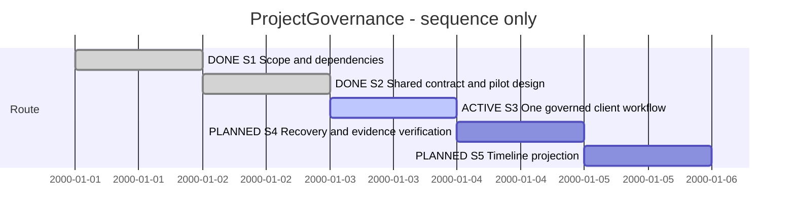

# Session 0007 — ProjectGovernance

## Session roadmap

Latest recorded turn: T009 — explicit MCP approval/report verified; PGI3 remains open. S3 is active
under PLAN-SDP-0018; PGI1 core/CLI and PGI2 adapters are verified at their bounded levels.
The app-server client and complete participating capabilities remain unfinished.
Sequence only; synthetic dates represent order, not estimates or elapsed time.

| State | Step | Work | Prerequisite / authority | Outcome / evidence |
| --- | --- | --- | --- | --- |
| completed | S1 | Recover skills, studies, card dependencies and ownership | Owner request, 2026-10-03 | Assessment below; RGS2 reused |
| completed | S2 | Design the smallest common routing, run, Session and client contract | Owner continuation, T002 | [PGD1 / PLAN-SDP-0017](../04--Design/SDPTool/ProjectGovernance/Plan.md), contract, acceptance cases and protocol inspection |
| active | S3 | Deliver one end-to-end workflow through SDPTool and the Codex client | S2 complete; [PLAN-SDP-0018](../05--Implementation/SDPTool/ProjectGovernance/Plan.md) active | PGI1/PGI2 delivered; PGI3-C3 live approval/report verified; reattachment/provenance gaps open |
| planned | S4 | Verify interruption, resume, scope change and evidence disposition | S3 candidate | Evidence required before wider use |
| planned | S5 | Project recorded activity into the KB043 timeline | Reliable S3/S4 capture and selected rendering scope | Full timeline remains deferred |

| Field | Value |
| --- | --- |
| Session reference | SESSION-SDP-0007 |
| Status | active |
| Primary card | [KB-SDP-038](../KanBan/active/%23038--Proposal--Codex-app-server-development-client.md) |
| Snapshot date | 2026-10-08 |
| Current step | S3 / PGI1-M1 and PGI2-M1 delivered; PGI3 in progress |
| Proposed next step | PGI3 executing-turn reattachment and applicable role/provenance evidence |
| Execution authority | T003/T004 select and resume PGI1; T006 selects PGI2; T007 selects PGI3; T008 resumes it with restored Git access; T009 selects explicit approval interaction |

## Goal and ownership

Owner definition, summarized from the current prompt: ProjectGovernance covers
method, methodology and tools that keep collaboration between the owner and Codex
agents organized. KB036, KB037, KB038, KB042 and KB043 belong to this workstream.
Retain the existing ProjectGovernance ecosystem; its name does not require one
monolithic binary or a second process tree.

The owner reports another agent is handling ModelGovernance. That workstream owns
model artifacts, identities, checkpoints, merge and promotion, as described in its
[current design](../04--Design/SDPTool/ModelGovernance/Design.md) and
[Session 0006](session-%230006--Model_governance.md). ProjectGovernance owns work
selection, collaboration, routine applicability, work progress and disposition.
It references model identities and evidence when relevant; a successful model
operation does not automatically complete an assignment or establish owner approval.
No ModelGovernance files or contracts are changed by this turn.

## Affected cards

Snapshot: 2026-10-08. Only KB038 is active for the selected increment; other
capability cards retain their broader backlog scope.
No card is merged, split or closed merely to group this workstream.

| Card | Role | Initial lifecycle / CardState | Planned outcome in this route | Current snapshot | Actual final |
| --- | --- | --- | --- | --- | --- |
| [KB038](../KanBan/active/%23038--Proposal--Codex-app-server-development-client.md) | Primary client and execution integration | backlog / backlog | One usable governed workflow | active / in-progress | PGI1/PGI2 delivered; PGI3 in progress |
| [KB036](../KanBan/backlog/%23036--Proposal--Request-routines-and-process-control.md) | Request classification and routine selection | backlog / backlog | Small shared entry contract exercised by pilot | backlog / backlog | Pending; broader coverage retained |
| [KB037](../KanBan/backlog/%23037--Proposal--Observable-routine-state-machine.md) | Durable run state, transitions and observation | backlog / backlog | Minimum run/recovery core | backlog / backlog | Pending; full observer retained |
| [KB042](../KanBan/backlog/%23042--Proposal--Goal-oriented-sessions-and-roadmaps.md) | Session identity, roadmap and turn history | backlog / backlog | Capture/correlation beyond existing manual format | backlog / backlog | Pending |
| [KB043](../KanBan/backlog/%23043--Proposal--Event-derived-session-timelines.md) | Derived timeline | backlog / backlog | Later projection of observed events | backlog / backlog | Pending |

## Plan register

| Ref | Plan / record | Document readiness | Canonical lifecycle | Role |
| --- | --- | --- | --- | --- |
| P0 | [PLAN-SDP-0007](../02--Requirements/RoutineGovernance/StudyPlan.md) | completed | completed | Reused RGS2 study; not reopened |
| P1 | [PLAN-SDP-0017](../04--Design/SDPTool/ProjectGovernance/Plan.md) | completed | completed | S2 contract, inspection and implementation handoff |
| P2 | [PLAN-SDP-0018](../05--Implementation/SDPTool/ProjectGovernance/Plan.md) | in progress | active | PGI1/PGI2 delivered; PGI3 in progress, PGI4/PGI5 planned |

## Dependency assessment and recommended first delivery

T001 assessment retained below. T002 delivers the shared design and handoff linked
in the plan register; remaining runtime acceptance belongs to PGI.

Reuse the completed [RGS2 synthesis](../02--Requirements/RoutineGovernance/Synthesis.md).
KB036 should precede client behavior at the contract level, but finishing all of
KB036 before starting KB038 is unnecessary. Machine-supported routing benefits
from the client-owned submission boundary in KB038; durable transition validation
belongs to KB037's SDPTool core. These responsibilities are complementary.

1. Define a minimum KB036 contract: classify an incoming request, reuse applicable
   work and authorization, select a versioned routine, and expose missing coverage.
   Reassess steering inputs that change scope. A status question should remain easy.
2. Define the KB037/KB042 identities and ownership together: project/checkout,
   Session/step, request, routine version/run, assignment/attempt, candidate and
   evidence, mapped to Codex thread/turn/item IDs. Pin state transitions, revision
   checks, retry handling and interruption/reconciliation. Keep ProjectManagement
   lifecycle and Traceability evidence authoritative; no rival history store.
3. Exercise that contract through a minimal KB038 client and the shared SDPTool
   core, using an adapter boundary for agent operations. Start with one controller,
   a simple status view, and one bounded Maintenance workflow. Preserve existing
   role responsibilities; choose and test actual delegation/context behavior in
   the pilot. This discussion does not request spawning agents now.
4. Capture real turn/item/activity identity and timestamps from the beginning, with
   explicit unknowns, then build KB043's richer timeline after reliable capture.
   Do not infer elapsed activity or routine compliance from a message or file alone.

First workflow acceptance proposal: owner request -> visible routing/work coverage
-> bounded assignment -> actual execution observations -> evidence/review disposition
-> durable Session result. Include a status-only request, a scope-changing input,
an interrupted/resumed attempt, repeated delivery, and stale candidate evidence.
Codex completion, tool success, independent review and owner acceptance stay distinct.

The manual Session format is already adopted; Session discovery/browsing also has
existing implementation and tests in SDPTool. These are starting assets, not proof
of an automated Session recorder or routine engine. Full KB040 KanBanTUI, KB020
source migration, KB050 semantic blueprints and ModelGovernance completion are not
prerequisites for this proposed pilot. Use explicit task/context/evidence references
first; integrate richer model references through the other workstream's contract.
KB014 distribution/versioning becomes relevant to broader installation, rather
than blocking an isolated local pilot.

## Route changes and decisions

| Date / turn | Change | Authority and consequence |
| --- | --- | --- |
| 2026-10-03 / T001 | Start ProjectGovernance assessment from KB038; group KB036/037/042/043 | Owner direction; preserve separate card responsibility |
| 2026-10-03 / T001 | Retain ModelGovernance as a separately progressing workstream | Owner reports another agent; inspect its contract without edits |
| 2026-10-03 / T001 | Minimum shared contract first, then one client workflow; richer timeline later | Agent recommendation, not an approved full implementation sequence |

| 2026-10-03 / T002 | Owner continues S2; PGD1 delivers contract and planned PGI handoff | Observed owner continuation; implementation not started |
| 2026-10-06 / T003 | Owner continues with PGI1-M1 | Active PLAN-SDP-0018; core/CLI only |
| 2026-10-06 / T004 | Owner resumes interrupted work; PGI1 delivered | PGI2 next; original Git metadata remains read-only |

## Turn journal

### T001 — 2026-10-03: scope, skills and dependencies

- Capture mode: manual owner-input and work summaries. Host thread/turn/item IDs
  and exact prompt timing are unknown. Local T001 is not a host identifier.
- Owner input summary: read AGENTS and SDP skills, prepare for backlog work,
  prioritize KB038, assess whether KB036 should precede it and where KB042/043
  belong. Define ProjectGovernance as methodology/tooling for owner-agent
  collaboration; another agent owns ModelGovernance.
- Category: orientation, dependency analysis and architecture/planning discussion.
- Skills loaded (agent-reported): sdp 1.1.1, sdp-change-analysis 1.0.0,
  sdp-architect 2.0.0, sdp-planning 1.0.0, sdp-traceability 2.0.0, and OpenAI Docs
  (no skill version declared). Shared workflow, authority source map and planning
  contract read. No routine-run ID or runtime-enforcement evidence exists.
- Skills authority: root Skills is maintained; .agents/skills provides discovery;
  historical SDP/History skills are not the active collection.
- Steps touched: S1 completed; S2 named next. Reused existing studies and inspected
  relevant cards, ecosystem boundaries, ModelGovernance design and Session tests.
- External evidence: [official app-server documentation](https://learn.chatgpt.com/docs/app-server),
  accessed 2026-10-03, documents thread/turn/item operations and version-specific
  schema generation. This supports the proposed capture boundary. It does not
  verify the locally installed protocol, account access or the proposed pilot.
- Work summary, not a captured final response: recommend a small KB036/037/042
  contract feeding the KB038 pilot, retaining KB043 as a later projection. Record
  owner-defined ProjectGovernance scope and independent ModelGovernance ownership.
- Validation: `python3 SDP/ProjectManagement/validate.py` passed after the card
  update and EVT-KB-SDP-000286: 61 cards, 35 management records, four lineage
  operations and 474 events. `git diff --check` passed. Product code/tests are unchanged.
- Remaining work: S2 must settle concrete operation/storage contracts, supported
  Codex compatibility and the bounded implementation sequence. No new model turn,
  account configuration, application implementation, merge or release performed.

### T002 — 2026-10-03: shared design and bounded implementation handoff

- Capture mode: manual journal; host thread/turn/item identifiers and exact prompt
  time unknown. Exact owner input: “ok fortsett” (verbatim Norwegian quotation).
- Category: continuation of selected S2 planning/design. Reused SDP 1.1.1,
  planning 1.0.0, architect 2.0.0, change-analysis 1.0.0, traceability 2.0.0 and
  OpenAI Docs instructions already loaded in T001; read relevant plan template,
  schemas, code and current records. Agent-reported routine use; no runtime run ID.
- S2 outcome: PLAN-SDP-0017 delivered Design.md, 18 mapped acceptance scenarios,
  offline codex-cli 0.160.0 default-schema inspection (314 files) and the planned
  PLAN-SDP-0018 handoff. Its first milestone is a bounded core/CLI fixture; later
  phases cover adapters, owner workflow, evidence reconciliation and integrated review.
- Decisions/recommendations: shared SDPTool Go core; one local controller and simple
  terminal interface; private durable operational state referencing canonical project
  records; checked recoverable document publication; actual native child/reviewer
  provenance required. These are design choices for the pilot, not observed runtime.
- KB038 was active/in-progress during PGD1 and returned to backlog after design
  delivery, now linked to the planned implementation. KB036/037/042/043 remain
  backlog with reciprocal design/Session references and preserved broader scope.
- The other agent committed ModelGovernance MG2 during this turn. Its files and
  committed ledger bytes were preserved. Only this workstream's unpublished KanBan
  event IDs were reallocated above the committed counter, and its draft events
  appended after the committed prefix before delivery. No frozen history rewritten.
- Work summary, not a captured final response: design and implementation sequence
  ready; no application implementation, account operation, model turn, release or
  independent product review claimed. Traceability records the design separately
  from management transitions. Validation results are in PGD1 Evidence.md.
- Next: S3 / PGI1-M1 under PLAN-SDP-0018. Establish an isolated implementation
  checkout and a compatible Go toolchain, then execute the core slice when selected.

### T003 — 2026-10-06: PGI1 implementation, interrupted

- Late registration: reconstructed from the retained work/tool summary after an
  intentional turn interruption. Exact owner continuation: “ok fortsett” (verbatim
  Norwegian). Host identifiers and exact prompt/interrupt times are unknown.
- Loaded/reused routines: SDP entrypoint and shared workflow; Master 2.0.0,
  Worker 2.0.0 and Verifier 2.0.0, plus current planning/design/traceability context.
  These are agent-reported skill use, not a measured runtime routine execution.
- Owner input selected the next bounded PGI1-M1 core increment, not the later live
  client integration. PLAN-SDP-0018 and KB038 activated through EVT-PM-SDP-000143
  and EVT-KB-SDP-000304. ModelGovernance delivery was already committed at 043c59c.
- Original Git metadata was read-only in the host sandbox. Created an independent
  clone under /tmp from 043c59c on sdp/project-governance-pilot; did not switch the
  shared worktree or alter its unrelated files. Go 1.27.1 found in the local SDP
  toolchain; caches isolated under /tmp.
- Work summary: implemented shared core/CLI, immutable state generations,
  receipts, revision guards, strict inputs and initial tests. Core tests passed
  before canonical ledger coverage was added. The interruption left that new
  coverage change and CLI/schema verification unfinished; no milestone delivery
  or independent review was claimed.

### T004 — 2026-10-06: resume and verify PGI1

- Capture mode: manual owner-input/work summary. Exact owner input: “prøv igjen
  nå” (verbatim Norwegian). No invented host IDs or exact prompt timing.
- Recovered T003 artifacts, current Session, plan and Git status. Reused SDP,
  Master/Worker/Verifier and existing design/planning/traceability instructions.
  Original Git metadata remains read-only. An unrelated Session0006 edit appeared
  in the shared worktree; it stays outside this delivery.
- Direct implementation continues under the host's delegation restriction; no
  sub-agent or independent-review result is claimed. Fixed the interrupted ledger
  change's compile error, added compiled CLI workflow and exact wire schemas,
  rejected JSON field case aliases and preserved full fixture project bytes.
- S3/PGI1-M1 delivered. Full SDPTool race suite, vet and 21 captured wire cases
  pass with Go 1.27.1. The first broad test failed because default runtime/cache
  directories were read-only; temporary XDG directories resolved the environment
  failure without changing tests. Core checks include canonical record conflicts,
  source drift, retry/CAS, lock contention and injected HEAD publication failures.
- Work summary: core and compiled CLI are ready for adapter work. No live Codex
  execution, automatic journal, completed-work gate, release or independent review
  is claimed. This entry summarizes actual work; it is not a captured final reply.
  Exact candidate/commands and limitations are in PGI1 Evidence-PGI1.md.
- Handoff: KB038 changes in-progress -> ready with EVT-KB-SDP-000305. The plan stays
  active, S3 continues with PGI2; KB036/037/042/043 retain separate backlog scope.
  The milestone commit lives in the isolated clone; verified changes are returned
  to the original worktree as uncommitted files, preserving its branch/Git metadata
  and the unrelated Session0006/sourceinput/npm changes. No push or merge.
- Backlog/dependency review: PGI2 adapters are the next bounded milestone. No new
  prerequisite from ModelGovernance or KB050/KB040 is introduced. Full host recovery,
  candidate-bound publication and independent review remain PGI2–PGI5 obligations.

### T005 — 2026-10-07: implementation status and goal distinction

- Capture: manual work summary; host thread/turn/item IDs and exact prompt time
  unknown. Owner input summary: asks how ProjectGovernance implementation is going
  after the separate SDL Go familiarization Session was closed.
- Request category: status-only; no new implementation phase is selected here.
  Skills/routines reused: SDP 1.1.1 entrypoint, document workflow and mandatory
  Session upkeep. No automatic routine-run identity or enforcement is claimed.
- Recovered Session0007, PLAN-SDP-0018, KB038, PGI1 evidence and candidate manifest.
  Verified all 19 recorded PGI1 candidate files still match their SHA-256 identities
  in the shared worktree. The isolated clone retains milestone commit `d3e457b`.
  Existing recorded race/vet/21-wire-case results were inspected, not rerun.
  Hash agreement for this subset does not validate concurrent changes elsewhere.
- Current outcome: PGI1-M1 core/CLI delivered; PGI2–PGI5 remain planned/unstarted.
  KB038 remains active/ready, PLAN-SDP-0018 active and S3 unfinished. Source and
  evidence returned from the isolated clone are still uncommitted in the shared
  worktree; other agents' changes are preserved. The earlier read-only Git limit
  describes the PGI1 host, not a newly verified current blocker.
- Clarification: Session0009 closed only SDL code familiarization, PATH repair
  and its test baseline; it did not complete or advance ProjectGovernance.
  The implemented core does not yet supply the live client, automatic Session
  journal, evidence completion gate or independent integrated review.
- Next step remains PGI2-M1: thin MCP/controller adapters and actual protocol
  negotiation. No implementation, card transition, merge or release performed
  during this status turn. This entry is a work summary, not a captured final reply.

### T006 — 2026-10-07: resume adapters and protocol negotiation

Owner input summary: resume Session0007, and explain Session0008. The latter is
semantic-blueprint design (BP2-B delivered; BP2-C next), not this implementation.
Skills loaded/reused: SDP, Master, Worker, Planning, Verifier, document workflow;
OpenAI Docs for the app-server boundary. Work directly under current host rules;
no independent review or native child execution is claimed. Unknown host IDs and
exact prompt times remain unknown. Manual work summary, not final-response capture.

PGI2-M1 selected; KB038 in-progress. Reuse the clean isolated clone and retain
PGI1 core/CLI behavior. Inspect installed Codex 0.160.1, pin the MCP Go SDK, prove
real negotiation, implement scoped adapters and bounded replay/reconciliation.
No model turn, account reconfiguration, independent review, publication or release
is selected by this increment.

Work outcome: PGI2-M1 delivered. Shared-core MCP tools restrict launch-bound agent
rights, while the controller protocol adapter pins Codex 0.160.1, MCP SDK v1.8.0
and protocol 2025-11-25. The actual rebuilt probe observes ChatGPT account mode
and discovers three MCP tools in an idle ephemeral thread, without submitting a
model turn. Durable attempt mappings, bounded visible observations, replay/CAS,
byte/count paging and conservative epoch/history reconciliation have fixture tests.
A disconnected attempt cannot be revived by an observation before reconciliation.
Full isolated SDPTool race tests and vet pass, as do 21 CLI and three host/core wire
schema captures. Earlier fixture/import failures and exact candidate scope are
recorded in [PGI2 evidence](../05--Implementation/SDPTool/ProjectGovernance/Evidence-PGI2.md).
Traceability skill reused for delivery links; no independent reviewer was invoked.
Management/Toolkit validators pass in both checkouts after correcting a misplaced
verification YAML block. All 22 candidate files match on return; adapter race tests
also pass in the shared workspace, without claiming its unrelated changes fully
regression-tested. Ledger byte prefixes and new document links are preserved.

S3 remains active; KB038 returns to ready for PGI3. The isolated milestone commit
and returned source changes preserve concurrent shared work. Full owner execution,
controller-loop recovery, automatic project publication and independent integrated
verification remain PGI3–PGI5. No full Session-goal completion is claimed.

Session0008 is the separate semantic-blueprint workstream: NOW/TARGET change,
affected context and preserved obligations. During this turn its journal advanced
to BP2-C delivered with an independent authored-model trial and planned successor
PLAN-SDP-0020. BPI1 Go analyzer selection is next there; BP2-A's particular pilot
still awaits owner feedback. Its journal and implementation are not changed here.

Next step: PGI3-M1, preserving the above runtime/evidence gaps. This is a manual
work summary, not an automatically captured final response.

### T007 — 2026-10-07: continue owner workflow

Owner input summary: continue. Manual work summary, not host transcript or final
response capture; host thread/turn/item identities are unknown. Recovered committed
PGI2 12542b2 and shared Session/plan. Skills reused: SDP, Master, Worker, Planning,
Verifier and document workflow; OpenAI Docs for local pinned protocol inspection.
PGI3 selected; direct implementation preserves current delegation restrictions.
The host now allows writes only beneath SDL and /tmp. All PGI3 code and Session,
card, plan and evidence updates remain together in the isolated clone; no shared
publication or network/model execution is claimed.

Work summary: PGI3-M1-C1 implements controller-only durable input, pre-send claim,
managed-account/scoped-MCP guards, fresh bounded Master turn submission, line-oriented
steering/interrupt/scope-stop, observer status and conservative history recovery.
A lost acknowledgment cannot trigger automatic resubmission. Input/source identities,
Session and project bytes survive the fixture journey and restart. Closing output
observers does not terminate the controller. No automatic project publication occurs.
The final isolated full race suite, vet, 28 application wire cases and four captured
app-server request schemas pass. Tests use recorded fake host processes, not a model.
Traceability skill was reused for checkpoint evidence; no independent reviewer ran.
Management validation (61 cards, 38 records, 509 events), Toolkit, candidate hashes,
new document links, ledger-prefix preservation and whitespace checks pass.

Actual rebuilt probe: Codex 0.160.1 exits with connection-ended EOF before initialize
completes. A filtered direct startup check exits 1 with no protocol output and
matches read-only-filesystem errors; no raw host logs or account data are retained.
The exact failing path remains unknown. No live model turn was
started and no permission bypass attempted. PGI3 remains in progress, including
live useful-task/steering/recovery evidence and unresolved ambiguous-send handling.
Native children are not granted under the current host delegation restriction.

The checkpoint commit, [evidence](../05--Implementation/SDPTool/ProjectGovernance/Evidence-PGI3-C1.md)
and this journal remain in the isolated clone. Shared Session0007 still ends at T006;
its PGI3 projection cannot be updated under the current filesystem permissions.
Future return must preserve current shared preimages and ledger history. S3 stays
active; next: establish a permitted app-server connection, perform the bounded live
workflow and address any measured recovery/provenance gaps. This is a work summary,
not a captured final answer or completed Session goal.

### T008 — 2026-10-07: recover Git and continue the actual PGI3 checkpoint

Owner input summary: Git access is now available; continue following the plan.
Recovered shared T006 and the newer isolated T007/PGI3-C1 checkpoint rather than
repeating PGI2. The original conversation's PGI1 summary was stale. Imported PGI1,
PGI2 and PGI3-C1 commits into the repository's ProjectGovernance branch and created
a persistent worktree at /home/warloc/git/SDP-project-governance. Other agents' dirty
SDUI/blueprint and shared-management changes remain untouched in the shared worktree.
Skills reused: SDP, Master, Worker, Planning, Verifier, Architect, Traceability,
document workflow and OpenAI Docs. Architect recorded the measured correlation
refinement before Worker implementation; no independent reviewer was invoked.

Work summary, continued through 2026-10-08: Codex 0.161.0 initialized with managed
ChatGPT mode and discovered the scoped MCP tools. A real disposable Maintenance
turn fixed Unicode boundary trimming, added eight tests and received in-scope
steering. Only the two authorized source/test files changed. The driver reran Go
tests successfully. Closing the actual output observer did not stop execution;
interrupt/recovery retained the run and Session, and explicit resume completed a
new attempt in a new thread. These are test-driver scenarios under the selected
PGI3 scope, not additional verbatim owner requests.

A proxy dropped the real turn/start response after forwarding the request. The
controller retained uncertain input. Recovery matched a unique recorded clientId
and exact payload in the mapped thread, persisted the observation and acknowledged
the input without starting another turn. Missing, conflicting or duplicate proof
still refuses. Completely unmapped creation and incomplete active history remain
open. The core preserves historical host versions and cannot silently relabel an
existing attempt.

Actual MCP run_read succeeded; run_transition failed with `MCP tool call requires
approval, but approval policy is never`. That host result is retained in sanitized
evidence. The owner was asked to choose explicit request approval or continued
visible refusal; no answer has been received. Policy remains unchanged. Host
completion does not grant routine completion or acceptance. No native child or
independent review is claimed, and no report was forced through another route.

Full SDPTool race tests, vet, 28 application wire cases and four actual-version
host request schemas pass. Management/Toolkit validation passes after correcting a misplaced verification
relation caught by the validator. Final outputs,
source identities and scenario boundaries are recorded in
[PGI3-C2 evidence](../05--Implementation/SDPTool/ProjectGovernance/Evidence-PGI3-C2.md).
The checkpoint is committed on the persistent ProjectGovernance branch; no merge,
push or release is selected. Private C1 management event IDs collide with later
shared records and must be reconciled before integration; neither history was
rewritten. Backlog review retains broader KB036/037/042/043 scope and the separate
ModelGovernance and blueprint workstreams.

S3 and KB038 remain in progress because PGI3 has unfinished runtime obligations.
Next: resolve the concrete approval interaction, then executing-turn reattachment
and applicable role/provenance evidence; PGI4/PGI5 remain planned. This is a manual
work summary, not a captured final response. Current conversation host IDs and
exact owner input timing are unknown.

### T009 — 2026-10-08: continue explicit approval interaction

Owner input summary: continue after C2 and its explicit per-request approval
recommendation. Selected PGI3-C3 within PLAN-SDP-0018; this selects implementation
and disposable verification, not acceptance of arbitrary runtime requests.
Recovered clean commit 37a09a6 in the persistent worktree. Skills reused: SDP,
Master, Architect, Worker, Planning, Verifier, document workflow and OpenAI Docs.
Measured the installed host's actual MCP form request before implementation;
recorded the bounded interaction and revision consequence in the design.
Architect recorded the bounded request binding, no permanent grant and exact
approved-call revision rule before Worker implementation. Verifier distinguishes
fixture tests, real protocol inspection and actual model execution; Traceability
is reused for the checkpoint links. No independent review is claimed.

Work summary: C3 implements opt-in per-request accept/decline/cancel with exact
stdin capture and observed closure. The real host rejected granular policy without
experimental API; the final path uses stable on-request with user review and rejects
unsupported requests. An initial live report reached verifying but its controller
failed on competing core writes. Bounded pre-mutation contention retries fixed this
without repeating any host send. Both failed trials remain explicit evidence.

The final actual trial completed one bounded Maintenance task, presented the exact
MCP report, recorded the test-driver acceptance, observed request closure and
advanced the routine to verifying. Excluded fixture files stayed identical and the
driver reran Go tests successfully. The test-driver decision is not a verbatim
owner reply or completed-work acceptance. Final affected package race tests,
compiled core CLI, vet and application/protocol schemas pass. Broad regression
started before the final policy/contention corrections; its historical boundary is
kept distinct from final affected-code verification. It also passes. Final
management/Toolkit, source identity, ledger-prefix and Markdown-link checks pass.
The actual mapped host history confirms one successful run_transition with no
error. The checkpoint is committed on the persistent branch; no shared integration
is claimed. See
[C3 evidence](../05--Implementation/SDPTool/ProjectGovernance/Evidence-PGI3-C3.md).

S3 and KB038 remain in progress for executing-turn reattachment and applicable
role/provenance evidence. Lost approval closure remains uncertain rather than
being resent. PGI4/PGI5 remain planned. The persistent worktree keeps all records
and the checkpoint together; shared work, historical ledger bytes and earlier
unintegrated event-ID collisions are preserved. No merge/push/release is selected.
This is a manual work summary, not a captured final answer.
Manual summary; current conversation host IDs/timestamps are not available.

## Closeout

The Session remains active. S1/S2 are complete; S3 includes delivered PGI1 core/CLI
and PGI2 adapters. PGI3-C3 verifies explicit approval/reporting alongside C2 live workflow and mapped
lost-response recovery. Executing-turn reattachment and applicable provenance
obligations keep PGI3 open. PGI4/PGI5 and wider capability closure remain planned.
