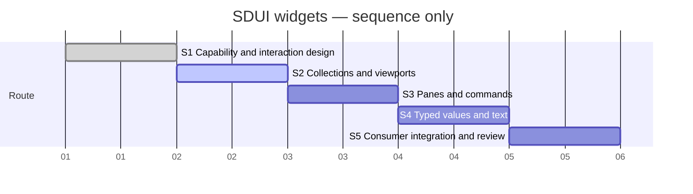

# Session — SDUI widget inventory

## Session roadmap

Latest recorded turn: T002. Current work: S2. Next: review the WCI1 collection/viewport
implementation and native acceptance after completed WCD1 and WCI0. Diagram is **sequence only**, using synthetic equal
slots; it is not a delivery schedule or measured timeline.

| State | Step | Work and linked plan milestone | Prerequisites | Authorization | Completion evidence / outcome |
| --- | --- | --- | --- | --- | --- |
| completed | S1 | PLAN-SDP-0021 WCD1 and PLAN-SDP-0022 WCI0 | Existing gap study and inventory | Owner T001 | WCD1 independently reviewed and complete; WCI0 verified and independently reviewed |
| on-going | S2 | PLAN-SDP-0022 WCI1 | S1 | Owner T001 full card | pending |
| planned | S3 | PLAN-SDP-0022 WCI2 | S2 pilot evidence | Owner T001 full card | pending |
| planned | S4 | PLAN-SDP-0022 WCI3 | Shared contracts from S1–S3 | Owner T001 full card | pending |
| planned | S5 | PLAN-SDP-0022 WCI4 | S2–S4 | Owner T001; publication unselected | pending |

| Field | Value |
| --- | --- |
| Session reference | SESSION-SDP-0010 |
| Status | active |
| Primary card | [KB-SDUI-003](../KanBan/active/%23003--SDUI--Proposal--Capabilities-and-navigation-pilot.md) |
| Snapshot date | 2026-10-07 owner request; actual ledger timestamps recorded separately |
| Current step | S2 |
| Proposed next step | S2 WCI1 integration, native evidence and independent review |
| Execution authority | Owner T001 requests taking the card's work |

## Goal

Deliver the complete KB-SDUI-003 widget inventory in staged runnable slices,
with truthful profile/capability checks, native Fyne behavior, typed SDL binding,
exports and consumer distribution preparation. No full XFMD rewrite, FOX bridge,
rich editor, upstream publication or merge is selected. Preserve original 0.2 and
XM-M2 evidence. Rich optional research retains its existing disposition.

## Affected cards

| Card | Role | Initial lifecycle / CardState | Planned final disposition | Current snapshot | Actual final disposition |
| --- | --- | --- | --- | --- | --- |
| KB-SDUI-003 | Primary | backlog / backlog at T001 | All inventory delivered, verified and reviewed | active / in-progress | pending |
| KB-SDUI-005 | Context-only dependency | active / gate-review in producer record | Retain separate preview ownership | Existing dirty producer changes preserved | Not disposed here |
| KB-SDUI-004 | Context-only | backlog | Separate glyph/wrapping fidelity work | backlog | Not disposed here |

## Plan register

| Local ref | Plan type and document | Document readiness | Canonical plan lifecycle | Depends on | Outcome / evidence |
| --- | --- | --- | --- | --- | --- |
| P1 | [PLAN-SDP-0021 DesignPlan](../04--Design/SDUI/Widgets/Plan.md) | completed | completed | PLAN-SDP-0009 research | Independently reviewed design and per-family acceptance |
| P2 | [PLAN-SDP-0022 ImplementationPlan](../05--Implementation/SDUI/Widgets/Plan.md) | on-going | active | P1, staged elaboration | WCI0 delivered; WCI1 stage design active |

## Route changes and decisions

| Date / turn | Previous route | Change and reason | Authority | Affected steps/cards |
| --- | --- | --- | --- | --- |
| T001 | Inventory only, execution unselected | Activate prerequisite design and staged full-card execution | Owner prompt below | S1–S5, KB-SDUI-003 |

## Turn journal

### T001 — take the widget work

- Capture mode: exact owner prompt below, manually recorded work summaries.
- Host thread/turn/item IDs and exact prompt time: unknown. Independent reviewer
  agent ID observed: `01a11854-523d-7c11-adf4-f622b19b68c6`.
- Request category: existing card execution. Routine run ID: unavailable; no
  claim of enforced routing. Skills loaded by coordinator: sdp 1.1.1,
  sdp-master 2.0.0, sdp-planning 1.0.0, sdp-architect 2.0.0, sdp-worker 2.0.0, sdp-traceability 2.0.0 and sdp-verifier 2.0.0.
  Paths: Skills/<name>/SKILL.md; loading is agent-reported. Reviewer separately
  reports sdp-reviewer use. Worker role is loaded for subsequent bounded execution.

Owner prompt, verbatim:

> kan du ta jobben som er beskrevet i kb-sdui-003?

Work summary (not an already captured final response): recovered the full revised
inventory, project contracts and relevant implementation. Intake HEAD `3d265d1`
has concurrent uncommitted governance and preview work; preserve those changes.
Created design/acceptance candidate, staged implementation plan and this Session.
Activated the card through management history. All widget delivery remains pending.
Independent initial inspection identifies typed item identity, atomic preparation,
explicit prototype/connected distinction and restricted SDL action types as design
requirements. Actual document review follows that inspection.

WCD1 update: independent document review identified three blockers; all were
resolved and the same independent reviewer approved bounded design completion.
[Evidence](../04--Design/SDUI/Widgets/Evidence.md) records the dispositions.
The management validator passed with 528 events; all local links in eight new or
moved documents resolved. This is design/record evidence, not widget delivery.

WCI0 implementation started in `/tmp/sdp-sdui-widgets`, branch
`sdui/widgets-wci0`, dependency baseline `00b105a`. The KB005 input snapshot has
an explicit hash manifest and its own dependency commit. Worker agent
`01a1185a-ed19-7793-989c-52fbe15b1f9d` implements only Preparation.md's detached
capability/admission boundary. Full native publication remains WCI1. No shared
branch switch or unrelated governance change is part of this work.

Remaining work and next step: inspect and verify the WCI0 candidate, then obtain
independent implementation review. Later grammar/native slices remain explicit
implementation obligations.

### T002 — 2026-10-08, continuation after permission interruption

- Owner prompt, verbatim: “ok fortsett”. The preceding access question was answered
  from the observed unrestricted environment; it did not change product scope.
- Capture: manually recorded work summary. Host thread/turn/item IDs and exact
  prompt times remain unknown. Routine run ID unavailable.
- Recovered Session0010 and reused sdp/master, planning, architect, worker,
  traceability and verifier routines loaded in T001; re-read sdp/master entries.
- T001 interruption correction: the scoped design patch reached the index, but
  its commit permission request was interrupted. Verified HEAD and index before
  continuing; committed WCD1 as `eae0149` without unrelated staged changes.
- WCI0 independent reviewer approved the exact inventoried candidate and reran
  targeted race/bridge tests. Coordinator inspected actual diffs, compared target
  baselines and copied ten reviewed implementation/test files into the shared tree.
  Phase commit `fac09f2` on `sdui/widgets-wci0` retains dependency `00b105a`.
- Full SDUI race tests and bounded SDL bridge/runtime checks pass. An unchanged SDL
  generated-constructor baseline mismatch is explicitly registered as a WCI1
  prerequisite investigation; no all-SDL-suite pass is claimed.
- Steps: S1 complete at its bounded level; S2 stage design started. Architect agent
  `01a11878-3e2d-7c32-98fb-69bee87297a4` owns only Collections.md. Worker investigates
  constructor mismatch read-only. All widget families remain pending.
- WCI1-P0 correction: worker identified stale generated constructors after KB005,
  regenerated through sdl-gen and added a compiled reuse/provenance regression.
  SDL codegen/bridge and SDUI codegen pass. Phase branch `sdui/widgets-wci1`
  starts with prerequisite commit `d1c5c88`; exact files integrated after baseline
  comparison. No frozen fixture or historical evidence was altered.
- WCI1 stage contract independently approved after correcting canceled/failed-load
  keyboard recovery and pruning mandatory SVG snapshots/general scene/custom row
  drawing. Export rejection remains explicit; all required interaction stays in scope.
- WCI1 implementation lanes in the isolated clone: frontend/export Dalton,
  runtime James (`01a11887-3b3f-7d11-9501-8c00902b9bdf`), layout Gibbs
  (`01a11887-8d55-74f3-bd58-7c6ea563b28e`), native/preparation/bridge Noether.
  Exclusive file ownership and an early shared API memo govern integration.
- Native tooling smoke: actual X11 click and Tab+space each reached the Fyne
  desktop driver, using separate Xvfb :189 and XDG area. This proves the input
  route only, not collection acceptance; see native/README in WCI1 evidence area.
- Work summary, not captured final response: WCI1 code, integration and native
  verification are ongoing; full inventory and no release/merge authority retained.

## Closeout

Open. No widget, plan, card or Session completion is inferred from intake/design.
