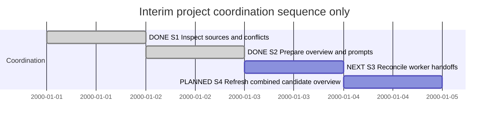

# Session 0012 — Interim project coordination

## Session roadmap

Latest local turn: T001, 10 October 2026. Initial overview and prompts delivered as local coordination artifacts; worker handoffs have not been sent. Sequence only; synthetic dates are not estimates.

| State | Step | Outcome | Authority and evidence |
| --- | --- | --- | --- |
| completed | S1 | Recover last main merge, current workstreams and concrete integration risks | Owner request; [snapshot](../ProjectManagement/Coordination/evidence/snapshot-2026-10-10.json) |
| completed | S2 | Durable overview and copyable assignments/report format | Owner request; [overview](../ProjectManagement/Coordination/Overview.md), [prompts](../ProjectManagement/Coordination/Prompts.md) |
| next | S3 | Receive/inspect worker handoffs and establish the actual integration allocation | Prompts prepared; delivery/acceptance is not inferred |
| planned | S4 | Refresh the grand overview against the combined candidate and actual outcomes | Fresh source/worker evidence required |

| Field | Value |
| --- | --- |
| Session reference | SESSION-SDP-0012, manual identity checked across known SDP worktrees before creation |
| Status | active |
| Primary coordination context | KB-SDP-052 Project Leader and SAD orchestration, owned by PG Session0007; this Session does not change its runtime lifecycle |
| Snapshot date | 2026-10-10 |
| Current step | S3 |
| Proposed next step | Owner sends the bounded integrator/cooperating prompts, then coordinator refreshes durable handoffs |
| Execution authority | Owner explicitly requests temporary Project Leader/Steering assistance, recent-work inspection and prompts; no main merge or product implementation requested |
| BranchPolicy | current, isolated sdp/interim-governance-overview from verified origin/main |
| CommitPolicy | milestone; coordination documents only |

## Goal and boundaries

Help the owner recover an accurate cross-workstream overview while ProjectGovernance automation is unfinished. Coordinate through existing Sessions, plans, cards and revision-bound handoffs. Do not create a competing lifecycle ledger, impersonate owner acceptance, or claim background event capture. Implementation remains with the respective workers.

The primary context card is owned in the PG worktree:
file:///home/warloc/git/SDP-project-governance/SDP/KanBan/active/%23052--Change--Project-Leader-and-SAD-orchestration.md

This Session is a separate owner coordination goal, not a takeover or continuation of PG's implementation Session. No new card/plan/management event was allocated for this inspection. Existing work plans retain their authority and lifecycle.

## Affected work projections

| Work | Current observed disposition | Effect of this Session |
| --- | --- | --- |
| PG Session0007 / KB038/052 | Active; PGL1 delivered, PGL2 next | Coordination/report prompt only |
| Blueprint Session0008 / KB050 | Owner-paused; pilot acceptance pending | Pause preserved |
| Actions Session0011 / PLAN-SDP-0024 | Active coordination; ACT0 red, plan planned | Bounded integration assignment prepared, not sent |
| Widgets/release Session0010 | Selected work completed, including publication/upgrade | Current publication facts reconciled in overview |
| XFMD Session0005 | Owner-paused after local 0.8 installation | Pause preserved |
| XFMD Session0006 / KB030 | Active setup/inspection; card queued | Consumer/producer handoff prompt prepared |

## Turn journal

### T001 — 2026-10-10 initial coordination inventory

- Capture: manually summarized observed owner inputs and work outcome. Exact host thread/turn/item identifiers and initial prompt timestamp unavailable. No private reasoning or eventual final response is captured here.
- Owner input summary: act temporarily as both Project Leader and Steering assistant before PG/MCP tooling is ready; inspect recent parallel SDP-vNow and XFMD work since the last main merge; identify loose ends and merge risks; generate prompts and retain a foundation for later grand overviews.
- Additional owner input, verbatim Norwegian quotation: “det ser ut som du ble avbrutt. bare fortsett”. This resumes the same assignment without changing scope.
- Loaded routines, agent-reported: SDP entrypoint 1.1.1, planning 1.0.0, steering 1.0.0, Project Leader 1.0.0 from the newer Actions branch; document workflow, role contract, planning contract, Session routine and concurrent-work preflight. No observed routine-run ID or enforced runtime is claimed. Read Page-writing guidance for destination selection; repository documentation remains the established destination.
- Evidence: verified remote main at 04f88ff/PR52; inspected owning Sessions, branch history, dirty/staged/untracked status, PR/release state and installed extension inventory. Fresh committed merge forecasts yield 7/6/9 conflict paths; cross-worktree management history has 14 semantic event-ID collisions, plus card KB051 and Maintenance0015 subject collisions. Full exact inputs/outputs are retained in the snapshot.
- Freshness correction: release and Actions agents advanced during inspection. Initial release-pending and dirty-closeout observations were superseded by 3475367/48c919f/d5097b9 and Actions 732e85c; the latest snapshot and overview use these updated facts. No worker update was overwritten.
- Work summary: created an isolated coordination worktree, this Session, source-backed overview and four concrete agent prompts/common report format. Recommended the existing Actions/Blueprint agent as bounded integrator; this recommendation and prepared prompt do not mean the worker has received or accepted the assignment.
- Changes limited to new coordination documentation/evidence and this Session. No worker branch, index, product source, card state or canonical ledger was edited. No sub-agent was spawned, and no external message, main merge or release was performed.
- Verification: all relative and absolute local document links resolve; both JSON evidence files parse; forecast counts, event-collision count and PR ancestry agree with the retained evidence. Existing ProjectManagement validation passes with 62 cards, 41 management records, four lineage operations and 542 events on this main-derived documentation branch. These checks validate the coordination artifact, not the proposed combined product candidate.
- Next: S3 worker handoff/actual allocation, followed by a refreshed combined-candidate overview. Product integration must preserve source provenance and obtain a concrete disposition if current schemas cannot reconcile immutable history.

## Closeout

Initial inspection and prompt preparation are complete. The broader coordination goal remains active for later owner status requests and worker handoffs. Persisted snapshots are dated observations, not live monitoring.
