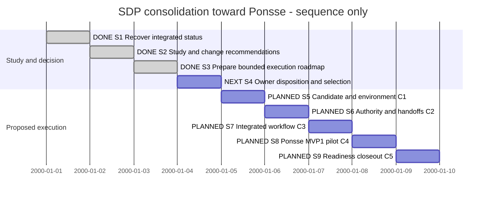

# Session 0013 — SDP consolidation and Ponsse readiness

## Session roadmap

Latest turn T001, 23 October 2026. Status study and proposed route delivered;
next is owner disposition of the readiness target. Sequence only; synthetic dates
are display slots, not estimates or promised durations.

| State | Step | Work / linked milestone | Prerequisite and authority | Completion evidence / outcome |
| --- | --- | --- | --- | --- |
| completed | S1 | Recover integrated source, records and owner correction; WR1-M1 | Owner study request; laptop handover confirmed | Snapshot, management/import checks; source and engine pins. |
| completed | S2 | Study status, boundaries and suspected duplication; WR1-M2 | S1; analysis authorized | Study findings F01–F08; no semantic duplicate implementation established. |
| completed | S3 | Propose consolidation and readiness sequence; WR1-M2 | S2; planning authorized | C1–C5 and alternatives in Study; execution is proposed. |
| next | S4 | Record owner disposition; WR1-M3 | Concrete study available for review | Pending: readiness target, one completion owner and selected route; preserve existing pauses. |
| planned | S5 | Reproduce candidate and selected engine; C1 | S4 selection, scoped preflight and appropriate execution plan | Pending: compatible toolchain, current engine identity, Go/race/vet and regression evidence. |
| planned | S6 | Consolidate authority, identity/state mapping and handoffs; C2 | S5 and bounded owning plans | Pending: current entrypoints; actual conflicts fixed or explicitly deferred. |
| planned | S7 | Integrated workflow trial; C3 | S6 and chosen manual/PG execution boundary | Pending: real candidate flow, drift/refusal/recovery and independent review evidence. |
| planned | S8 | Inspect actual Ponsse state and perform selected MVP1 pilot; C4 | S7, actual consuming-project access and scoped authority | Pending: real repository/profile/model facts and useful bounded MVP1 result. |
| planned | S9 | Close readiness round and hand back to MVP1; C5 | S8 evidence and actual disposition | Pending: accepted outcome, remaining cards and any separately authorized release/upgrade. |

| Field | Value |
| --- | --- |
| Session reference | SESSION-SDP-0013 |
| Status | active |
| Primary card | [KB-SDP-055](../KanBan/active/%23055--Study--SDP-consolidation-and-Ponsse-readiness.md) |
| Snapshot date | 2026-10-23 |
| Current step | S4; study and roadmap delivered |
| Proposed next step | Owner disposition of the proposed readiness target and route |
| Execution authority | Owner requests new Session, status study, proposed changes and Session plan; product execution not selected by this request |
| BranchPolicy | current; sdp/workstation-completion-assessment |
| CommitPolicy | milestone |

## Goal and scope

Establish a reliable status and a bounded path from the consolidated SDP project
to normal MVP1 work in Ponsse. The authorized current delivery is the study and
plan, including investigation of unclear or potentially duplicated implementation.
Execution steps S5–S9 are proposed future scope, not already authorized milestones.
Do not require all SDP backlog work to finish unless the owner selects that target.

The owner confirms complete laptop handover. No laptop recovery step is included.
Use integrated local sources; historical worktrees and old agent Sessions preserve
provenance but do not establish live ownership. This Session coordinates readiness;
existing PG/Blueprint/XFMD Sessions continue to own their scopes and pause decisions.

## Result entrypoints

- [Status study and recommendations](../Maintenance/WorkstationReadiness/Study.md).
- [WR1 MaintenancePlan](../Maintenance/WorkstationReadiness/Plan.md).
- [Candidate snapshot and check results](../Maintenance/WorkstationReadiness/evidence/snapshot-2026-10-23.json).
- [Predecessor coordination Session0012](session-%230012--Interim_project_coordination.md).

## Affected cards and plans

| Record | Role | Initial state | Current projection | Final disposition |
| --- | --- | --- | --- | --- |
| KB055 | Primary study/planning review | Absent | active / gate-review; concrete study delivered | Pending owner feedback; not a product implementation card. |
| MAINT-SDP-0017 | Authorized study/planning assignment | Absent | active; WR1-M1/M2 delivered, M3 next | Pending actual study disposition/handoff. |
| KB038 / KB052 / PLAN-SDP-0018 | PG context; retained implementation owner | active / in-progress | Unchanged; broader workflow and verification open | No takeover, cancellation or acceptance inferred. |
| KB050 / Session0008 | Blueprint pilot context | gate-review / owner-paused | Unchanged | Pilot feedback still required when resumed. |
| KB032 / XFMD Session0007 | Producer/consumer handoff context | active / on-going | Latest October 21 delivery inspected | Acceptance/resource/release residuals retained with owners. |

## Plan register

| Ref | Plan | Document readiness | Lifecycle | Outcome |
| --- | --- | --- | --- | --- |
| P1 | [MAINT-SDP-0017 — WR1](../Maintenance/WorkstationReadiness/Plan.md) | on-going | active | Study and roadmap delivered; disposition next. |
| P2 | C1–C5 execution ownership | planned; no IDs allocated | Not selected | Reuse existing plans where scope fits, select bounded successors where necessary after S4. |

The Session is the cross-work roadmap, not a second detailed implementation plan.

## Route changes and decisions

| Date / turn | Previous route | Change and reason | Authority | Affected steps |
| --- | --- | --- | --- | --- |
| 2026-10-23 / T001 | Session0012 recommended checking laptop residuals | Owner confirms complete handover; remove that dependency | Current owner correction | S1 and all execution prerequisites. |
| 2026-10-23 / T001 | Broad interim coordination | New goal-specific status study and readiness roadmap | Explicit owner request | S1–S4 authorized; S5–S9 proposed. |

## Turn journal

### T001 — 2026-10-23 status study and Session plan

- Capture: manual owner-input and work summary. Exact host/thread/turn identifiers and prompt timestamp unknown; no eventual final response claimed captured.
- Owner input summary: all remaining work was handed over from the laptop; requests a new Session and Session plan to clarify/consolidate unclear or possibly duplicated implementation, a status study, change proposals and execution plan.
- Skills loaded/reused, agent-reported: sdp, sdp-steering, sdp-planning and sdp-change-analysis; document/source-map workflow, typed-plan contract, Session/card templates, management/KanBan rules and concurrent-work preflight. No routine-run identity or automatic enforcement claimed.
- Inspection baseline: SDP main bfe3b40, current 37836ac, one registered SDP worktree; clean before documentation edits. XFMD 953d09e clean, inspected read-only. No Ponsse checkout in observed git directory. Owner correction removes laptop uncertainty; no claim of background agent observation.
- Findings: management/import integrity passes; 6 management and 85 Toolkit Python tests pass; Toolkit validator passes. Selected gh sdp is 2.2.0 and rejects actions. Go unavailable in current PATH, so no fresh Go/race/native/Ponsse verification. XFMD Session0007 contains later viewpoint/deferred discovery/0.9 installation evidence than Session0005 used in the preceding answer.
- Duplication analysis: no exact non-test Go duplicate groups in the bounded scan. Distinct model, Blueprint and PG state owners are visible; design_check.go consumes canonical provider facts. Semantic equivalence and whole-workflow consistency remain unproven; no rewrite is justified by this scan.
- Scoped preflight: green for new documentation/management registration only; ID availability checked in known worktree files and canonical ledger. No competing product edits observed. Product execution needs a fresh scoped preflight when selected.
- Work summary: delivered Study, bounded MaintenancePlan, evidence snapshot, KB055 and this Session roadmap; owner recommendation is one accountable completion agent and a manual-capable Ponsse pilot, with independent review when selected. This is a recommendation, not an owner decision to pause/cancel PG or resume Blueprint/XFMD.
- Steps S1–S3 complete; S4 next because the requested study/plan is concrete and reviewable. C1–C5 remain proposed. No agents spawned, product edits, package installation, external messages, merge or release performed.
- Artifact verification: 17 local links resolve; snapshot JSON parses; pre-turn ledger bytes remain an exact prefix. Updated management replay passes with 69 cards, 46 records, four lineage operations and 628 events; exact history-import verification and whitespace check pass. See [document checks](../Maintenance/WorkstationReadiness/evidence/document-checks.json).
- Next: record owner feedback and select the exact readiness scope and execution ownership. Do not ask for laptop recovery again.

## Closeout

Study and planning artifacts are delivered for review. Session remains active.
Ponsse readiness, product implementation and independent review are not claimed.
