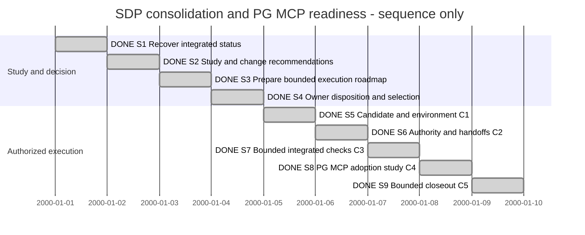

# Session 0013 — SDP consolidation and ProjectGovernance MCP readiness

## Session roadmap

Latest turn T002, begun 23 October 2026 and finalized 24 October Europe/Oslo. Owner authorizes execution with C4 replaced
by a ProjectGovernance MCP adoption study. Bounded round delivered; full PG readiness remains open and MVP1 deferred. Sequence only; synthetic dates
are display slots, not estimates or promised durations.

| State | Step | Work / linked milestone | Prerequisite and authority | Completion evidence / outcome |
| --- | --- | --- | --- | --- |
| completed | S1 | Recover integrated source, records and owner correction; WR1-M1 | Owner study request; laptop handover confirmed | Snapshot, management/import checks; source and engine pins. |
| completed | S2 | Study status, boundaries and suspected duplication; WR1-M2 | S1; analysis authorized | Study findings F01–F08; no semantic duplicate implementation established. |
| completed | S3 | Propose consolidation and readiness sequence; WR1-M2 | S2; planning authorized | C1–C5 and alternatives in Study; execution is proposed. |
| completed | S4 | Record owner disposition; WR1-M3 | Owner T002 authorizes execution | WR2 selected; C4 becomes MCP adoption study; MVP1 pilot deferred. |
| completed | S5 | Reproduce candidate and selected engine; C1 / WR2-M1 | Owner T002; WR2 preflight | Go 1.27.1 private build; four race suites/three vet checks pass. Current controller 0.164.0 refusal retained. |
| completed | S6 | Consolidate authority, identity/state mapping and handoffs; C2 / WR2-M2 | Owner T002; scoped documentation preflight | State responsibility map and current MCP/action/orchestration docs reconciled; no demonstrated semantic duplicate requires refactor. |
| completed | S7 | Execute bounded integrated verification; C3 / WR2-M3 | Owner T002; exact candidate | Real model/Blueprint/provider CLI and MCP transport/host read checks pass. Full native execution and independent review remain unverified, transferred to existing PG gates. |
| completed | S8 | Study starting ProjectGovernance use through MCP; revised C4 / WR2-M4 | Owner T002; S7 evidence | Adoption study/configuration delivered; actual Codex inspection works; execution/leader gaps explicit. Existing Ponsse pilot model preserved. |
| completed | S9 | Close consolidation/MCP readiness round; C5 / WR2-M5 | S8 evidence; authorized bounded scope | Results and limits recorded; full PG execution/leader/evidence gates retained under KB038/052 and PLAN-SDP-0018. MVP1 remains deferred. |

| Field | Value |
| --- | --- |
| Session reference | SESSION-SDP-0013 |
| Status | completed — revised bounded consolidation and MCP study |
| Primary card | [KB-SDP-056](../KanBan/completed/%23056--Change--SDP-consolidation-and-PG-MCP-readiness.md); predecessor KB055 completed |
| Snapshot date | 2026-10-24 |
| Current step | none; S1–S9 disposed at their documented boundaries |
| Proposed next step | Existing PG workstream: select current-host compatibility, then leader/report and evidence gates; no new implementation increment auto-selected |
| Execution authority | T002 authorizes executing the Session plan with C4 replaced by PG MCP adoption study; no MVP1 pilot |
| BranchPolicy | current; sdp/workstation-completion-assessment |
| CommitPolicy | milestone |

## Goal and scope

Establish a reliable status and a bounded path from the consolidated SDP project
to normal MVP1 work in Ponsse. The initial study/planning delivery is complete. Owner T002 authorizes the
consolidation/verification round and MCP adoption study in WR2, including
investigation of unclear or potentially duplicated implementation.
Owner T002 selects S5–S9 for WR2 execution, replacing S8 with the MCP adoption study.
Do not require all SDP backlog work to finish unless the owner selects that target.

The owner confirms complete laptop handover. No laptop recovery step is included.
Use integrated local sources; historical worktrees and old agent Sessions preserve
provenance but do not establish live ownership. This Session coordinates readiness;
existing PG/Blueprint/XFMD Sessions continue to own their scopes and pause decisions.

## Result entrypoints

- [Status study and recommendations](../Maintenance/WorkstationReadiness/Study.md).
- [WR1 MaintenancePlan](../Maintenance/WorkstationReadiness/Plan.md), completed; [WR2 execution](../Maintenance/WorkstationReadiness/ExecutionPlan.md).
- [Execution evidence](../Maintenance/WorkstationReadiness/Execution-Evidence.md) and [MCP adoption study](../Maintenance/WorkstationReadiness/MCP-Adoption-Study.md).
- [Candidate snapshot and check results](../Maintenance/WorkstationReadiness/evidence/snapshot-2026-10-23.json).
- [Predecessor coordination Session0012](session-%230012--Interim_project_coordination.md).

## Affected cards and plans

| Record | Role | Initial state | Current projection | Final disposition |
| --- | --- | --- | --- | --- |
| KB055 | Predecessor study/planning review | Absent | completed; owner selects revised route in T002 | Delivered study transferred to KB056/WR2; no product acceptance. |
| MAINT-SDP-0017 | Predecessor study/planning assignment | Absent | completed; WR1-M3 disposition recorded | WR2 owns authorized continuation. |
| KB056 / MAINT-SDP-0018 | Consolidation and MCP study | Absent | completed; M1–M5 delivered | Bounded round complete; retained PG conditions handed to KB038/052 and PLAN-SDP-0018. |
| KB038 / KB052 / PLAN-SDP-0018 | PG context; retained implementation owner | active / in-progress | Unchanged; broader workflow and verification open | No takeover, cancellation or acceptance inferred. |
| KB050 / Session0008 | Blueprint pilot context | gate-review / owner-paused | Unchanged | Pilot feedback still required when resumed. |
| KB032 / XFMD Session0007 | Producer/consumer handoff context | active / on-going | Latest October 21 delivery inspected | Acceptance/resource/release residuals retained with owners. |

## Plan register

| Ref | Plan | Document readiness | Lifecycle | Outcome |
| --- | --- | --- | --- | --- |
| P1 | [MAINT-SDP-0017 — WR1](../Maintenance/WorkstationReadiness/Plan.md) | completed | completed | Study/roadmap delivered and selected with T002 revision. |
| P2 | [MAINT-SDP-0018 — WR2](../Maintenance/WorkstationReadiness/ExecutionPlan.md) | completed | completed | Candidate/consolidation checks and revised MCP adoption study delivered; limits and successor PG work explicit. |

The Session is the cross-work roadmap, not a second detailed implementation plan.

## Route changes and decisions

| Date / turn | Previous route | Change and reason | Authority | Affected steps |
| --- | --- | --- | --- | --- |
| 2026-10-23 / T001 | Session0012 recommended checking laptop residuals | Owner confirms complete handover; remove that dependency | Current owner correction | S1 and all execution prerequisites. |
| 2026-10-23 / T001 | Broad interim coordination | New goal-specific status study and readiness roadmap | Explicit owner request | S1–S4 authorized; S5–S9 proposed. |

## Turn journal

### T001 — 2026-10-23 status study and Session plan

- Capture: manual owner-input and work summary. Exact host/thread/turn identifiers and prompt timestamp unknown; no eventual final response claimed captured.
- Owner input summary: all remaining work was handed over from the laptop; requests a new Session and Session plan to clarify/consolidate unclear or possibly duplicated implementation, a status study, change proposals and execution plan.
- Skills loaded/reused, agent-reported: sdp, sdp-steering, sdp-planning and sdp-change-analysis; document/source-map workflow, typed-plan contract, Session/card templates, management/KanBan rules and concurrent-work preflight. No routine-run identity or automatic enforcement claimed.
- Inspection baseline: SDP main bfe3b40, current 37836ac, one registered SDP worktree; clean before documentation edits. XFMD 953d09e clean, inspected read-only. No Ponsse checkout in observed git directory. Owner correction removes laptop uncertainty; no claim of background agent observation.
- Findings: management/import integrity passes; 6 management and 85 Toolkit Python tests pass; Toolkit validator passes. Selected gh sdp is 2.2.0 and rejects actions. Go unavailable in current PATH, so no fresh Go/race/native/Ponsse verification. XFMD Session0007 contains later viewpoint/deferred discovery/0.9 installation evidence than Session0005 used in the preceding answer.
- Duplication analysis: no exact non-test Go duplicate groups in the bounded scan. Distinct model, Blueprint and PG state owners are visible; design_check.go consumes canonical provider facts. Semantic equivalence and whole-workflow consistency remain unproven; no rewrite is justified by this scan.
- Scoped preflight: green for new documentation/management registration only; ID availability checked in known worktree files and canonical ledger. No competing product edits observed. Product execution needs a fresh scoped preflight when selected.
- Work summary: delivered Study, bounded MaintenancePlan, evidence snapshot, KB055 and this Session roadmap; owner recommendation is one accountable completion agent and a manual-capable Ponsse pilot, with independent review when selected. This is a recommendation, not an owner decision to pause/cancel PG or resume Blueprint/XFMD.
- Steps S1–S3 complete; S4 next because the requested study/plan is concrete and reviewable. C1–C5 remain proposed. No agents spawned, product edits, package installation, external messages, merge or release performed.
- Artifact verification: 17 local links resolve; snapshot JSON parses; pre-turn ledger bytes remain an exact prefix. Updated management replay passes with 69 cards, 46 records, four lineage operations and 628 events; exact history-import verification and whitespace check pass. See [document checks](../Maintenance/WorkstationReadiness/evidence/document-checks.json).
- Next: record owner feedback and select the exact readiness scope and execution ownership. Do not ask for laptop recovery again.

## Closeout

Initial study/planning and the T002-authorized bounded execution round are complete.
The revised scope ends in the MCP adoption study; MVP1 remains deferred. PG feature
completion, full Ponsse readiness and independent review are not claimed. Existing
PG/Blueprint/XFMD records retain their unfinished or paused scopes.

### T002 — 2026-10-23 execute consolidation and study PG MCP adoption

- Owner input, manual summary: asks how far PG has progressed and whether it can be used; authorizes executing the Session plan with the MVP1 pilot replaced by a study of beginning PG use through MCP. A pilot model already exists in Ponsse; MVP1 waits for the broader SDP system.
- Disposition: WR1 complete; KB055 completed with KB056/MAINT-SDP-0018 as successor. S4 complete; S5 started. S8 replaces Ponsse trial, and no new Ponsse model or application changes are selected.
- Skills loaded/reused, agent-reported: sdp, planning, Master/Worker, Architect and Verifier, plus OpenAI Docs for current MCP host configuration. No independent review or automatic routine-run identity claimed. No sub-agent authorized/spawned.
- Preflight: f8110e9 clean, one SDP worktree; main is ancestor; owner confirms full handover. Green for bounded WR2 records/docs and isolated build/verification artifacts. Product changes require a fresh exact write-set check. No live competing edits observed.
- Work in progress: compatible toolchain discovery/provisioning, current binary build and meaningful candidate checks. Current Codex CLI is 0.164.0, later than the previously verified PG host version. Further outcomes and next step will be recorded before return.

### T002 work summary — WR2-M1–M4 outcomes

- Isolated Go 1.27.1 official archive/hash verified; current sdptool/controller/MCP built from 4174c68. No stable engine, global MCP config or default PATH replaced. Four module race suites (50 tested-package results) and three module vet checks pass.
- Current Codex 0.164.0 is refused by the pinned 0.161.0 controller. A separate actual read-only app-server probe successfully discovers MCP and performs context/status/refusal calls without turn/start, account reads or state creation. This is not a migrated controller or native execution evidence.
- Existing provider-backed fixture with the checked 0.6 reduced specimen passes current review/digest and TARGET-drift checks. Two preliminary unsupported/partial inputs were refused and retained; no model source was repaired to bypass validation. No Ponsse pilot model or domain work changed.
- Seven real stdio worker tools exercised under an explicitly scripted host binding; report retry is idempotent, final state verifying, complete/controller-start refuse, all fixture preimages preserved. This is fixture evidence, not implementation, native host execution or acceptance.
- Current state responsibility map, MCP/action usage and orchestration facts corrected. Go/runtime source unchanged; no semantic duplicate diagnosis or broad refactor. MCP adoption study and concrete config validated via nonpersistent CLI overrides are delivered.
- WR2-M1–M4 complete at their declared boundaries. S7 full native/independent-review conditions remain unverified and stay with PG's existing plan/cards; they are not silently passed. S9 reconciles this bounded round and handoff. Evidence: Execution-Evidence.md and evidence/WR2.

### T002 final work summary — bounded closeout

- WR2-M5 completed at 2026-10-23T22:00:17.273279+00:00; this is an observed work summary, not a captured future final response. WR2/KB056 and this revised Session round close; S7's full native and independent-review conditions remain explicitly unverified and transferred to existing PG gates. No full PG/SDP acceptance is inferred.
- Go/race/vet results remain applicable to unchanged runtime source. Final Toolkit validator, 85 Toolkit tests, six management tests and exact history import verification pass. Local document links and retained artifact hashes resolve; original ledger prefix preserved. Final management replay/placement checks run after closure.
- Additional context boundary: the successful condition-free read selected active WR2 Maintenance work. An actual query of PG's ImplementationPlan reports the legacy Maintenance-only coverage conditions. Do not wrap/rename that plan to hide the gap; broader leader inspection belongs to its existing service integration work. Old WR2 context becomes historical at closure.
- Current MCP study/config, state map and execution evidence are the durable results. No global MCP config, stable signed engine, Ponsse pilot model or domain source was changed; no agents spawned, native model tasks, independent approval, merge or release performed.
- Next recommended work: an explicit current-Codex compatibility increment under PLAN-SDP-0018, then trusted leader/report consumption and evidence/publication gates. Inspection-only adoption is separately demonstrated and can be selected without claiming complete PG readiness. No further scope or phase auto-started.

- Calendar continuity note: the environment date advanced to 24 October Europe/Oslo during T002 closeout. Earlier checks retain their actual recorded UTC timestamps and original dates; no new owner scope instruction was supplied by that environment update.

- Final record verification: [WR2 final checks](../Maintenance/WorkstationReadiness/evidence/WR2-final-checks.json); management replay 70 cards / 47 records / four lineage operations / 637 events passes after closure, with Toolkit validation, local links, JSON, retained hashes and preserved ledger prefix.
