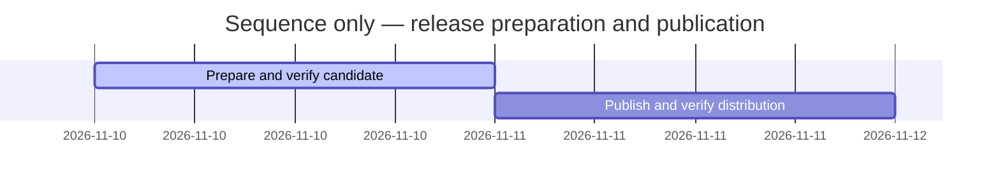

# Session0014 — SDP2.2.1 equivalent to the local producer

| Step | State | Outcome |
| --- | --- | --- |
| R221-M1 | active | Freeze equivalent source, validate metadata/package, independent review |
| R221-M2 | planned | Signed publication and verified explicit gh-sdp selection |

Goal: publish the owner-selected2.2.1 corresponding to local34ee535, with truthful
remaining PG limitations. Direct authorized Maintenance assignment:
[MAINT-SDP-0019](../Maintenance/R221/Plan.md), no duplicate feature card.

T001, 2026-11-10, manual work summary; host turn ID unknown. Release, Versioning,
Planning and SDP entry skills loaded. Existing clean checkout reused; no new
worktree. Runtime implementation remains unchanged. Latest public version2.2.0
confirmed and original signed descriptor downloaded; predecessor digest added.
Publisher private key not located locally; owner asked for location only, not
secret contents. Preparation continues. Public identities remain unset until
observed. No ProjectGovernance completion or project-directory upgrade inferred.
