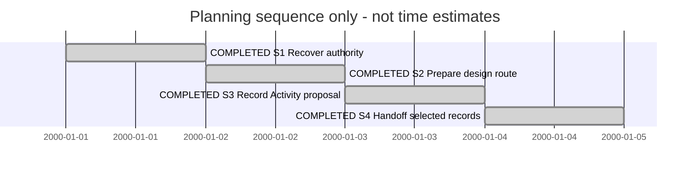

# Session 0015 — SDL browsing planning and Activity proposal

| State | Step | Outcome / authority |
| --- | --- | --- |
| completed | S1 Recover authority | Existing plans, Sessions, Blueprint and PG boundaries inspected |
| completed | S2 Prepare design route | PLAN-SDP-0025 prepared from owner-selected NavigationDesign; execution planned |
| completed | S3 Record Activity proposal | KB061 and conceptual study distinguish need, Activity, Session, plan and Blueprint |
| completed | S4 Handoff records | KB060/061 remain backlog; design execution and Activity disposition are explicit successors |

| Field | Value |
| --- | --- |
| Session reference | SESSION-SDP-0015 |
| Status | completed — planning/discussion deliverable only |
| Primary card | KB-SDP-060 |
| Snapshot date | 2026-11-11 |
| Current step | none |
| Proposed next step | PLAN-SDP-0025 D1–D3 in a successor Session when selected; KB061 remains separate proposal |
| Execution authority | Owner requests planning and feedback; no product implementation or process migration |

## Goal and continuity

Receive the HEOS browsing study and prepare a concrete producer-side design route,
while capturing the owner's Activity concept. Predecessor:
[HEOS Session0012](../../../HEOS/SDP/Sessions/session-0012--SDLBrowsing.md).
No duplicate implementation plan or new Activity lifecycle is created.

## Plans and cards

[PLAN-SDP-0025](../04--Design/SDPTool/SDLBrowsing/Plan.md): document ready for
design selection; canonical lifecycle planned. Detailed implementation plan not
yet created; route R3 owns its preparation. Future Sessions are unallocated route
slots until selected, following the owner's successive-Session preference.

| Card | Role | Initial / current state | Disposition |
| --- | --- | --- | --- |
| [KB060](../KanBan/backlog/%23060--Change--Producer-owned-SDL-browsing.md) | Primary browsing change | backlog / backlog | Implementation/design execution not started; plan prepared |
| [KB061](../KanBan/onHold/%23061--Proposal--Need-driven-activities.md) | Separate governance proposal | backlog / backlog | Analysis captured for design decision; no adoption |
| KB032, KB-XFMD-028 | Predecessor/consumer context | Existing states unchanged | Reconcile old obligations at design/preflight; not closed here |

## T1 — 2026-11-11 planning and workflow discussion

Manual summary; host IDs and exact turn timing unknown. Owner asks to begin
implementation planning, considers RefactorPlan and KB registration, and proposes
an Activity above successive study/design/planning/execution Sessions. Needs are
distinguished from requirements; Blueprint should inform a Worker's bounded plan.

Loaded canonical SDP entry, Planning and its adopted plan contract/template,
document workflow, Architect/Change Analysis context and relevant local governance
records. Classification: behavior-changing browsing improvement with internal
refactoring. Select supported DesignPlan now; do not invent a RefactorPlan enum.

Planning preflight: SDP had one clean registered worktree at a96affd on
sdp/release-2.2.1; created sdp/sdl-browsing-planning to preserve the release branch.
Read existing navigation/Blueprint/PG work and identities. Highest actual records
before allocation: PLAN0024, KB059, Session0014. An unrelated prose KB428 token is
not a canonical card identity. XFMD has unrelated RPM/process changes; HEOS has
the current uncommitted study. No writes to XFMD or existing product/model files.
Documentation scope is clear; full product preflight remains required before execution.

Work summary, not a captured final response: created DesignPlan, successor cards
and Activity study; retained HEOS NavigationDesign as canonical analysis. Suggested
route study → requirements/WORK design → Blueprint and detailed plan → successive
delivery Sessions → verification/disposition. Milestones stay in typed plans.
Activity is a proposal with lifecycle/stage separation and scoped one-active
selection, not an adopted schema or runtime claim. No generated viewpoints,
product tests, commit, push, model/software release or acceptance claimed.

## Closeout

The requested initial planning/feedback deliverable is complete. KB060/PLAN0025
retain the browsing design/execution successor; KB061 retains Activity refinement.
Source navigation/doc links and new canonical record identities are checked before
return. This Session's completion does not complete either card or the DesignPlan.
