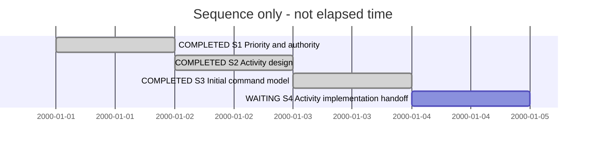

# Session 0016 — Activity system design

| State | Step | Outcome / authority |
| --- | --- | --- |
| completed | S1 Priority and authority | Owner selects Activity integration before SDL browsing |
| completed | S2 Activity design | Complete candidate covers folders, states/events, tab, timeline, ownership and adoption |
| completed | S3 Initial command model | Activity/Session creation command design and five-file SDL WORK validate; preliminary model checkpoint retained |
| waiting | S4 Implementation handoff | Complete executable payload/guard contract and scoped Blueprint/ImplementationPlan handoff |

| Field | Value |
| --- | --- |
| Session reference | SESSION-SDP-0016 |
| Status | on hold by owner sequencing decision |
| Primary card | KB-SDP-061 |
| Snapshot date | 2026-11-12 |
| Current step | S4 |
| Execution authority | Owner authorizes complete Activity design and priority change; current turn does not implement runtime capabilities |

## Goal and source

Design Activity as the need-level scope for successive Sessions, with producer-owned
navigation and ledger-derived project lifecycle. [Design](../04--Design/SDPTool/ProjectGovernance/Activities/Design.md).
Predecessor Session0015 completed initial planning. KB061 moves backlog → active /
in-progress for selected design work. KB060 becomes queued behind Activity integration;
PLAN-SDP-0025 stays planned. No new Activity schema record is created before support.

## T1 — 2026-11-11 selected Activity design

Manual summary, host IDs/timing unknown. Owner prioritizes Activity integration,
requests Activities replacing Sessions in XFMD, state groups, six phase folders
per Activity, linked Sessions/documents, and a timestamped lifecycle ledger/Gantt.

Reused SDP Architect/Change Analysis and Planning authority. Inspected canonical
projecthistory persistence, management payload 0.2, Session discovery/actions,
producer tab construction, generic XFMD tabs and current PG Session binding. The
current schema does not implement Activity, and folder creation is insufficient.

Work summary: authored complete design candidate and updated priority/card links.
Recommend an ActivityLedger domain in the existing management ledger; no second
writable history. Preserve system-owned requirements/models, link old records,
use the six Activity phases and Session phase references. Distinguish observed
state time from effort and forecasts. Canceled and unassigned legacy records remain
visible. One active Activity is enforced at the canonical project authority, not
claimed across disconnected clones. Renderer/schema validation remains future work.

No product/model code changes, generated viewpoints, automatic migration, runtime
Activity events, commit or push. Current branch sdp/sdl-browsing-planning retains
the predecessor's uncommitted planning; other repositories are untouched this turn.
Next: refine selected design into model/protocol and implementation plan; browsing
stays queued until the adopted Activity workflow is qualified.

## T2 — 2026-11-12 owner corrections and event markers

Manual work summary; host IDs and precise turn timing unknown. Owner confirms
system-owned current requirements/SDL, the shared management ledger and calendar
state duration. Corrects README to standard directory guidance with no Activity
content; need/outcome belong in 01-Mandate/Mandate.md. Selects root-level Sessions/.
Clarifies that unrelated discussion/capture/planning remains allowed while
implementation must belong to the active Activity. Requests differently colored
commit/ledger ticks on the timeline as observed events, not effort estimates.

Reused SDP Architect/Change Analysis context. Updated Design's layout, navigation,
content ownership and admission table. Added timestamp provenance, explicit
Activity attribution, correlated commit/event markers, accessible shapes, dense
event aggregation and missing-history handling. Product and schema code untouched.
No Activity runtime events, model edits, generated views, commit or push.

S2 design is refined; S3 remains next model/protocol and implementation handoff.
KB061 remains in-progress, KB060 queued. Owner-confirmed decisions are recorded;
renderer/schema/runtime verification is still prospective.

## T3 — 2026-11-12 SDPTool source map and Activity command SDL

Owner selects beginning SDL design for Activity and Session creation via SDPTool
and asks how SDPTool's source directory fits together. Manual summary; host IDs
and exact turn timing unknown. Used SDP Architect and source-authoring guidance;
Worker instructions were inspected but no product-code assignment was executed.

Scoped preflight is recorded in [Commands](../04--Design/SDPTool/ProjectGovernance/Activities/Commands.md).
One SDP worktree at a96affd, dirty only for this conversation's planning; no existing
Go/SDL modifications. SessionLifecycle WORK :00003 was clean and is preserved.
Added a separate ActivityWorkflow concern under the same System/container boundary,
created through ModelGovernance rather than copying/editing artifact metadata.

Work summary: code map and proposed activity CLI/JSON action family, including
activity session create, share one domain service. Document creation is separate
from current governance.session execution/adoption. Five authored SDL files model
goals, responsibilities, record shapes, channels and six scenarios, including
stale creation and out-of-scope refusal. Source formatting followed a first check
that reported only noncanonical form; final canonical validation passes without
warnings. [Evidence](../04--Design/SDPTool/ProjectGovernance/Activities/Evidence-T3.md)
records tool/source identities and limits. WORK checkpoint is preliminary; no
independent review, model release, generated viewpoints or Activity Go code.

S3's initial model delivery is complete. S4 retains detailed payload/guard design,
model/Blueprint handoff and the implementation plan. KB061 remains in-progress;
browsing remains queued. No Git commit or push; the model checkpoint is distinct
from repository publication.

## T4 — 2026-11-12 Go architecture assessment

Owner asks about SDPTool architecture improvements and CLI/action coverage. Used
SDP and Architect skills; inspected routing, registry/invocation, Session bridge,
Blueprint handlers and persistence. Manual work summary; host IDs/timing unknown.
[Assessment](../04--Design/SDPTool/ProjectGovernance/Activities/ArchitectureReview.md)
records recommendations and evidence. Clarification to T3: Session actions reuse
the service indirectly through CLI parsing and JSON output decoding. Recommend
direct typed calls, operation-local policy, deliberate catalogue coverage,
inspectable contracts and explicit Activity record recovery. Preserve domain
authorization and restricted MCP exposure. Broader migration remains proposed.

S4 remains next; KB061 remains in-progress and browsing queued. No product/model
changes, tests, lifecycle transition, Git commit or publication this turn.

## T5 — 2026-11-12 complete migration proposal

Owner rejects unscheduled gradual cleanup: temporary bridges become accidental
architecture and review understanding is lost during implementation. Requests a
complete refactor/upgrade route using KB, Sessions, SDL and Blueprint. Loaded
Planning and Vertical Refactor alongside Architect; checked current Blueprint
producer/assessment capabilities and adopted plan contract. Manual work summary;
host IDs and exact turn timing unknown.

Prepared [PLAN-SDP-0026](../05--Implementation/SDPTool/ArchitectureMigration/Plan.md)
and KB062 as a planned/backlog proposal, not an activated implementation. It covers
finite operation inventory, code-matched NOW and whole-system TARGET, executable
architecture rules, a real Blueprint trial, complete operation-family migration,
Activity integration and final zero-leftover acceptance. Intermediate work is
permitted only with removal inside the same plan; original completion cannot be
claimed after silently moving obligations to backlog. Current Blueprint cannot
automatically prove Go conformance; actual checks and independent review remain
necessary. The earlier unscheduled-follow-up recommendation is superseded in this
proposal. No model/code changes or generated outputs.

S4 remains next, now with this proposed whole-system handoff route to resolve.
Existing KB061/KB060 priority states remain unchanged. No execution, Git commit,
push or release occurred; only proposal registration is added to management history.

## T6 — 2026-11-12 first manual Activity and owner scope split

Owner selects three successive Activities: SDPTool restructuring first, Activity
support second and manually created, then browsing as the first tool-created
Activity. Authorizes manual creation and ledger registration now. This supersedes
T5's combined restructuring/Activity implementation scope. No new SDPTool product
functionality is permitted in ACTIVITY-SDP-0001.

Created [Activity0001](../Activities/Activity-0001--SDPTool-Restructuring/01-Mandate/Mandate.md)
with standard README, mandate, phase references and root
[Session0017](../Activities/Activity-0001--SDPTool-Restructuring/Sessions/session-%230017--SDPTool_restructuring.md).
Session0017 owns current coordination; this Session remains historical and on hold
for future Activity feature work. No retrospective Activity ownership is assigned
to earlier turns. KB062 moves to active/ready; KB061 to onHold; KB060 remains queued.
PLAN0026 remains planned with Activity feature M4 explicitly transferred out.

Used Planning and Traceability, retaining Architect context. Defined manual
Activity record schemas, appended actual creation/activation and management scope
updates, and preserved old ledger bytes. Existing management validator limitations
are documented in the bootstrap evidence; no tool support is claimed. Current
records are ready for M0 baseline work, which has not been executed. No product
code, SDL edits, generated viewpoints, Git commit or publication this turn.
